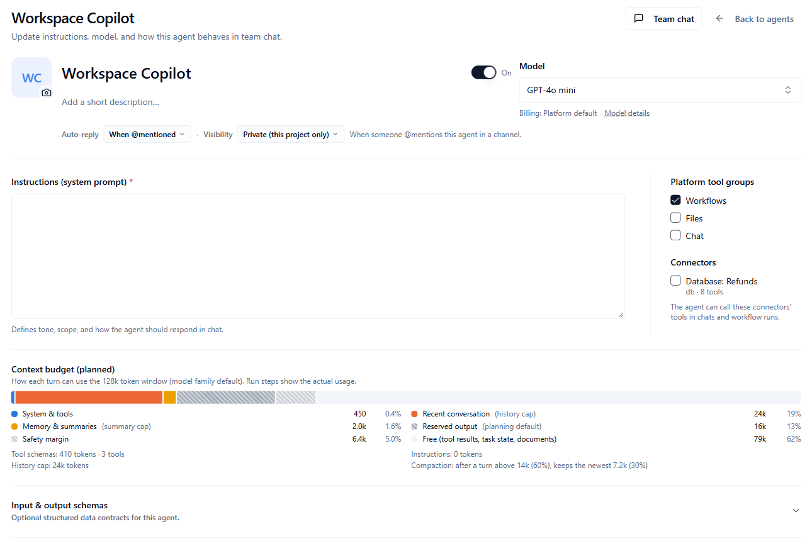
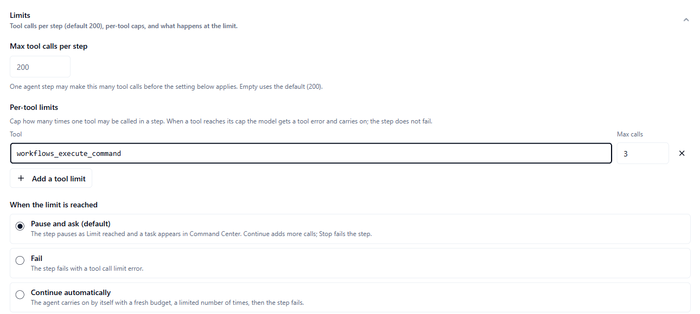
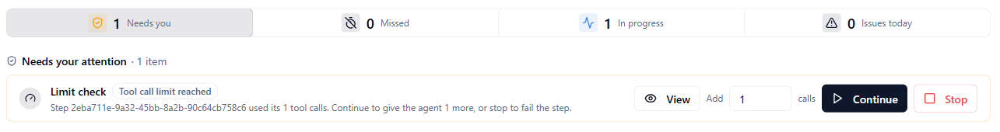

An **agent** is a reusable AI worker. You give it instructions, a model and tools. People talk to it in team chat with an @mention or a direct message. Workflows can also run it in an `agent` step. You manage agents on the **Agents** page in the Console.

Agents are not the same as **Autopilot**. Autopilot is the assistant that helps you operate the Console. See [Autopilot and chat](/ai/autopilot-and-chat).

**Who this is for:** people who build and look after agents. To create or edit an agent you need the `project_contributor` role or higher. To delete one you need `project_admin`. Without permission, the buttons are greyed out.

**What you will do on this page:** create an agent, choose when it replies and who can see it, add optional input and output schemas, and debug one of its runs.

## Create an agent

<Steps>
  <Step title="Open the form">
    In the [Console](https://console.agentruntime.io) sidebar, click **Agents**, then **Create agent**. The dialog says "Set up a chat agent for team chat DMs and @mentions."
  </Step>
  <Step title="Name it">
    Enter a **Display name**, such as `Support Bot`. It is required. Add a short description if you like.
  </Step>
  <Step title="Write the instructions">
    Fill in **Instructions (system prompt)**. It is required. It defines the agent's tone, its scope, and how it should respond in chat. A new agent starts with "You are a helpful assistant for this workspace."
  </Step>
  <Step title="Set the options">
    Pick a **Model** and an **API key**. Choose **Auto-reply** and **Visibility**. See below. Optionally tick **Platform tool groups** and **Connectors**.
  </Step>
  <Step title="Create it">
    Click **Create agent**. You should see "Agent created" and the agent in the list.
  </Step>
</Steps>

| Field | What it does |
|-------|--------------|
| **Display name** | The agent's name. Required. |
| **On** or **Off** switch | Turns the agent on or off. A turned-off agent shows a **Disabled** badge in the list. |
| **Model** and **API key** | The model the agent uses and which key pays for it. See [LLM providers](/ai/llm-providers). |
| **Auto-reply** | When the agent replies in channels. See [Auto-reply](#auto-reply). |
| **Visibility** | Whether the agent is private to this project or public. See [Visibility](#visibility). |
| **Instructions (system prompt)** | What the agent is and how it behaves. Required. |
| **Platform tool groups** | Built-in tool groups the agent can use: **Workflows**, **Files** and **Chat**. |
| **Connectors** | The connectors whose tools the agent can call in chats and workflow runs. For a connector that uses an account, choose **Shared account** or **Each person's own**. |
| **Input & output schemas** | Optional. See [Input and output schemas](#input-and-output-schemas). |

The form also shows **Context budget (planned)**, which estimates how much of the model's context window the agent uses.

To change an agent later, select it in the list and click **Edit**. Click **Save changes**. You should see "Agent updated". Changes apply to new messages in team chat. To delete an agent, open the **⋮** menu in the agent's header and click **Delete agent**.

<Frame caption="An agent's settings">
  
</Frame>

### Auto-reply

**Auto-reply** sets the agent's default for when it replies in a channel. The control is labelled **Auto-reply in channels**. The choices are:

| Choice | The agent replies |
|--------|-------------------|
| **When @mentioned** | When a message @mentions it. This is the default for a new agent. |
| **Always** | To every message in the room |
| **Never** | Not on its own |

### Visibility

**Visibility** has two choices:

| Choice | Meaning |
|--------|---------|
| **Private (this project only)** | The agent is for this project. This is the default. |
| **Public (show on Marketplace)** | The agent is marked public. |

Choosing **Public** does not list the agent by itself. To list it in the Marketplace, open the agent and click **Publish to catalog**.

### Input and output schemas

Open **Input & output schemas** at the bottom of the form. It says "Optional structured data contracts for this agent." It opens by itself for an agent that already has a schema. It holds two editors, **Input schema (optional)** and **Output schema (optional)**.

For each field, click **Add field** and fill in:

| Setting | What to enter |
|---------|---------------|
| **Name** | The field name |
| **Type** | **String**, **Integer**, **Boolean**, **Number**, **Array** or **Object** |
| **Optional** | Whether the field can be left out |
| **Description** | What the field holds |

The **Input schema** describes structured input for the agent. The **Output schema** describes the fields the agent must reply with. In a workflow, an `agent` step whose agent has an output schema puts each field on the step result, so later steps can use it. See [Step types](/workflows/step-types#agent-run-an-agent).

## Limits

Limits stop an agent that is stuck in a loop from running for ever. They are a safety net, not a budget to tune tightly: the defaults let an agent do a lot of work in one step. Open the agent and find the **Limits** section.

| Setting | What it does |
|---|---|
| **Max tool calls per step** | How many tool calls one agent step may make. Leave it empty for the default, 200. Every call counts, even when the agent makes several at once. |
| **Per-tool limits** | Cap one tool, for example a paid search tool at 3 calls. Click **Add a tool limit**, pick or type the tool, and enter **Max calls**. When a tool reaches its cap, the agent is told so and carries on with its other tools; the step does not fail. Calls past the cap still count toward **Max tool calls per step**. |
| **When the limit is reached** | **Pause and ask (default)**, **Fail**, or **Continue automatically** (up to a number of times you set in **Continue up to**, 3 by default). |

<Frame caption="The Limits section of an agent's settings">
  
</Frame>

The counts apply to one agent step. A new step, or the same step in the next run, starts again at zero.

### When an agent reaches its limit

With **Pause and ask**, the step does not fail and keeps everything it has done so far. A **Tool call limit reached** task appears in [Command Center](/workflows/command-center):

<Frame caption="A Tool call limit reached task in Command Center">
  
</Frame>

- **Continue** gives the agent more calls (you can change how many) and it picks up exactly where it stopped. Nothing runs again.
- **Stop** fails the step. You can add a reason.

The run's events show **Tool call limit reached** and, after a Continue, **Continued** with the number of calls added.

An agent step inside a `for_each` or `while` loop cannot pause. It fails when it reaches the limit, whatever you chose.

## See an agent's sessions

Select an agent in the list. The panel on the right shows **Recent sessions**: up to 15 of the agent's recent chat sessions. Each row shows a status, the chat it belongs to, and when it started.

| Status | Meaning |
|--------|---------|
| **Reply in progress** | The agent is working on a reply. |
| **Turn complete** | The agent finished its turn. |
| **Waiting for reply** | The run is paused and waits. |
| **Failed** | The run failed. |
| **Stopped** | The run was stopped. |

Each row has the chat icon (**Open in team chat**) and a **Debug** button. **All sessions** opens the runs list in **Operate**, filtered to this agent. A new agent shows **No sessions yet**. Start a direct message with it in team chat.

## Debug an agent run

Click a row, or click **Debug**. The **Agent run debugger** opens in a side panel. Click **Open full debugger** at the bottom of the panel to open the same view as a page, titled **Agent run** and the agent's name. Its address is `/agents/<agent id>/runs/<run id>`. You can also open `/agent-runs/<run id>` directly. **Back** returns you to **Agents**, or to the runs list in **Operate** if the page has no agent.

The top of the debugger shows the agent's name, the run ID, the run's status, and when it started. If the run has a problem, such as a failure, a red box describes it. While the run is active, the top also shows the controls to pause, resume or stop it.

Two buttons sit at the top right:

- **Open in chat** opens the conversation in team chat in a new tab. It appears when the run belongs to a conversation.
- **Copy run id** copies the run's ID. You should see "Run ID copied". Give it to support if you need help.

Four tabs show the details:

| Tab | What it shows |
|-----|---------------|
| **Timeline** | The run's events, with a time and a short summary for each. Tasks waiting for a person appear above them under **Human review**. It shows up to 100 events and refreshes while the run is active. An empty run says "No run events yet." |
| **Tools** | One entry for each tool the agent called, with the tool's name, when it ran, and a short summary. If there are none, it says "No tool calls recorded for this turn." |
| **Context** | Session details such as `session_mode`, `conversation_id`, `agent_id`, `chat_turn_id`, `source` and `model_ref`. Only the ones the run has are shown. Otherwise it says "No session context on this run." |
| **Raw** | The events, the context and the run as JSON, for support or for your own tools |

Only runs that belong to an agent, to a conversation, or that a chat started have a **Debug** button.

## Common problems

| Problem | What to try |
|---------|-------------|
| **Create agent** is greyed out | You need the `project_contributor` role or higher. |
| The agent never answers in a channel | Check **Auto-reply**. If it is **Never**, the agent does not reply on its own. With **When @mentioned**, @mention the agent. Also check that the agent is **On**. |
| The agent is public but not in the Marketplace | Open the agent and click **Publish to catalog**. |
| A session has no **Debug** button | The run does not belong to an agent or a conversation. |
| The debugger page says it could not resolve the workflow | Open the run from **Agents** or **Operate**. Or add `workflow_id` to the address. |
| The **Timeline** says "No run events yet." | The run may have just started. The tab refreshes while the run is active. |

## Next steps

- [Autopilot and chat](/ai/autopilot-and-chat): the Console assistant, and **Open in IDE**
- [Step types](/workflows/step-types): run an agent from a workflow
- [Connections](/integrations/connections): who can use an account an agent calls
- [LLM providers](/ai/llm-providers): models and API keys
- [Conversation sessions](/workflows/conversation-sessions): a chat that runs one workflow run across many messages
