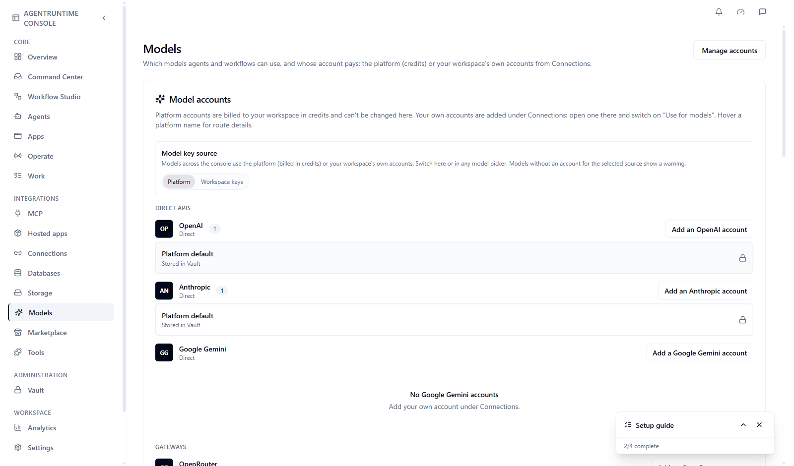
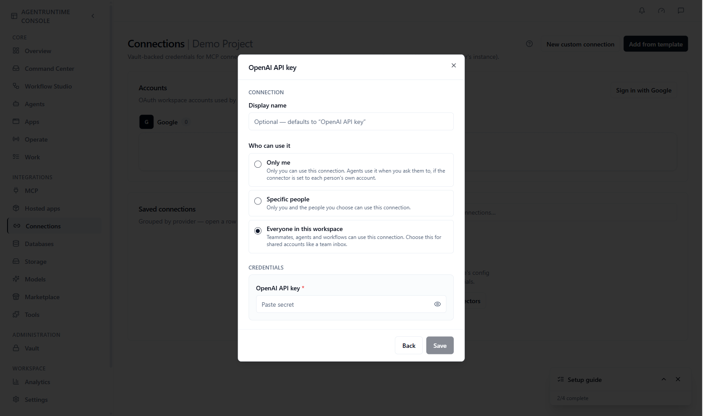

An **LLM** (large language model) is the AI model behind an **LLM** step, an **agent**, or **Autopilot**. The **Models** page shows which models your workspace can use and whose account pays for them.

This page is for workspace admins and builders who want to use their own OpenAI, Anthropic, Google, or gateway account, or who just want to know where to pick a model.

## Two kinds of accounts

| Kind | What it is | Where it lives |
|------|------------|----------------|
| **Platform accounts** | Accounts AgentRuntime provides. Usage is billed to your workspace in credits | Shown read-only on **Models**, marked with a lock |
| **Your accounts** | Your own provider account. Usage is billed by your provider | A connection on **Connections**, switched on for models |

Your own provider account is an ordinary [connection](/integrations/how-connecting-works): you add its API key once, and the same connection can serve models, tools and voice. There is no separate place for provider keys.

On **Models**, each provider has a row. A **Platform default** account (locked, **Stored in Vault**) is always there for OpenAI and Anthropic. Your accounts are listed under their provider and link to **Connections**. The **Model key source** switch (**Platform** or **Workspace keys**) sets which accounts the models across the Console use. You can also switch it in any model picker.

<Frame caption="The Models page">
  
</Frame>

If you add no accounts, workflows and agents use the platform accounts. If you add your own, runs that use it go to your provider account. **Settings → Usage & History** shows your usage.

<Warning>
  Provider API keys go on **Connections**, not in **Settings → API keys**. API keys are personal access tokens for calling the AgentRuntime API. Never paste a provider key into **API keys**, or an API key into a connection.
</Warning>

## Before you start

- A key from your AI provider (an API key from the provider's dashboard)
- A role that can manage model accounts: `tenant_admin` or `project_contributor`. If you do not see **Use for models** on a connection, ask a workspace admin

## Add your own account

<Steps>
  <Step title="Open Connections">
    In the [Console](https://console.agentruntime.io), choose **Connections** in the sidebar. On **Models**, the **Add an … account** link under a provider takes you there too.
  </Step>
  <Step title="Pick the provider's API key template">
    Click **Add from template**, find the provider, for example **OpenAI API key**, **Anthropic API key**, **Google Gemini API key**, **OpenRouter API key**, **Portkey API key** or **Amazon Bedrock key**, and click **Connect**. OpenRouter, Portkey and Bedrock are **gateways**: one account that gives access to many models.
  </Step>
  <Step title="Fill in the form">
    Enter a name such as `Production` or `OpenAI dev` and paste the API key. Leave **Who can use it** on **Everyone in this workspace**: only a connection the whole workspace can use can serve models.

    <Frame caption="Adding an OpenAI account, before you type anything">
      
    </Frame>
  </Step>
  <Step title="Switch it on for models">
    Save, open the new connection, and under **Used for** switch on **Use for models**. Switch on **Default for … models** too if agents and workflows that don't pick an account should use this one.
  </Step>
</Steps>

**What you should see:** the connection shows a **Models** chip on **Connections**, and the account appears under its provider on **Models**, with **Default** on the default one. You can add several accounts for one provider.

To change the key, edit the connection on **Connections**: every model, tool and voice agent that uses it picks up the new key. A connection that serves models can't be deleted or made personal until you switch **Use for models** off.

## Google Gemini and Amazon Bedrock keys

<Warning>
  Gemini and Bedrock support is new and has not yet been checked against live provider accounts. Test a model with the lightning icon (see [Choose which models to use](#choose-which-models-to-use)) before you rely on it.
</Warning>

Both work in **LLM** steps and in agent steps, including agents that call tools.

**Google Gemini.** Paste a Gemini API key from Google AI Studio. It starts with `AIza`.

- Gemini counts its thinking against the step's maximum tokens. If you set a small `max_tokens`, the answer can come back empty, so leave room.
- An agent's output schema is checked after Gemini replies; Gemini itself does not enforce it.

**Amazon Bedrock.** The key is one line: the AWS region where your models run, a colon, and then one of these:

| Credential | Format |
|---|---|
| A Bedrock API key | `us-east-1:ABSK…` |
| An IAM access key | `us-east-1:AKIA…:secret-access-key`. For temporary credentials, add a colon and the session token at the end. |

The **Amazon Bedrock key** template shows this format in its key field. An IAM user needs permission `bedrock:InvokeModel` on the models you use.

- Choose models by their Bedrock model ID or inference profile. The model picker lists common ones.
- Bedrock replies arrive whole, not word by word.
- Models without tool use, such as Titan or Llama 3, fail an agent step that offers tools.

## Choose which models to use

Under **Workspace models** on **Models** you see the models enabled for agents and workflows. Platform defaults are always on.

1. Click **Browse models**.
2. Choose a provider or gateway tab and add the models you want.
3. Click the lightning icon next to a model, choose an **API key** (the platform default or one of your accounts) and click **Run test**. **What you should see:** a short reply from the model, or an error that tells you what is wrong with the key.

## Pick a model in a workflow

1. Open a workflow in **Workflow Studio**.
2. Drag an **LLM** step onto the canvas and select it.
3. In the step settings, choose a **Model**, then an **API key**: the platform default or one of your accounts.
4. Write your prompt and save.

The saved step stores a `model_ref` (for example `direct.openai.gpt-4o`) and, if you chose one, the account. Use any model that appears in the picker. You can also use `model_ref` in the [JSON editor](/workflows/json-editor). See [Step types](/workflows/step-types#llm).

Agents use the same **Model** and **API key** pickers on the agent form.

## Common problems

| Problem | What to do |
|---------|------------|
| An LLM step fails with a key error | The key is missing, expired, or has no credit at your provider. Check the connection on **Connections** and test the model with the lightning icon on **Models** |
| My account doesn't appear on **Models** | Open the connection on **Connections** and switch on **Use for models**. If the switch isn't there, share the connection with everyone in the workspace first |
| A model is missing from the picker | Add it under **Workspace models → Browse models** |
| I can't switch on **Use for models** | Your role can't manage model accounts. Ask a workspace admin |
| Usage looks higher than expected | Open **Settings → Usage & History**, and see [Billing and credits](/platform/billing-and-credits) |

## Next steps

- [How connecting works](/integrations/how-connecting-works): connections and who can use them
- [Step types](/workflows/step-types#llm): every field of an LLM step
- [Dry run](/workflows/dry-run): check a workflow before running it
- [Autopilot and chat](/ai/autopilot-and-chat): the Console assistant
