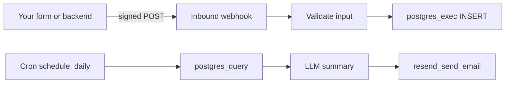

In this guide you build two small workflows. The first **saves every form submission** to a Postgres table. The second **emails your team a daily summary** of what came in, written by an LLM.

It is for people who collect leads or requests through a form and want them stored and summarized without manual work. It takes about 30 minutes.



**Outcome:** every submission is stored with a timestamp, and each morning your team gets an HTML email listing the last day's submissions.

## Prerequisites

- The `project_contributor` role in your project
- A [Postgres connection](/connectors/postgres) that can `INSERT` into and `SELECT` from a `form_submissions` table
- A [Resend connection](/connectors/resend) with a verified sending domain
- A model your workspace can use. See [LLM providers](/ai/llm-providers)

### Create the table

Run this once against your database:

```sql
CREATE TABLE IF NOT EXISTS form_submissions (
  id SERIAL PRIMARY KEY,
  email TEXT NOT NULL,
  name TEXT,
  message TEXT,
  source TEXT DEFAULT 'webhook',
  created_at TIMESTAMPTZ DEFAULT NOW()
);
```

## Connectors to install

| Adapter | Purpose |
|---------|---------|
| [postgres](/connectors/postgres) | Store and read submissions |
| [resend](/connectors/resend) | Send the digest email |

Install each one from **MCP → Add connectors** (click the connector, then **Add to workspace**), then connect it on **Instance config**.

## Part 1: save submissions

<Steps>
  <Step title="Create the workflow">
    In **Workflow Studio**, create a workflow named `form-submission-ingest`.
  </Step>
  <Step title="Add the validate step">
    Add a `lua` step that requires `email` and tidies the input.
  </Step>
  <Step title="Add the Postgres step">
    Add an `mcp` step with the `postgres_exec` tool on your `postgres` instance, to insert a row.
  </Step>
  <Step title="Add an inbound webhook">
    Open **Workflow setup → Inbound** and create a subscription for this workflow. Copy the **ingress URL** and the **signing secret** (shown once). See [Inbound webhooks](/integrations/inbound-webhooks).
  </Step>
  <Step title="Send a test">
    Send a signed test request (see below). **What you should see:** a successful run in **Command Center**, and a new row in `form_submissions`.
  </Step>
</Steps>

<Warning>
  Inbound webhooks only accept requests signed with your signing secret and sent with an `Idempotency-Key` header. Most form tools cannot sign requests this way. Post the form data from your own server code or a small serverless function, which signs it. [Inbound webhooks](/integrations/inbound-webhooks#verify-signatures) shows how.
</Warning>

### Validate step

```json
{
  "id": "validate",
  "type": "lua",
  "name": "Validate submission",
  "script": "if not input.email or input.email == '' then error('email required') end\nreturn {\n  email = input.email,\n  name = input.name or '',\n  message = input.message or '',\n  source = input.source or 'webhook'\n}",
  "timeout_s": 10
}
```

### Insert step

```json
{
  "id": "insert-row",
  "type": "mcp",
  "name": "Save submission",
  "instance_id": "REPLACE_POSTGRES_INSTANCE",
  "tool_name": "postgres_exec",
  "tool_args": {
    "sql": "INSERT INTO form_submissions (email, name, message, source) VALUES ($1, $2, $3, $4)",
    "args": [
      "{{steps.validate.result.email}}",
      "{{steps.validate.result.name}}",
      "{{steps.validate.result.message}}",
      "{{steps.validate.result.source}}"
    ]
  },
  "depends_on": ["validate"],
  "timeout_s": 30
}
```

### Example body

The JSON body of your request becomes the run's input, so `email` is read as `{{input.email}}`:

```json
{
  "email": "alex@example.com",
  "name": "Alex Kim",
  "message": "Interested in enterprise plan",
  "source": "landing-page"
}
```

## Part 2: the daily digest

Create a second workflow named `form-daily-digest`.

<Steps>
  <Step title="Query the last 24 hours">
    Add an `mcp` step with `postgres_query`.
  </Step>
  <Step title="Summarize with an LLM">
    Add an **LLM** step. Its prompt includes `{{steps.query-submissions.result.rows}}` and asks for a short HTML bullet list.
  </Step>
  <Step title="Send the email">
    Add an `mcp` step with `resend_send_email` on your `resend` instance. Use the LLM's text as the `html`.
  </Step>
  <Step title="Schedule it">
    Open **Workflow setup → Cron**, pick a preset such as **Daily 09:00**, choose a **Timezone**, choose an **Automation API key**, and click **Add schedule**. See [External triggers](/workflows/external-triggers#cron-schedules).
  </Step>
</Steps>

**What you should see:** the schedule under **Active schedules** with the time of the next run.

### Query step

```json
{
  "id": "query-submissions",
  "type": "mcp",
  "name": "Fetch today's submissions",
  "instance_id": "REPLACE_POSTGRES_INSTANCE",
  "tool_name": "postgres_query",
  "tool_args": {
    "sql": "SELECT email, name, message, source, created_at FROM form_submissions WHERE created_at >= NOW() - INTERVAL '1 day' ORDER BY created_at DESC"
  },
  "timeout_s": 30
}
```

`postgres_query` returns at most 200 rows (100 by default). Add `"limit"` to `tool_args` to change it.

### LLM step

```json
{
  "id": "summarize",
  "type": "llm",
  "name": "Write digest narrative",
  "model_ref": "REPLACE_MODEL_REF",
  "prompt": "You are an ops assistant. Given these form submissions as JSON, write a concise HTML email body with a bullet per submission (email, name, message). Submissions: {{steps.query-submissions.result.rows}}",
  "depends_on": ["query-submissions"],
  "timeout_s": 120
}
```

### Send step

```json
{
  "id": "send-digest",
  "type": "mcp",
  "name": "Email team digest",
  "instance_id": "REPLACE_RESEND_INSTANCE",
  "tool_name": "resend_send_email",
  "tool_args": {
    "to": ["team@example.com"],
    "subject": "Daily form submissions",
    "html": "{{steps.summarize.result.text}}"
  },
  "depends_on": ["summarize"],
  "timeout_s": 30
}
```

`to` is a list of addresses. Use a sender address on the domain you verified in Resend.

## Full workflow graphs

Paste each into the [JSON editor](/workflows/json-editor), then replace each `REPLACE_POSTGRES_INSTANCE` and `REPLACE_RESEND_INSTANCE` with the id of your `postgres` and `resend` instance, and `REPLACE_MODEL_REF` with a model from your [Providers](/ai/llm-providers) catalog.

### Ingest workflow

```json
{
  "steps": [
    {
      "id": "validate",
      "type": "lua",
      "name": "Validate submission",
      "script": "if not input.email or input.email == '' then error('email required') end\nreturn {\n  email = input.email,\n  name = input.name or '',\n  message = input.message or '',\n  source = input.source or 'webhook'\n}",
      "timeout_s": 10
    },
    {
      "id": "insert-row",
      "type": "mcp",
      "name": "Save submission",
      "instance_id": "REPLACE_POSTGRES_INSTANCE",
      "tool_name": "postgres_exec",
      "tool_args": {
        "sql": "INSERT INTO form_submissions (email, name, message, source) VALUES ($1, $2, $3, $4)",
        "args": [
          "{{steps.validate.result.email}}",
          "{{steps.validate.result.name}}",
          "{{steps.validate.result.message}}",
          "{{steps.validate.result.source}}"
        ]
      },
      "depends_on": ["validate"],
      "timeout_s": 30
    }
  ]
}
```

### Digest workflow

```json
{
  "steps": [
    {
      "id": "query-submissions",
      "type": "mcp",
      "name": "Fetch today's submissions",
      "instance_id": "REPLACE_POSTGRES_INSTANCE",
      "tool_name": "postgres_query",
      "tool_args": {
        "sql": "SELECT email, name, message, source, created_at FROM form_submissions WHERE created_at >= NOW() - INTERVAL '1 day' ORDER BY created_at DESC"
      },
      "timeout_s": 30
    },
    {
      "id": "summarize",
      "type": "llm",
      "name": "Write digest narrative",
      "model_ref": "REPLACE_MODEL_REF",
      "prompt": "You are an ops assistant. Given these form submissions as JSON, write a concise HTML email body with a bullet per submission (email, name, message). Submissions: {{steps.query-submissions.result.rows}}",
      "depends_on": ["query-submissions"],
      "timeout_s": 120
    },
    {
      "id": "send-digest",
      "type": "mcp",
      "name": "Email team digest",
      "instance_id": "REPLACE_RESEND_INSTANCE",
      "tool_name": "resend_send_email",
      "tool_args": {
        "to": ["team@example.com"],
        "subject": "Daily form submissions",
        "html": "{{steps.summarize.result.text}}"
      },
      "depends_on": ["summarize"],
      "timeout_s": 30
    }
  ]
}
```

## Handle repeated deliveries

Senders sometimes retry. AgentRuntime ignores a repeated `Idempotency-Key`, so a retry with the same key does not start a second run. To also protect against two different keys for the same submission, add a unique `submission_id` column and use `ON CONFLICT DO NOTHING` in the insert.

## Common problems

| Problem | What to check |
|---------|---------------|
| The webhook returns `400` | The signature or `Idempotency-Key` header is missing or wrong. See [Inbound webhooks](/integrations/inbound-webhooks#verify-signatures) |
| The run fails on **Save submission** | The Postgres instance has no connection, the table does not exist, or the database user cannot `INSERT` |
| `email required` error | The request body has no `email` field |
| The digest email never arrives | The Resend domain is not verified, or `to` is not a list |
| The digest is empty | No rows in the last day. The LLM is given an empty list |

## Variations

- Swap Resend for [Gmail](/connectors/gmail) with `gmail_send_email`.
- Append rows to [Google Sheets](/connectors/google-sheets) with `google_sheets_insert_row` instead of using a database.
- Add a `human` approval step before the digest sends. See [Approve then send](/workflows/patterns#approve-then-send).

## Next steps

- [Postgres connector](/connectors/postgres) and [Resend connector](/connectors/resend)
- [Inbound webhooks](/integrations/inbound-webhooks)
- [All guides](/guides/overview)
