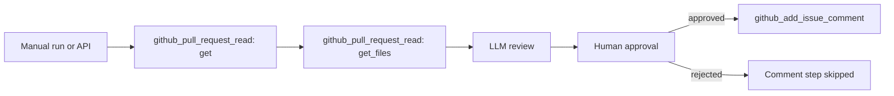

In this guide you build a workflow that does a **first-pass review of a pull request**. It reads the pull request and its changed files from GitHub, asks an LLM to draft a review, **pauses for your approval**, and only then posts the comment.

It is for developers and team leads who want AI help with reviews without anything being posted unchecked. It takes about 20 minutes.



**Outcome:** you see the draft in Command Center, approve or reject it, and only approved text is posted to the pull request.

## Prerequisites

- The `project_contributor` role
- A [GitHub connection](/connectors/github) with access to the repositories you want to review (a personal access token with the `repo` scope)
- A model your workspace can use. See [LLM providers](/ai/llm-providers)
- The pull request's `owner`, `repo`, and number

## Connectors to install

| Adapter | Purpose |
|---------|---------|
| [github](/connectors/github) | Read the pull request and post the comment |

Install it from **MCP → Add connectors** (click the connector, then **Add to workspace**), then connect it on **Instance config**.

## Build the workflow

<Steps>
  <Step title="Create the workflow">
    Name it `github-pr-review` in **Workflow Studio**.
  </Step>
  <Step title="Check the input">
    Add a `lua` step that requires `owner`, `repo`, and `pr_number`.
  </Step>
  <Step title="Fetch the pull request and its files">
    Add two `mcp` steps that use `github_pull_request_read`: one with `method` set to `get`, one with `get_files`.
  </Step>
  <Step title="Draft the review">
    Add an **LLM** step. Put the title, description, and file list in the prompt. Ask for risks, missing tests, and a suggested comment.
  </Step>
  <Step title="Ask for approval">
    Add a `human` step with `task_type` set to `approval`, showing the draft. See [Human tasks](/workflows/human-tasks).
  </Step>
  <Step title="Post the comment">
    Add an `mcp` step with `github_add_issue_comment`, after the approval.
  </Step>
</Steps>

### Check the input

```json
{
  "id": "validate",
  "type": "lua",
  "name": "Validate PR coordinates",
  "script": "if not input.owner or not input.repo or not input.pr_number then error('owner, repo, pr_number required') end\nreturn {\n  owner = input.owner,\n  repo = input.repo,\n  pr_number = tonumber(input.pr_number)\n}",
  "timeout_s": 10
}
```

### Fetch the pull request

```json
{
  "id": "get-pr",
  "type": "mcp",
  "name": "Get pull request",
  "instance_id": "REPLACE_GITHUB_INSTANCE",
  "tool_name": "github_pull_request_read",
  "tool_args": {
    "method": "get",
    "owner": "{{steps.validate.result.owner}}",
    "repo": "{{steps.validate.result.repo}}",
    "pullNumber": "{{steps.validate.result.pr_number}}"
  },
  "depends_on": ["validate"],
  "timeout_s": 30
}
```

The pull request is returned under `data`, so the title is `{{steps.get-pr.result.data.title}}`.

### List the changed files

```json
{
  "id": "list-files",
  "type": "mcp",
  "name": "List PR files",
  "instance_id": "REPLACE_GITHUB_INSTANCE",
  "tool_name": "github_pull_request_read",
  "tool_args": {
    "method": "get_files",
    "owner": "{{steps.validate.result.owner}}",
    "repo": "{{steps.validate.result.repo}}",
    "pullNumber": "{{steps.validate.result.pr_number}}"
  },
  "depends_on": ["get-pr"],
  "timeout_s": 30
}
```

### Draft the review

```json
{
  "id": "draft-review",
  "type": "llm",
  "name": "Draft PR review",
  "model_ref": "REPLACE_MODEL_REF",
  "prompt": "You are a senior engineer reviewing a pull request.\n\nTitle: {{steps.get-pr.result.data.title}}\nDescription: {{steps.get-pr.result.data.body}}\nFiles changed: {{steps.list-files.result.data}}\n\nWrite a concise review comment (markdown) covering: summary, risks, testing suggestions, and approval recommendation. Output only the comment body.",
  "depends_on": ["list-files"],
  "timeout_s": 180
}
```

### Ask for approval

```json
{
  "id": "approve-review",
  "type": "human",
  "name": "Approve review comment",
  "task_type": "approval",
  "task_payload": {
    "title": "Post PR review on {{steps.validate.result.owner}}/{{steps.validate.result.repo}}#{{steps.validate.result.pr_number}}",
    "description": "Read the draft below. Approve to post it to GitHub, or reject to cancel.",
    "draft_body": "{{steps.draft-review.result.text}}"
  },
  "depends_on": ["draft-review"],
  "timeout_s": 86400
}
```

### Post the comment

```json
{
  "id": "post-comment",
  "type": "mcp",
  "name": "Add GitHub comment",
  "instance_id": "REPLACE_GITHUB_INSTANCE",
  "tool_name": "github_add_issue_comment",
  "tool_args": {
    "owner": "{{steps.validate.result.owner}}",
    "repo": "{{steps.validate.result.repo}}",
    "number": "{{steps.validate.result.pr_number}}",
    "body": "{{steps.draft-review.result.text}}"
  },
  "depends_on": ["approve-review"],
  "timeout_s": 30
}
```

If you **reject** the task, the steps that come after it are skipped by default, so nothing is posted.

<Note>
  **Approve** only sets `approved: true` on the task. It does not copy `draft_body` anywhere. The comment text comes from the LLM step. To post text you edited, complete the task through the API with a custom `result`. See [Human tasks](/workflows/human-tasks#what-downstream-steps-receive).
</Note>

## Full workflow

Paste this into the [JSON editor](/workflows/json-editor), then replace `REPLACE_GITHUB_INSTANCE` with the id of your `github` instance on each `mcp` step, and `REPLACE_MODEL_REF` with a model from your [Providers](/ai/llm-providers) catalog.

```json
{
  "steps": [
    {
      "id": "validate",
      "type": "lua",
      "name": "Validate PR coordinates",
      "script": "if not input.owner or not input.repo or not input.pr_number then error('owner, repo, pr_number required') end\nreturn {\n  owner = input.owner,\n  repo = input.repo,\n  pr_number = tonumber(input.pr_number)\n}",
      "timeout_s": 10
    },
    {
      "id": "get-pr",
      "type": "mcp",
      "name": "Get pull request",
      "instance_id": "REPLACE_GITHUB_INSTANCE",
      "tool_name": "github_pull_request_read",
      "tool_args": {
        "method": "get",
        "owner": "{{steps.validate.result.owner}}",
        "repo": "{{steps.validate.result.repo}}",
        "pullNumber": "{{steps.validate.result.pr_number}}"
      },
      "depends_on": ["validate"],
      "timeout_s": 30
    },
    {
      "id": "list-files",
      "type": "mcp",
      "name": "List PR files",
      "instance_id": "REPLACE_GITHUB_INSTANCE",
      "tool_name": "github_pull_request_read",
      "tool_args": {
        "method": "get_files",
        "owner": "{{steps.validate.result.owner}}",
        "repo": "{{steps.validate.result.repo}}",
        "pullNumber": "{{steps.validate.result.pr_number}}"
      },
      "depends_on": ["get-pr"],
      "timeout_s": 30
    },
    {
      "id": "draft-review",
      "type": "llm",
      "name": "Draft PR review",
      "model_ref": "REPLACE_MODEL_REF",
      "prompt": "You are a senior engineer reviewing a pull request.\n\nTitle: {{steps.get-pr.result.data.title}}\nDescription: {{steps.get-pr.result.data.body}}\nFiles changed: {{steps.list-files.result.data}}\n\nWrite a concise review comment (markdown) covering: summary, risks, testing suggestions, and approval recommendation. Output only the comment body.",
      "depends_on": ["list-files"],
      "timeout_s": 180
    },
    {
      "id": "approve-review",
      "type": "human",
      "name": "Approve review comment",
      "task_type": "approval",
      "task_payload": {
        "title": "Post PR review on {{steps.validate.result.owner}}/{{steps.validate.result.repo}}#{{steps.validate.result.pr_number}}",
        "description": "Read the draft below. Approve to post it to GitHub, or reject to cancel.",
        "draft_body": "{{steps.draft-review.result.text}}"
      },
      "depends_on": ["draft-review"],
      "timeout_s": 86400
    },
    {
      "id": "post-comment",
      "type": "mcp",
      "name": "Add GitHub comment",
      "instance_id": "REPLACE_GITHUB_INSTANCE",
      "tool_name": "github_add_issue_comment",
      "tool_args": {
        "owner": "{{steps.validate.result.owner}}",
        "repo": "{{steps.validate.result.repo}}",
        "number": "{{steps.validate.result.pr_number}}",
        "body": "{{steps.draft-review.result.text}}"
      },
      "depends_on": ["approve-review"],
      "timeout_s": 30
    }
  ]
}
```

## Run it

Start a manual run in Workflow Studio with this input:

```json
{
  "owner": "your-org",
  "repo": "your-repo",
  "pr_number": 42
}
```

You can also start it from code. See [API examples](/api/examples#start-a-run).

**What you should see:** the run pauses at **Approve review comment**. Open [Command Center](/workflows/command-center), read the draft, and click **Approve** or **Reject**. After you approve, the comment appears on the pull request.

To run it automatically when a pull request opens, create an [inbound webhook](/integrations/inbound-webhooks) and choose the **GitHub** vendor adapter.

## Common problems

| Problem | What to check |
|---------|---------------|
| `owner, repo, pr_number required` | The run input is missing a field |
| A GitHub step fails with not found or forbidden | The connection's token cannot see that repository |
| The draft shows empty title or description | Check the field names under `data` in the run's step results, in the run view |
| The run seems stuck | It is waiting for your approval. Open Command Center |
| A comment was posted after I rejected | Check that the `post-comment` step lists `approve-review` in `depends_on` |

## Variations

- Add a `github_compare_commits` step for more context before the LLM step.
- After approval, call `github_merge_pull_request` in a separate workflow with stricter checks.
- Ask the LLM to output the word `BLOCK` for risky changes, and add a Lua step that always requires approval in that case.

## Next steps

- [GitHub connector](/connectors/github)
- [Approve then send](/workflows/patterns#approve-then-send)
- [Command Center](/workflows/command-center)
- [All guides](/guides/overview)
