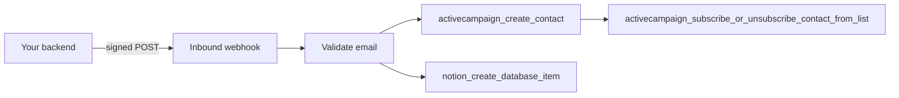

In this guide you build a workflow that handles every new **lead** from your website. It creates the contact in **ActiveCampaign** (your marketing tool) and adds a row to a **Notion** database (so sales can see it), at the same time.

It is for marketing and sales teams who copy leads between tools by hand today. It takes about 30 minutes.



**Outcome:** marketing automation gets the lead immediately, and sales sees the same lead in Notion with its source and a status of **New**.

## Prerequisites

- The `project_contributor` role
- An [ActiveCampaign connection](/connectors/activecampaign) (your account URL and API token)
- A [Notion connection](/connectors/notion), with your leads database shared with the integration
- A Notion database with these properties: **Name** (title), **Email** (email), **Source** (select), **Status** (select, with an option named `New`)

## Connectors to install

| Adapter | Purpose |
|---------|---------|
| [activecampaign](/connectors/activecampaign) | Create the contact and add it to a list |
| [notion](/connectors/notion) | Log the lead in your database |

Install each from **MCP → Add connectors** (click the connector, then **Add to workspace**) and connect it on **Instance config**.

## Build the workflow

<Steps>
  <Step title="Find your Notion database ID">
    Run a test step with `notion_search` and copy the database ID of your leads table.
  </Step>
  <Step title="Create the workflow">
    Name it `lead-sync-ac-notion` in **Workflow Studio**.
  </Step>
  <Step title="Validate the input">
    Add a `lua` step that requires `email` and tidies `first_name`, `last_name`, and `source`.
  </Step>
  <Step title="Create the ActiveCampaign contact">
    Add an `mcp` step with `activecampaign_create_contact`.
  </Step>
  <Step title="Log the lead in Notion">
    Add an `mcp` step with `notion_create_database_item`. Give it the same `depends_on` as the contact step, so the two run side by side.
  </Step>
  <Step title="Add the contact to a list (optional)">
    Add an `mcp` step with `activecampaign_subscribe_or_unsubscribe_contact_from_list` after the contact is created.
  </Step>
  <Step title="Send leads in">
    Create an [inbound webhook](/integrations/inbound-webhooks) for the workflow (**Workflow setup → Inbound**) and have your own backend call it, as explained below.
  </Step>
</Steps>

<Warning>
  Inbound webhooks only accept requests signed with your signing secret and sent with an `Idempotency-Key` header. A plain browser form cannot do this. Post the lead from your server code or a serverless function. [Inbound webhooks](/integrations/inbound-webhooks#verify-signatures) shows how.
</Warning>

### Validate the input

```json
{
  "id": "validate",
  "type": "lua",
  "name": "Validate lead",
  "script": "if not input.email or input.email == '' then error('email required') end\nreturn {\n  email = input.email,\n  first_name = input.first_name or '',\n  last_name = input.last_name or '',\n  source = input.source or 'website'\n}",
  "timeout_s": 10
}
```

### Create the ActiveCampaign contact

```json
{
  "id": "create-contact",
  "type": "mcp",
  "name": "Create AC contact",
  "instance_id": "REPLACE_ACTIVECAMPAIGN_INSTANCE",
  "tool_name": "activecampaign_create_contact",
  "tool_args": {
    "email": "{{steps.validate.result.email}}",
    "first_name": "{{steps.validate.result.first_name}}",
    "last_name": "{{steps.validate.result.last_name}}",
    "field_values_json": "[{\"field\":\"1\",\"value\":\"{{steps.validate.result.source}}\"}]"
  },
  "depends_on": ["validate"],
  "timeout_s": 30
}
```

Replace the field `1` with the ID of your ActiveCampaign custom field for lead source. If you have no such field, leave out `field_values_json`.

### Log the lead in Notion

```json
{
  "id": "log-notion",
  "type": "mcp",
  "name": "Log lead in Notion",
  "instance_id": "REPLACE_NOTION_INSTANCE",
  "tool_name": "notion_create_database_item",
  "tool_args": {
    "database_id": "your-database-id",
    "properties": {
      "Name": { "title": [{ "text": { "content": "{{steps.validate.result.first_name}} {{steps.validate.result.last_name}}" } }] },
      "Email": { "email": "{{steps.validate.result.email}}" },
      "Source": { "select": { "name": "{{steps.validate.result.source}}" } },
      "Status": { "select": { "name": "New" } }
    }
  },
  "depends_on": ["validate"],
  "timeout_s": 30
}
```

`properties` uses Notion's own format, keyed by your property names. Use `notion_retrieve_database` to check the exact names and types before you run this.

### Add the contact to a list (optional)

```json
{
  "id": "subscribe-list",
  "type": "mcp",
  "name": "Add to nurture list",
  "instance_id": "REPLACE_ACTIVECAMPAIGN_INSTANCE",
  "tool_name": "activecampaign_subscribe_or_unsubscribe_contact_from_list",
  "tool_args": {
    "contact_id": "{{steps.create-contact.result.json.contact.id}}",
    "list_id": "12",
    "status": "1"
  },
  "depends_on": ["create-contact"],
  "timeout_s": 30
}
```

`status` is `"1"` to subscribe and `"2"` to unsubscribe. ActiveCampaign's reply is returned under `json`, so the new contact's ID is at `result.json.contact.id`.

## Full workflow

Paste this into the [JSON editor](/workflows/json-editor). Replace `your-database-id`, the custom field `1`, and the list ID `12`, then replace `REPLACE_ACTIVECAMPAIGN_INSTANCE` and `REPLACE_NOTION_INSTANCE` with the ids of your `activecampaign` and `notion` instances.

```json
{
  "steps": [
    {
      "id": "validate",
      "type": "lua",
      "name": "Validate lead",
      "script": "if not input.email or input.email == '' then error('email required') end\nreturn {\n  email = input.email,\n  first_name = input.first_name or '',\n  last_name = input.last_name or '',\n  source = input.source or 'website'\n}",
      "timeout_s": 10
    },
    {
      "id": "create-contact",
      "type": "mcp",
      "name": "Create AC contact",
      "instance_id": "REPLACE_ACTIVECAMPAIGN_INSTANCE",
      "tool_name": "activecampaign_create_contact",
      "tool_args": {
        "email": "{{steps.validate.result.email}}",
        "first_name": "{{steps.validate.result.first_name}}",
        "last_name": "{{steps.validate.result.last_name}}",
        "field_values_json": "[{\"field\":\"1\",\"value\":\"{{steps.validate.result.source}}\"}]"
      },
      "depends_on": ["validate"],
      "timeout_s": 30
    },
    {
      "id": "log-notion",
      "type": "mcp",
      "name": "Log lead in Notion",
      "instance_id": "REPLACE_NOTION_INSTANCE",
      "tool_name": "notion_create_database_item",
      "tool_args": {
        "database_id": "your-database-id",
        "properties": {
          "Name": { "title": [{ "text": { "content": "{{steps.validate.result.first_name}} {{steps.validate.result.last_name}}" } }] },
          "Email": { "email": "{{steps.validate.result.email}}" },
          "Source": { "select": { "name": "{{steps.validate.result.source}}" } },
          "Status": { "select": { "name": "New" } }
        }
      },
      "depends_on": ["validate"],
      "timeout_s": 30
    },
    {
      "id": "subscribe-list",
      "type": "mcp",
      "name": "Add to nurture list",
      "instance_id": "REPLACE_ACTIVECAMPAIGN_INSTANCE",
      "tool_name": "activecampaign_subscribe_or_unsubscribe_contact_from_list",
      "tool_args": {
        "contact_id": "{{steps.create-contact.result.json.contact.id}}",
        "list_id": "12",
        "status": "1"
      },
      "depends_on": ["create-contact"],
      "timeout_s": 30
    }
  ]
}
```

`create-contact` and `log-notion` both depend only on `validate`, so they run in parallel.

## Test it

Start a manual run with:

```json
{
  "email": "alex@example.com",
  "first_name": "Alex",
  "last_name": "Kim",
  "source": "landing-page"
}
```

**What you should see:** a successful run in **Command Center**, a new contact in ActiveCampaign, and a new row in Notion.

## Common problems

| Problem | What to check |
|---------|---------------|
| `email required` | The input has no `email` |
| The Notion step fails | The database is not shared with the integration, or a property name or type does not match. Run `notion_retrieve_database` |
| The ActiveCampaign step fails | Check the account URL and token on the connection |
| Duplicate rows in Notion | A sender retried. Store a `submission_id` in Notion and check it with `notion_find_database_item` first |
| Duplicate contacts | If the email already exists, update the contact with `activecampaign_update_contact` instead |

## Variations

- Score the lead with an **LLM** step, then tag it `hot`, `warm`, or `cold` with `activecampaign_add_tag_to_contact`.
- Email your sales team for `hot` leads with [Resend](/connectors/resend).
- Log leads in [Google Sheets](/connectors/google-sheets) with `google_sheets_insert_row` instead of Notion.

## Next steps

- [ActiveCampaign connector](/connectors/activecampaign) and [Notion connector](/connectors/notion)
- [Inbound webhooks](/integrations/inbound-webhooks)
- [All guides](/guides/overview)
