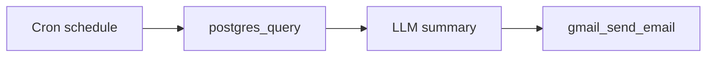

In this guide you build a **weekly report** that runs by itself. It reads numbers from your Postgres database, asks an LLM to turn them into a short written summary, and emails it to your team from your Gmail account.

It is for ops, finance, and product teams who want a regular report without anyone building it by hand. It takes about 30 minutes.



**Outcome:** every Monday morning, the people you choose receive an email with your key numbers and a plain-language summary.

## Prerequisites

- The `project_contributor` role
- A [Postgres connection](/connectors/postgres), ideally with a read-only database user
- A [Google connection](/integrations/google-workspace) with Gmail turned on
- A model your workspace can use. See [LLM providers](/ai/llm-providers)

## Connectors to install

| Adapter | Purpose |
|---------|---------|
| [postgres](/connectors/postgres) | Run the report query |
| [gmail](/connectors/gmail) | Send the email from your Google account |

Install each from **MCP → Add connectors** (click the connector, then **Add to workspace**) and connect it on **Instance config**.

## Example report query

Change this to fit your tables. This one totals the last seven days of orders:

```sql
SELECT
  DATE_TRUNC('week', created_at) AS week,
  COUNT(*) AS order_count,
  SUM(total)::numeric(12,2) AS revenue
FROM orders
WHERE created_at >= NOW() - INTERVAL '7 days'
GROUP BY 1
ORDER BY 1 DESC;
```

## Build the workflow

<Steps>
  <Step title="Create the workflow">
    Name it `weekly-ops-report` in **Workflow Studio**.
  </Step>
  <Step title="Query Postgres">
    Add an `mcp` step with `postgres_query` and your SQL. `postgres_query` only allows read queries.
  </Step>
  <Step title="Write the summary">
    Add an **LLM** step that turns the rows into a short summary with highlights and anything unusual.
  </Step>
  <Step title="Send the email">
    Add an `mcp` step with `gmail_send_email` to your distribution list.
  </Step>
  <Step title="Test it">
    Start a manual run. **What you should see:** the run succeeds and the email arrives.
  </Step>
  <Step title="Schedule it">
    Open **Workflow setup → Cron**, choose the **Weekly Mon 09:00** preset (or type a **Cron (5-field)** expression such as `0 8 * * 1`), choose a **Timezone**, choose an **Automation API key**, and click **Add schedule**.
  </Step>
  <Step title="Optional: add approval">
    For reports that need a sign-off, add a `human` step between the LLM and Gmail steps. See [Approve then send](/workflows/patterns#approve-then-send).
  </Step>
</Steps>

**What you should see after step 6:** the schedule under **Active schedules**, with the cron expression, timezone, and time of the next run. See [External triggers](/workflows/external-triggers#cron-schedules).

### Query step

```json
{
  "id": "weekly-metrics",
  "type": "mcp",
  "name": "Fetch weekly KPIs",
  "instance_id": "REPLACE_POSTGRES_INSTANCE",
  "tool_name": "postgres_query",
  "tool_args": {
    "sql": "SELECT DATE_TRUNC('week', created_at) AS week, COUNT(*) AS order_count, SUM(total)::numeric(12,2) AS revenue FROM orders WHERE created_at >= NOW() - INTERVAL '7 days' GROUP BY 1 ORDER BY 1 DESC"
  },
  "timeout_s": 60,
  "retry_count": 2
}
```

### LLM step

```json
{
  "id": "write-summary",
  "type": "llm",
  "name": "Executive summary",
  "model_ref": "REPLACE_MODEL_REF",
  "prompt": "You are a business analyst. Given this weekly metrics JSON from our database, write a concise email body (plain text, 3-5 short paragraphs) for leadership. Call out week-over-week changes if visible. Data: {{steps.weekly-metrics.result.rows}}",
  "depends_on": ["weekly-metrics"],
  "timeout_s": 120
}
```

### Gmail step

```json
{
  "id": "send-report",
  "type": "mcp",
  "name": "Email weekly report",
  "instance_id": "REPLACE_GMAIL_INSTANCE",
  "tool_name": "gmail_send_email",
  "tool_args": {
    "to": ["leadership@example.com"],
    "subject": "Weekly ops report",
    "body": "{{steps.write-summary.result.text}}"
  },
  "depends_on": ["write-summary"],
  "timeout_s": 30
}
```

`to` is a list of addresses. Add `"body_type": "html"` if the body is HTML. The default is plain text.

## Full workflow

Paste this into the [JSON editor](/workflows/json-editor), then replace `REPLACE_POSTGRES_INSTANCE` and `REPLACE_GMAIL_INSTANCE` with the ids of your instances, and `REPLACE_MODEL_REF` with a model from your [Providers](/ai/llm-providers) catalog. Change the SQL and the recipients first.

```json
{
  "steps": [
    {
      "id": "weekly-metrics",
      "type": "mcp",
      "name": "Fetch weekly KPIs",
      "instance_id": "REPLACE_POSTGRES_INSTANCE",
      "tool_name": "postgres_query",
      "tool_args": {
        "sql": "SELECT DATE_TRUNC('week', created_at) AS week, COUNT(*) AS order_count, SUM(total)::numeric(12,2) AS revenue FROM orders WHERE created_at >= NOW() - INTERVAL '7 days' GROUP BY 1 ORDER BY 1 DESC"
      },
      "timeout_s": 60,
      "retry_count": 2
    },
    {
      "id": "write-summary",
      "type": "llm",
      "name": "Executive summary",
      "model_ref": "REPLACE_MODEL_REF",
      "prompt": "You are a business analyst. Given this weekly metrics JSON from our database, write a concise email body (plain text, 3-5 short paragraphs) for leadership. Call out week-over-week changes if visible. Data: {{steps.weekly-metrics.result.rows}}",
      "depends_on": ["weekly-metrics"],
      "timeout_s": 120
    },
    {
      "id": "send-report",
      "type": "mcp",
      "name": "Email weekly report",
      "instance_id": "REPLACE_GMAIL_INSTANCE",
      "tool_name": "gmail_send_email",
      "tool_args": {
        "to": ["leadership@example.com"],
        "subject": "Weekly ops report",
        "body": "{{steps.write-summary.result.text}}"
      },
      "depends_on": ["write-summary"],
      "timeout_s": 30
    }
  ]
}
```

## Common problems

| Problem | What to check |
|---------|---------------|
| The query step fails | The SQL has an error, the table does not exist, or the connection is not wired on the instance |
| `postgres_query only allows SELECT/CTE queries` | The report must be a `SELECT` or `WITH` query |
| The email is not sent | Gmail is not turned on for the Google connection, or `to` is not a list |
| The schedule never runs | Check **Active schedules** for the next run time and timezone, and that the schedule has an **Automation API key** |
| The summary invents numbers | Tell the LLM in the prompt to use only the data given |

## Variations

- Write the rows to [Google Sheets](/connectors/google-sheets) with `google_sheets_insert_multiple_rows`.
- Send with [Resend](/connectors/resend) (`resend_send_email`) from a verified domain.
- Run several queries (revenue, support tickets, churn) before one LLM step.

## Next steps

- [Postgres connector](/connectors/postgres) and [Gmail connector](/connectors/gmail)
- [External triggers](/workflows/external-triggers): schedules, webhooks, and events
- [All guides](/guides/overview)
