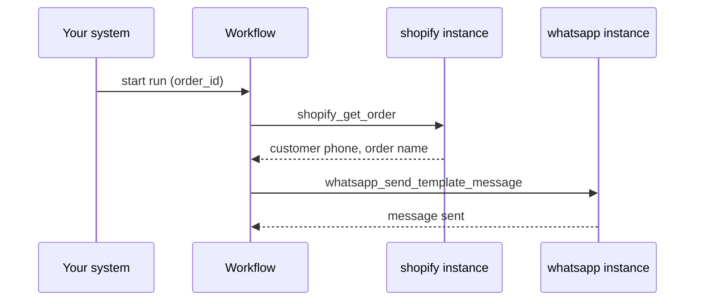

In this guide you build a workflow that tells customers on WhatsApp when their **Shopify order ships**. It looks up the order in Shopify, finds the customer's phone number, and sends an approved WhatsApp **template message**.

It is for shop owners and developers who already use Shopify and have a WhatsApp Business number. It takes about 30 minutes, plus the time Meta takes to approve a template if you do not have one.

A **template message** is a message format that Meta has approved in advance. WhatsApp only lets a business start a conversation with a template. Free-form messages are only allowed within 24 hours of the customer's last message.



**Outcome:** when you start the workflow with an order ID, the customer receives your WhatsApp message with their order number.

## Prerequisites

- The `project_contributor` role
- A [Shopify connection](/connectors/shopify) whose access token can read orders
- A [WhatsApp connection](/connectors/whatsapp) with your phone number ID
- At least one **APPROVED** WhatsApp template, for example `order_shipped`, where `{{1}}` is the order name and `{{2}}` is a tracking link
- Customer phone numbers on your Shopify orders, in international format such as `+14155551234`

<Warning>
  Use `whatsapp_send_template_message` for shipping updates. `whatsapp_send_message` only works within 24 hours of the customer's last message, or when you are replying inside a [conversation session](/workflows/conversation-sessions).
</Warning>

## Connectors to install

| Adapter | Purpose |
|---------|---------|
| [shopify](/connectors/shopify) | Read the order and customer details |
| [whatsapp](/connectors/whatsapp) | Send the template message |

Install each from **MCP → Add connectors** (click the connector, then **Add to workspace**) and connect it on **Instance config**.

## Check your WhatsApp template

<Steps>
  <Step title="List your templates">
    Run a test workflow with an `mcp` step using `whatsapp_list_message_templates`.
  </Step>
  <Step title="Note the name and language">
    Find an `APPROVED` template and write down its name and language code (for example `en_US`).
  </Step>
  <Step title="Match the placeholders">
    Count the template's placeholders. You will send one value for each, in order.
  </Step>
</Steps>

## Build the workflow

<Steps>
  <Step title="Create the workflow">
    Name it `shopify-order-shipped-whatsapp` in **Workflow Studio**.
  </Step>
  <Step title="Check the input">
    Add a `lua` step that requires `order_id`.
  </Step>
  <Step title="Fetch the order">
    Add an `mcp` step with `shopify_get_order`.
  </Step>
  <Step title="Find the phone number">
    Add a `lua` step that reads the customer's phone number from the order and fails clearly if it is missing.
  </Step>
  <Step title="Send the template">
    Add an `mcp` step with `whatsapp_send_template_message`.
  </Step>
  <Step title="Start it">
    Start a manual run with an order ID (see [Test the workflow](#test-the-workflow)). When it works, start it from your own system, as described below.
  </Step>
</Steps>

### Check the input

```json
{
  "id": "validate",
  "type": "lua",
  "name": "Require order_id",
  "script": "local id = input.order_id or input.id\nif not id then error('order_id required') end\nreturn { order_id = tostring(id) }",
  "timeout_s": 10
}
```

### Fetch the order

```json
{
  "id": "get-order",
  "type": "mcp",
  "name": "Get Shopify order",
  "instance_id": "REPLACE_SHOPIFY_INSTANCE",
  "tool_name": "shopify_get_order",
  "tool_args": {
    "order_id": "{{steps.validate.result.order_id}}"
  },
  "depends_on": ["validate"],
  "timeout_s": 30,
  "retry_count": 2
}
```

`shopify_get_order` returns the order under `order`, so later steps read `steps['get-order'].result.order`.

### Find the customer's phone number

```json
{
  "id": "extract-phone",
  "type": "lua",
  "name": "Get phone number",
  "script": "local order = steps['get-order'].result.order\nlocal phone = order.phone or (order.customer and order.customer.phone)\nif not phone or phone == '' then error('no phone on order') end\nreturn { phone = phone, order_name = order.name or tostring(order.id) }",
  "depends_on": ["get-order"],
  "timeout_s": 10
}
```

### Send the WhatsApp template

```json
{
  "id": "notify-customer",
  "type": "mcp",
  "name": "WhatsApp shipping update",
  "instance_id": "REPLACE_WHATSAPP_INSTANCE",
  "tool_name": "whatsapp_send_template_message",
  "tool_args": {
    "to": "{{steps.extract-phone.result.phone}}",
    "template_name": "order_shipped",
    "language_code": "en_US",
    "body_parameters": [
      { "text": "{{steps.extract-phone.result.order_name}}" },
      { "text": "https://your-store.com/pages/tracking" }
    ]
  },
  "depends_on": ["extract-phone"],
  "timeout_s": 30
}
```

Each item in `body_parameters` is an object with a `text` value, one per placeholder in your template, in order.

## Full workflow

Paste this into the [JSON editor](/workflows/json-editor), then replace `REPLACE_SHOPIFY_INSTANCE` and `REPLACE_WHATSAPP_INSTANCE` with the ids of your `shopify` and `whatsapp` instances. Change `template_name`, `language_code`, and `body_parameters` to match your template.

```json
{
  "steps": [
    {
      "id": "validate",
      "type": "lua",
      "name": "Require order_id",
      "script": "local id = input.order_id or input.id\nif not id then error('order_id required') end\nreturn { order_id = tostring(id) }",
      "timeout_s": 10
    },
    {
      "id": "get-order",
      "type": "mcp",
      "name": "Get Shopify order",
      "instance_id": "REPLACE_SHOPIFY_INSTANCE",
      "tool_name": "shopify_get_order",
      "tool_args": {
        "order_id": "{{steps.validate.result.order_id}}"
      },
      "depends_on": ["validate"],
      "timeout_s": 30,
      "retry_count": 2
    },
    {
      "id": "extract-phone",
      "type": "lua",
      "name": "Get phone number",
      "script": "local order = steps['get-order'].result.order\nlocal phone = order.phone or (order.customer and order.customer.phone)\nif not phone or phone == '' then error('no phone on order') end\nreturn { phone = phone, order_name = order.name or tostring(order.id) }",
      "depends_on": ["get-order"],
      "timeout_s": 10
    },
    {
      "id": "notify-customer",
      "type": "mcp",
      "name": "WhatsApp shipping update",
      "instance_id": "REPLACE_WHATSAPP_INSTANCE",
      "tool_name": "whatsapp_send_template_message",
      "tool_args": {
        "to": "{{steps.extract-phone.result.phone}}",
        "template_name": "order_shipped",
        "language_code": "en_US",
        "body_parameters": [
          { "text": "{{steps.extract-phone.result.order_name}}" },
          { "text": "https://your-store.com/pages/tracking" }
        ]
      },
      "depends_on": ["extract-phone"],
      "timeout_s": 30
    }
  ]
}
```

## Test the workflow

Start a manual run with this input, using the ID of a real Shopify test order:

```json
{
  "order_id": "5678901234"
}
```

For the WhatsApp side, use a [test recipient number](https://developers.facebook.com/docs/whatsapp/cloud-api/get-started#test-numbers) registered in Meta.

**What you should see:** the run succeeds in **Command Center**, and the phone receives the template message.

## Start it when an order ships

To start the workflow automatically, create an [inbound webhook](/integrations/inbound-webhooks) for it and have your own system call it when an order is fulfilled, sending `order_id`.

<Warning>
  Shopify's own webhooks are not signed in the format AgentRuntime expects, so Shopify cannot call an inbound webhook directly. Receive the Shopify webhook in your own server or serverless function, then post `order_id` to the AgentRuntime webhook with the required signature.
</Warning>

## Common problems

| Problem | What to check |
|---------|---------------|
| `order_id required` | The run input has no `order_id` |
| `no phone on order` | The order has no phone number. Ask customers for one at checkout |
| The template step fails | The template name or language code is wrong, the template is not approved, or `body_parameters` has the wrong number of items |
| The message is not delivered | The number is not in international format, or you are sending to a number that is not allowed on a Meta test account |
| An MCP step cannot connect | The instance has no connection. See [MCP instances](/integrations/mcp-instances) |

## Variations

- Add a `human` approval step before sending for high-value orders. See [Approve then send](/workflows/patterns#approve-then-send).
- Write a row to [Postgres](/connectors/postgres) after sending, for an audit log.
- Use `shopify_list_fulfillments` to put a tracking number in the template.

## Next steps

- [Shopify connector](/connectors/shopify) and [WhatsApp connector](/connectors/whatsapp)
- [WhatsApp customer chat with staff hand-off](/guides/whatsapp-customer-chat): answer replies from customers
- [All guides](/guides/overview)
