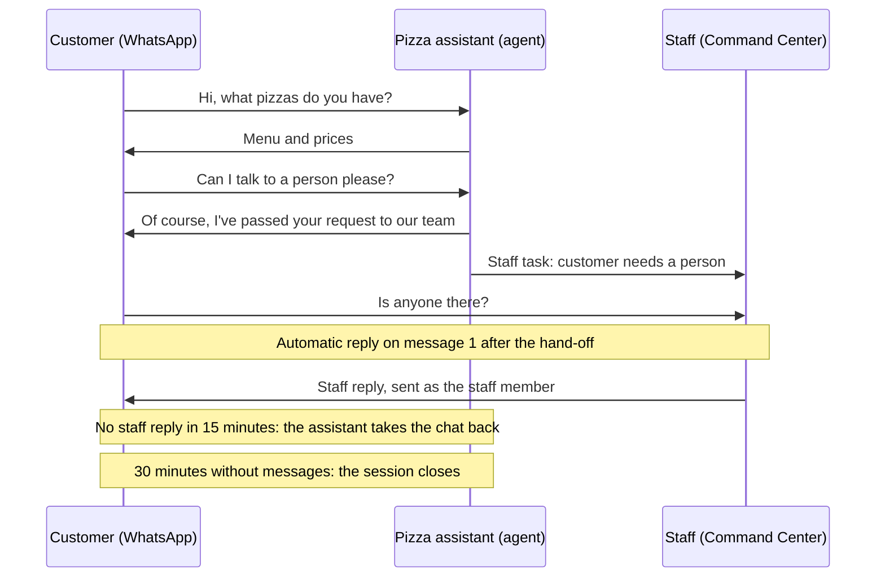

Build a WhatsApp line for a small business, here a pizza shop called **Slice & Co.** An agent answers customers on WhatsApp. When a customer asks for a person, or the agent can't help, the chat goes to your staff. Staff reply from AgentRuntime and their reply reaches the customer on WhatsApp. If nobody answers in time, the assistant takes the conversation back.

Each customer's chat is one [conversation session](/workflows/conversation-sessions): all their messages go to one run, which stays open while they are talking and closes after 30 quiet minutes.



**Outcome:** customers get an instant answer from the assistant, a person when they need one, and never a silent chat.

## Prerequisites

- A [WhatsApp connection](/connectors/whatsapp) made with **Embedded signup** (or manual credentials including the phone number ID)
- An active **whatsapp** MCP instance wired to that connection
- An [LLM provider](/ai/llm-providers) for the agent
- **project_contributor** access in the project

## Connectors to install

| Adapter | Purpose |
|---------|---------|
| [whatsapp](/connectors/whatsapp) | Receive customer messages and send replies (`whatsapp_send_message`, `whatsapp_send_media` for files, and `whatsapp_send_interactive_buttons` / `whatsapp_send_interactive_list` for choices) |

## 1. Create the assistant agent

In **Agents**, create an agent named **Pizza assistant**.

**Instructions:** describe the shop and when to involve a person. For example:

```text
You are the WhatsApp assistant for Slice & Co., a pizza shop in Colombo.
Answer questions about the menu, prices, delivery areas and order status.
Keep replies short and friendly; this is WhatsApp.
If the customer asks for a person, wants a refund, or you cannot help,
hand off to staff: set action to "human", tell the customer a team member
will reply here, and explain the customer's issue in reason.
Otherwise set action to "reply".
When the customer has to pick one of a few things (a size, pickup or
delivery), ask in reply and list the options in choices, at most 10,
each title under 20 characters.
```

**Output schema:** under **Input & output schemas → Output schema (optional)**, add the fields the workflow reads:

```json
{
  "type": "object",
  "properties": {
    "action": { "type": "string", "enum": ["reply", "human"], "description": "reply: answered; human: needs a person" },
    "reply": { "type": "string", "description": "The message sent to the customer on WhatsApp" },
    "reason": { "type": "string", "description": "For staff: why a person is needed and what is unresolved" },
    "choices": {
      "type": "array",
      "maxItems": 10,
      "description": "Optional: options the customer can tap to answer reply",
      "items": {
        "type": "object",
        "properties": {
          "id": { "type": "string" },
          "title": { "type": "string", "maxLength": 20 },
          "description": { "type": "string", "maxLength": 72 }
        },
        "required": ["title"]
      }
    }
  },
  "required": ["action", "reply"]
}
```

`reply` is what the customer sees. `message`, which every agent also returns, stays an internal summary. `choices` turns `reply` into a question the customer answers with a tap (see [Choices](#choices)).

## 2. Build the workflow

Create a workflow named **Slice & Co. WhatsApp orders** with two steps.

### Pizza assistant (agent step)

| Field | Value |
|---|---|
| Agent | **Pizza assistant** |
| Prompt | `WhatsApp customer: {{input.contact_name}}, WhatsApp number {{input.from}}. Their latest message: "{{input.text}}". Reply to them.` |
| **Talks in the conversation** | On |
| **Reply field (optional)** | `reply` |

The agent also receives every message since its last turn and, with contact memory on, the customer's earlier conversations. The prompt only needs the latest message.

### Staff reply (human step)

| Field | Value |
|---|---|
| Runs after | **Pizza assistant** |
| **Skip when** | `{{steps.<assistant step id>.result.action == "reply"}}`, so the step only runs on a hand-off |
| Timeout | 900 seconds (15 minutes) |
| **If no response (timeout policy)** | **Hand the conversation back (session workflows)** |
| **Hand off the conversation to a person** | On |
| **Replies while nobody has answered** | 1: *Thanks! A member of our team will reply here shortly.*<br />4: *Sorry for the wait, our team is busy right now. We haven't forgotten you.* |
| **Give the conversation back to (optional)** | The assistant step |

Give the task a title, a message for staff, and a reply box in its `task_payload` (the [JSON editor](/workflows/json-editor) is the quickest way):

```json
{
  "title": "Reply to {{input.contact_name}} on WhatsApp",
  "message": "{{input.contact_name}} ({{input.from}}) needs a person: {{steps.<assistant step id>.result.reason}}\nLatest message: \"{{input.text}}\"",
  "response": {
    "field": "reply",
    "label": "Reply to the customer",
    "placeholder": "Type the WhatsApp message to send"
  }
}
```

## 3. Turn on sessions

Open **Workflow setup → Sessions**:

<Steps>
  <Step title="One run per conversation">
    Turn it on.
  </Step>
  <Step title="Close after idle (minutes)">
    Leave it blank for 30 minutes, or see [choosing how long a chat stays open](#choose-how-long-a-chat-stays-open).
  </Step>
  <Step title="Reply channel">
    **Connection:** your WhatsApp MCP instance. **Send tool:** `whatsapp_send_message`. Keep the default **Tool arguments**: `to` = `{{input.from}}` and `text` = `{{message.text}}`.
  </Step>
  <Step title="Files">
    Keep the default **File send tool**, `whatsapp_send_media`, and its **File tool arguments**: `to` = `{{input.from}}`, `type` = `{{message.attachment.type}}`, `media_url` = `{{message.attachment.url}}`, `caption` = `{{message.attachment.caption}}`, `filename` = `{{message.attachment.filename}}`. This lets staff and the assistant send photos and documents.
  </Step>
  <Step title="Choices">
    Keep the default **Choices tool**, `whatsapp_send_interactive_buttons` **up to 3** options, and **Tool for more options**, `whatsapp_send_interactive_list` **up to 10**. This sends the assistant's `choices` as reply buttons or a list.
  </Step>
</Steps>

Every message the workflow sends goes through this channel: the assistant's replies, the automatic replies, and staff replies, text first and then any files. A question with choices goes last, after its files.

## 4. Route messages to the workflow

Open **Workflow setup → Inbound** and create a subscription:

| Field | Value |
|---|---|
| **Webhook purpose** | **Start workflow run** |
| **Vendor adapter** | **WhatsApp** |
| **Connection** | Your WhatsApp connection |
| **Conversation memory** | **Remember each contact** on |

There is no webhook URL to register with Meta. AgentRuntime receives your number's messages through its own Meta app and routes them to every workflow subscribed to that connection.

**Remember each contact** keeps one conversation per WhatsApp contact, so the assistant sees what the customer said in earlier sessions too.

## 5. Publish and test

**Publish** the workflow, then message your business number from a phone.

1. Ask *Hi, what pizzas do you have?* The assistant replies. In Workflow Studio's **Run logs and metrics** you see one run, waiting for the next message.
2. Send *Can I talk to a person please?* The assistant replies and the **Staff reply** task appears in [Command Center](/workflows/command-center).
3. Send a few more messages. The 1st and 4th after the hand-off get the automatic replies, and every message is listed on the task under **New since handoff**.
4. Reply from the task. The customer receives it on WhatsApp from your business number, and the run shows it as a staff reply.
5. Send a photo with a caption, then a voice note. The run shows them as *[image: …]* and *[voice note]*, and **Open the conversation** shows the photo and plays the voice note.
6. Reply from a task with a file attached. The customer receives the text, then the file.
7. Ask *What sizes do you have?* If the assistant offers sizes, they arrive as buttons under its reply. Tap one: the run shows your pick as the next message, and the conversation shows the options under the question.
8. To test the timeout, hand off again and leave the task alone. After 15 minutes the run shows *No reply in time; the conversation is handed back*, and the assistant answers the waiting messages.

All of this is one run. After 30 minutes without messages it closes as **Success**, and the next message starts a new session.

## What WhatsApp messages look like in the workflow

Each incoming message is the run's input. Read it with `{{input.*}}`:

| Field | Example | Notes |
|---|---|---|
| `text` | `Hi, can I talk to a person please?` | The text, a button or list reply's title, or a media caption |
| `type` | `text`, `image`, `video`, `audio`, `document`, `sticker`, `location`, `contacts`, `button`, `interactive`, `reaction`, `unsupported` | WhatsApp message type |
| `from` | `94712280951` | The customer's WhatsApp number; use it as the reply address |
| `contact_name` | `Timnirmal` | The customer's WhatsApp profile name |
| `message_id` | `wamid.HBg...` | WhatsApp message id |
| `timestamp` | `1792526100` | When the customer sent it (Unix seconds) |
| `display_phone_number`, `phone_number_id` | | Your business number |
| `attachments` | `[{ "file_id": "3f9c…", "type": "image", "caption": "my cold pizza" }]` | Photos, videos, audio, voice notes, documents and stickers, stored in your workspace. See [Photos, voice notes, and files](#photos-voice-notes-and-files) |
| `location` | `{ "latitude": 6.9, "longitude": 79.85, "name": "Galle Road" }` | A shared location |
| `shared_contacts` | | Contact cards the customer shared, as WhatsApp sends them |
| `message` | | The raw WhatsApp message object |

A repeated delivery of the same WhatsApp message is ignored, so a customer's message is never answered twice.

WhatsApp doesn't pass some messages on to businesses: polls, poll votes, and edited messages, among others. They arrive with `type` `unsupported` and a `text` that names them, for example `[unsupported: poll]`, so the assistant and staff know something was sent. A reaction arrives as `[reaction: 👍]`.

The closest thing to a poll is a question with [choices](#choices): reply buttons (up to 3) or a list (up to 10). The customer's pick arrives as an ordinary message whose `text` is the option's title and whose `type` is `interactive`.

## Choices

When the assistant returns `choices` next to `reply`, the customer gets `reply` as a question with the options to tap. The Sessions tab's **Choices** section (step 3) decides how they look:

- **1 to 3 options:** reply buttons under the question.
- **4 to 10 options:** a list behind an **Options** button. Change the button's label in **More options tool arguments** (`button_text`, up to 20 characters).
- **More than 10, or the Choices tool set to None:** the question with the options as numbered lines.

WhatsApp rejects button titles over 20 characters and list titles over 24. The `maxLength` in the output schema keeps the assistant inside that; if a title still doesn't fit, the question goes out with the options as numbered lines, so the customer always gets it.

The customer may also type an answer instead of tapping, so the instructions should not depend on a tap. Staff see the options under the question in the conversation. The [conversation sessions reference](/workflows/conversation-sessions#choices) has the full list of `{{message.*}}` values for the tool arguments.

## Photos, voice notes, and files

WhatsApp media links expire within minutes, so AgentRuntime downloads each photo, video, audio file, voice note, document, or sticker as soon as it arrives, with your connection's own access token, and stores it in your workspace. The message carries it as an attachment ([fields](/workflows/conversation-sessions#files-voice-notes-and-locations)). If the download fails, the message still arrives, with the error on its attachment.

- **Staff** see photos, video, and voice notes in place in the conversation and in the task, and download documents.
- **The assistant** reads a placeholder such as *[image: my cold pizza]* or *[voice note]*, plus the caption. It doesn't see the picture or hear the audio, so tell it in its instructions what to do, for example: *If the customer sends a photo or voice note you can't read, hand off to staff.*

To send files, keep the **File send tool** in the Sessions tab (step 3). Staff attach files in the task's reply box. The assistant can send a file by returning an `attachments` list of file ids next to `reply`. WhatsApp accepts these files:

| Type | Formats | Largest |
|---|---|---|
| Image | JPEG, PNG | 5 MB |
| Video | MP4, 3GP | 16 MB |
| Audio | AAC, AMR, MP3, M4A, OGG (Opus) | 16 MB |
| Document | Any, for example PDF | 100 MB |
| Sticker | WebP | 100 KB, animated 500 KB |

A file WhatsApp refuses is marked *failed* on the message, with Meta's error; the text and other files still go out. Captions are sent with images, videos, and documents.

### Reactions and read receipts

The WhatsApp connector also has `whatsapp_send_reaction` (an emoji on one of the customer's messages, `message_id` = `{{input.message_id}}`) and `whatsapp_mark_as_read` (blue ticks, with an optional typing indicator while the assistant works). Give the assistant these tools, or call them from an MCP step at the start of the workflow.

## Choose how long a chat stays open

The 30-minute default suits a quick support chat. Change **Close after idle** for other cases:

| Case | Close after idle | Longest session |
|---|---|---|
| Quick questions and orders | 30 (default) | – |
| One conversation per delivery day | 1440 | – |
| A customer's chat stays open for a month | 43200 | – |
| Keep chats open until you close them | A very long value, for example 525600 | – |
| Short booking window | 30 | 120 |

Two WhatsApp rules apply however long the session is:

- **24-hour window.** Free-form messages are only allowed within 24 hours of the customer's last message. The assistant always answers right after a customer writes, so it stays inside the window. Staff should reply within a day, or send an approved template with the [WhatsApp connector](/connectors/whatsapp).
- **Proactive messages need templates.** To start a conversation yourself (order shipped, appointment reminder), use a template message in a separate workflow, as in [Shopify order → WhatsApp template](/guides/shopify-order-whatsapp).

More combinations, including fixed-length sessions and back-office agents, are in [Conversation sessions → Recipes](/workflows/conversation-sessions#recipes).

## Variations

- **No staff:** remove the **Staff reply** step and the `action` field. The assistant answers everything.
- **Back-office lookups:** add an order-lookup agent with **Talks in the conversation** off and let the assistant hand work to it. The customer only ever hears from the assistant. See [Autonomous episodes](/workflows/autonomous-episodes).
- **Different wording for waiting customers:** change **Replies while nobody has answered**, or add more `on_message` entries.
- **Staff have longer to answer:** raise the human step's timeout, or choose **Keep waiting** so the chat stays with staff until someone replies.

## Full workflow JSON

Replace the instance id, agent id, and step ids with your own:

```json
{
  "settings": {
    "session": {
      "idle_timeout_s": 1800,
      "outbound": {
        "type": "mcp",
        "instance_id": "<whatsapp MCP instance id>",
        "tool_name": "whatsapp_send_message",
        "tool_args": { "to": "{{input.from}}", "text": "{{message.text}}" },
        "media": {
          "tool_name": "whatsapp_send_media",
          "tool_args": {
            "to": "{{input.from}}",
            "type": "{{message.attachment.type}}",
            "media_url": "{{message.attachment.url}}",
            "caption": "{{message.attachment.caption}}",
            "filename": "{{message.attachment.filename}}"
          }
        },
        "choices": {
          "tool_name": "whatsapp_send_interactive_buttons",
          "max_choices": 3,
          "tool_args": { "to_number": "{{input.from}}", "body_text": "{{message.text}}", "buttons": "{{message.choice_buttons}}" },
          "more": {
            "tool_name": "whatsapp_send_interactive_list",
            "max_choices": 10,
            "tool_args": {
              "to_number": "{{input.from}}",
              "body_text": "{{message.text}}",
              "button_text": "Options",
              "sections": [{ "title": "Options", "rows": "{{message.choices}}" }]
            }
          }
        }
      }
    }
  },
  "steps": [
    {
      "id": "assistant",
      "type": "agent",
      "name": "Pizza assistant",
      "agent_id": "<pizza assistant agent id>",
      "prompt": "WhatsApp customer: {{input.contact_name}}, WhatsApp number {{input.from}}. Their latest message: \"{{input.text}}\". Reply to them.",
      "timeout_s": 300,
      "depends_on": [],
      "conversation": { "reply_field": "reply" }
    },
    {
      "id": "staff_reply",
      "type": "human",
      "name": "Staff reply",
      "task_type": "approval",
      "timeout_s": 900,
      "timeout_policy": { "action": "return" },
      "depends_on": ["assistant"],
      "skip_when": "{{steps.assistant.result.action == \"reply\"}}",
      "task_payload": {
        "title": "Reply to {{input.contact_name}} on WhatsApp",
        "message": "{{input.contact_name}} ({{input.from}}) needs a person: {{steps.assistant.result.reason}}\nLatest message: \"{{input.text}}\"",
        "response": {
          "field": "reply",
          "label": "Reply to the customer",
          "placeholder": "Type the WhatsApp message to send"
        }
      },
      "conversation": {
        "while_waiting": [
          { "on_message": 1, "reply": "Thanks! A member of our team will reply here shortly." },
          { "on_message": 4, "reply": "Sorry for the wait, our team is busy right now. We haven't forgotten you." }
        ],
        "return_to": "assistant"
      }
    }
  ]
}
```

## Troubleshooting

| Symptom | Check |
|---|---|
| No run appears when a customer writes | The workflow is **published**, and **Workflow setup → Inbound** has an active WhatsApp subscription for the right connection. A connection made before inbound routing was available needs reconnecting so it has your phone number ID. |
| Every message starts a new run | **One run per conversation** is on in the published version. |
| The customer gets no reply | **Reply channel** has a connection and send tool, and the WhatsApp MCP instance is active. Staff replies more than 24 hours after the customer's last message are rejected by Meta. |
| The customer receives the agent's internal summary | Set **Reply field** to `reply` on the assistant step. |
| A back-office agent messages the customer | Turn on **Talks in the conversation** only on customer-facing agents. With none turned on, every agent answers. |
| A waiting customer hears nothing for a long time | Add **Replies while nobody has answered**, and set a timeout with **Hand the conversation back**. |
| A staff file shows *not sent* | Set **Files → File send tool** to `whatsapp_send_media` in the Sessions tab. |
| A file shows *failed* | Check the type and size against the table in [Photos, voice notes, and files](#photos-voice-notes-and-files). |
| Options arrive as numbered lines instead of buttons | The message's delivery says why: no **Choices tool** in the Sessions tab, more options than the tools show, or WhatsApp rejected the call (often a title over 20 characters). |
| An attachment has an `error` and no file | The download from WhatsApp failed, usually because the connection's token has expired. Reconnect WhatsApp. |

## Related

- [Conversation sessions](/workflows/conversation-sessions)
- [Human tasks](/workflows/human-tasks)
- [WhatsApp connector](/connectors/whatsapp)
- [Command Center](/workflows/command-center)
