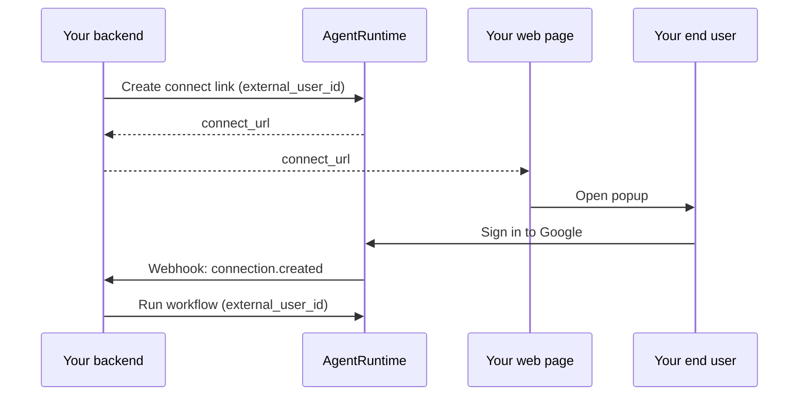

**Embedded Connect** is for software teams that want their customers to connect an account (for example Gmail) inside **their own product**, without those customers signing up for AgentRuntime. You are the AgentRuntime **workspace**. Your customers are **end users** that you identify with your own ID. AgentRuntime hosts the sign-in page, stores the credentials, and runs your workflows for each end user.

This guide assumes you can write a small backend (any language) and a web page that opens a popup.

<Note>
  Embedded Connect is offered to partners. To get set up or to ask a question, email [support@agentruntime.io](mailto:support@agentruntime.io).
</Note>

## What you will build

1. A backend call that asks AgentRuntime for a **connect link** for one of your users.
2. A popup in your web page that opens that link, where your user signs in to Google.
3. A **webhook** on your server that tells you the connection is ready.
4. A workflow run for that user, started with the same user ID.

| Who | Role |
|-----|------|
| **You** | Own one AgentRuntime workspace and pay for the runs |
| **Your customer (end user)** | Identified by your stable ID, called `external_user_id` |
| **AgentRuntime** | Hosts the connect page, stores tokens, runs workflows, and records usage per end user |

## How it works



## Before you begin

- An AgentRuntime workspace with billing set up, so runs can execute.
- A workflow that uses the end user's account. Its MCP steps must be set to use the end user's connection (see [Run a workflow for an end user](#run-a-workflow-for-an-end-user)).
- A server where you can keep a secret API key, and an internet-reachable HTTPS address for the webhook.

## Set up once

<Steps>
  <Step title="Create an API key">
    In the Console, open **Settings → API keys** and create a key from the **Embedded Connect** template. Keep it **only on your server**, for example in an environment variable. Never put it in a browser or mobile app. See [API authentication](/api/authentication).
  </Step>
  <Step title="Optional: show your own name on Google's consent screen">
    By default Google's consent screen shows AgentRuntime. To show your own app instead, create an OAuth client in Google Cloud Console. Then open **Settings → MCP & Integrations**, find **Google OAuth application**, and enter the **OAuth client ID** and **OAuth client secret**. Add the redirect URI shown on that page to your Google OAuth client.
  </Step>
  <Step title="Register your webhook">
    Set your webhook address and a signing secret of your choice with the API (shown below). There is no Console screen for this.
  </Step>
</Steps>

Register the webhook:

```http
PUT https://api.agentruntime.io/v1/embedded-connect/settings
Authorization: Bearer pat_xxxxxxxx
Content-Type: application/json

{
  "webhook_url": "https://api.yourproduct.com/agentruntime/webhook",
  "webhook_secret": "choose-a-long-random-secret"
}
```

`GET /v1/embedded-connect/settings` shows the saved address and whether a secret is set. It never returns the secret. Webhooks are sent only when the address and secret are both set and `enabled` is not `false`.

## Step 1: create a connect link

Call this from your **server** when a user clicks something like "Connect Gmail":

```http
POST https://api.agentruntime.io/v1/connect/link
Authorization: Bearer pat_xxxxxxxx
Content-Type: application/json

{
  "external_user_id": "cust_9182",
  "provider": "gmail",
  "services": ["gmail"]
}
```

| Field | Notes |
|-------|-------|
| `external_user_id` | Required. Your own stable ID for this customer. Letters, digits, `_` and `-` only, up to 256 characters. It only needs to be unique inside your workspace. |
| `provider` | Optional. Defaults to Google. `gmail`, `google`, and `google_account` all mean Google. |
| `services` | Optional list of Google services. Defaults to `["gmail"]`. |
| `metadata` | Optional object saved with the end user. |

The response has status `201`:

```json
{
  "connect_url": "https://…/connect/s/cs_abc123",
  "connect_session_id": "cs_abc123",
  "expires_at": "2026-08-13T10:05:00Z",
  "principal_id": "prin_…",
  "external_user_id": "cust_9182"
}
```

The link expires after **5 minutes**. Create a new one each time. If you suspended this end user, the call returns `403` with `principal_suspended`.

The first time you use an `external_user_id`, AgentRuntime creates the end user record for you (it appears under **Principals**, described below).

To check on a link, call `GET /v1/connect/sessions/{connect_session_id}`. The response includes its `status` and `expires_at`.

## Step 2: open the popup

Your server returns `connect_url` to your page, and your page opens it:

```javascript
async function connectGmail() {
  const res = await fetch("/api/connect-link", { method: "POST" }); // your backend
  const { connect_url } = await res.json();
  window.open(connect_url, "agentruntime-connect", "width=520,height=720");
}
```

The user sees an AgentRuntime page first and clicks to continue to Google. After they approve, they see a "Connected" page.

When the popup finishes, it also tries to send a browser message of the form `{ "type": "agentruntime-connect", "ok": true, "message": "…", "data": { … } }` to the window that opened it. Treat this only as a convenience for updating your page. Rely on the webhook, or on `GET /v1/connect/sessions/{id}`, to know the result.

One Google account can be linked to only one end user in your workspace. A second attempt with another `external_user_id` is refused.

## Step 3: receive the webhook

When an end user finishes connecting, AgentRuntime sends a `POST` to your webhook address:

```json
{
  "event": "connection.created",
  "tenant_id": "…",
  "external_user_id": "cust_9182",
  "principal_id": "prin_…",
  "connection_id": "conn_…",
  "provider": "google_account",
  "provider_account_key": "alice@gmail.com",
  "occurred_at": "2026-08-13T10:04:00Z"
}
```

Each request has an `X-Agentruntime-Signature` header of the form `t=<unix seconds>,v1=<hex>`. Compute HMAC-SHA256 of `"<t>." + raw body` with your `webhook_secret` and compare it with `v1`. This is the same scheme as [inbound webhooks](/integrations/inbound-webhooks#verify-signatures). Reject requests whose timestamp is far from the current time.

Saving `connection_id` is optional. If your own record disagrees with the webhook about whether a user is connected, trust the webhook.

## Run a workflow for an end user

First, in **Workflow Studio**, open each MCP step that should use the end user's account. In the step's **Connection at run time** setting, choose:

| Option | Meaning |
|--------|---------|
| **End user (principal)** | Use the end user's own connection, for example their Gmail. Choose this for per-user steps. |
| **Workspace (shared)** | Use the workspace's shared connection. |
| **Automatic (workspace default)** | Uses the workspace connection unless the step's connection is end-user scoped. Do not rely on this for per-user Gmail. |

Then start a run from your server with the same ID you used for the connect link:

```http
POST https://api.agentruntime.io/v1/workflows/{workflow_id}/command
Authorization: Bearer pat_xxxxxxxx
Content-Type: application/json

{
  "command": "execute",
  "params": { "external_user_id": "cust_9182" }
}
```

You never pass OAuth tokens. If the end user has not connected an account a step needs, the call fails with `principal_not_connected`. Show "Connect Gmail" in your product until you receive `connection.created`.

For scheduled work, loop over your customers and make this call for each one.

## Optional: end user records and groups

You can use the API to store details about your end users and pick groups of them.

| Method | Path | What it does |
|--------|------|--------------|
| `GET` | `/v1/principals` | List end users. Filters: `external_user_id`, `team`, `tag`, `provider`, `has_connection`, `status` |
| `GET` | `/v1/principals/{external_id}` | One end user and their connections |
| `PUT` | `/v1/principals/{external_id}` | Create or update details for one end user |
| `POST` | `/v1/principals/sync` | Create or update many end users: `{ "principals": [ … ] }` |
| `POST` | `/v1/principals/{external_id}/suspend` | Exclude the end user from runs |
| `DELETE` | `/v1/principals/{external_id}` | Delete the end user |
| `POST` / `DELETE` | `/v1/principals/{external_id}/link` | Link or unlink an end user to a workspace member |

A **segment** is a saved filter over your end users:

| Method | Path | What it does |
|--------|------|--------------|
| `GET` / `POST` | `/v1/principal-segments` | List or create segments: `{ "name": "…", "filter": { … } }` |
| `GET` | `/v1/principal-segments/{id}` | Get a segment |
| `GET` | `/v1/principal-segments/{id}/expand` | See who matches now |

A filter can use `include_tags`, `exclude_tags`, `team`, and `require_connection` (for example `"google_account"`). To run a workflow for everyone in a segment, send `"params": { "segment_id": "…" }` in the execute call.

In the Console, open **Principals** in the sidebar (or **Settings → Principals**) to see who has connected, edit their details, suspend or delete them, and work with segments. In **Workflow Studio → Schedule** you can pick a **Principal segment** so each scheduled run covers every matching end user.

## Usage and billing

You pay AgentRuntime for workflow runs from your workspace credits. AgentRuntime does not bill your end users; that is up to you. To pass costs on, export usage per end user:

```http
GET /v1/usage-history?group_by=principal&from=2026-08-01T00:00:00Z&to=2026-08-31T23:59:59Z
```

Each item includes `external_user_id`, `run_count`, and `total_delta_microcredits`.

## What each side stores

| You store | AgentRuntime stores |
|-----------|---------------------|
| `external_user_id` (required) | OAuth tokens (never sent to you) |
| Optionally the `connection_id` from the webhook | The end user record, connections, workflows, and run history |
| Your API key, on your server only | Usage per end user |

Two different workspaces can both use `"user_42"`. They do not see each other's data.

## Common problems

| Problem | What to do |
|---------|------------|
| `400` when creating a link | Check `external_user_id` (allowed characters, length) and `provider`. |
| `403` `principal_suspended` | The end user is suspended, so they cannot connect or run until that changes. Email [support@agentruntime.io](mailto:support@agentruntime.io) if you need help. |
| The popup says the link expired | Links last 5 minutes. Create a new one. |
| `409` `provider_account_already_linked` | That Google account is already linked to another of your end users. |
| `principal_not_connected` on a run | The end user has not connected the account the step needs. |
| No webhook arrives | Check that the address is reachable from the internet (use HTTPS), that a secret is set, and that `enabled` is not `false`. |

## Go-live checklist

- [ ] API key stored on your server only
- [ ] Webhook registered, and signature check tested
- [ ] Workflow MCP steps set to **End user (principal)** where needed
- [ ] Popup flow tested with a real Google account
- [ ] `external_user_id` is a stable ID from your own database
- [ ] Usage export tested, if you pass costs on

## Related

- [Integrations quickstart](/integrations/quickstart)
- [Connections](/integrations/connections)
- [Google Workspace](/integrations/google-workspace)
- [API authentication](/api/authentication)
- [Inbound webhooks](/integrations/inbound-webhooks)
- [Billing and credits](/platform/billing-and-credits)
