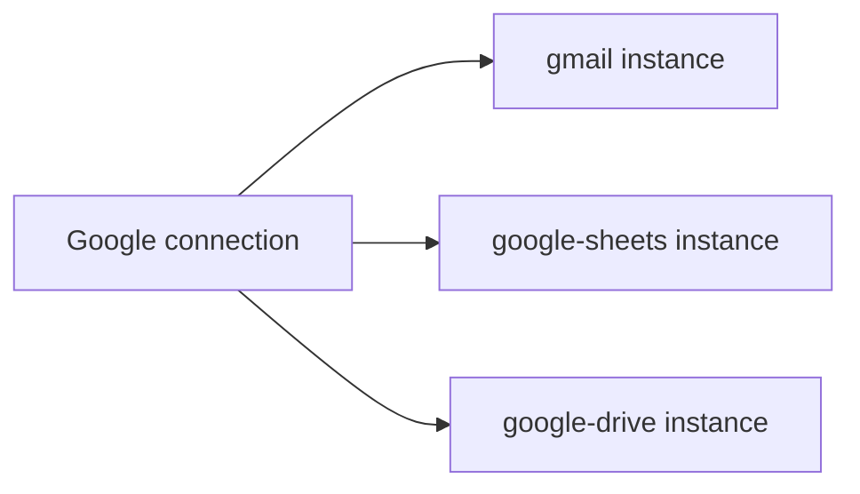

This page is for people who want workflows to use Gmail, Google Sheets, Google Calendar, and other Google services. You sign in with Google once, and several connectors can share that one connection.

## What you get

One Google connection can power many connectors. You add one **MCP instance** per connector, and each instance uses the same Google connection.

## Services you can pick

When you sign in, the services checklist offers these Google services. A green **· MCP** next to a name means its connector is ready.

| Service | Connector slug |
|---------|----------------|
| Gmail | `gmail` |
| Google Drive | `google-drive` |
| Google Sheets | `google-sheets` |
| Google Docs | `google-docs` |
| Google Slides | `google-slides` |
| Google Forms | `google-form` |
| Google Contacts | `google-contacts` |
| Google Chat | `google-chat` |
| Google Calendar | `google-calendar` |
| Google Tasks | `google-tasks` |
| Google Meet | `google-meet` |
| YouTube | `youtube` |
| Google Search Console | `google-search-console` |
| Google Business Profile | `google-business-profile` |
| Google Analytics | `google-analytics-4` |
| Google Ads | `google-ads` |

Connectors with their own guide are linked from the [connector catalog](/integrations/connector-catalog).

## Before you begin

- The **project_contributor** role or higher in your project.
- A Google account that can approve the permissions you request.
- A workspace selected in the Console header.

## Set it up

<Steps>
  <Step title="Sign in with Google">
    Open **Connections** and click **Sign in with Google**. Enter a **Display name** (for example `Work Google`).
  </Step>
  <Step title="Pick the services">
    Tick the services you need. **Select all** and **Clear all** are available. You must pick at least one.
  </Step>
  <Step title="Continue to Google">
    Click **Continue to Google**, choose your account, and approve the permissions. You return to the Console, and the account appears under **Accounts**.
  </Step>
  <Step title="Add a connector instance">
    Open **MCP**, click **Add connectors**, pick a connector such as `google-sheets`, and click **Add to workspace**.
  </Step>
  <Step title="Attach the Google connection">
    Open the instance. On **Instance config**, click **New profile**, choose your Google account in the credentials section, set **Status** to **Active**, click **Save**, then click **Use this profile for workflows**.
  </Step>
  <Step title="Check it">
    Run **MCP validation** for the connector, or run a small workflow that calls one read-only tool.
  </Step>
</Steps>

If **Sign in with Google** is missing or **Continue to Google** is disabled, Google sign-in is not set up for your workspace. Contact [support@agentruntime.io](mailto:support@agentruntime.io).

[Gmail](/connectors/gmail) has its own guide with tool details.

## Use your own Google app (optional)

By default, Google's consent screen shows AgentRuntime's app. To show your own app name instead, you can register your own Google Cloud OAuth client:

1. In the Console, open **Settings**, then **MCP & Integrations**.
2. Find **Google OAuth application**. Copy the authorized redirect URI shown there into your OAuth client in Google Cloud Console.
3. Turn on **Use workspace OAuth app**, enter a **Display name**, your **OAuth client ID**, and **OAuth client secret**, and save.

The client secret is stored in the Vault only.

## Add services or fix a broken connection

- **Add a service later:** open the Google account on **Connections** and click **Update permissions**. Google asks you to approve the new permissions.
- **Reconnect:** if access stops working (for example, someone revoked it), open the account and click **Reconnect** and approve again. Start a new run for any run that failed in the meantime.

## Example workflows

**Read a Sheet and email a summary**

1. `google-sheets` step: read a range.
2. A `lua` or `for_each` step: process the rows.
3. `gmail` step: `gmail_send_email` with the summary.

**Create a calendar event after approval**

1. `human` step: someone approves the meeting details.
2. `google-calendar` step: create the event.

See [Workflow patterns](/workflows/patterns) for approve-then-send and webhook triggers.

## Common problems

| Problem | What to do |
|---------|------------|
| A `403` mentions permissions or scopes | Open the account, click **Update permissions**, tick the service, and approve. |
| A `404` not found | Check the file, calendar, or spreadsheet ID in the tool arguments. |
| Google access stopped working | Click **Reconnect** on the account. |
| Works in testing but not in production | Use a separate instance and profile that point to the production Google account, and select the right instance on each step. |

See [Troubleshooting](/platform/troubleshooting) for more.

## Related

- [Connections](/integrations/connections)
- [MCP instances](/integrations/mcp-instances)
- [Connector catalog](/integrations/connector-catalog)
