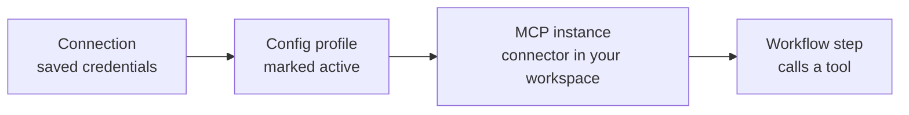

Before a workflow can send an email, read a spreadsheet, or message a customer, AgentRuntime needs permission to use that service. This page explains how that permission is stored and wired up, and the two ways you can give it.

**Who this is for:** anyone connecting a service for the first time, and admins deciding whether to use AgentRuntime's app or their own.

**What you will learn:** the four pieces that make up a connected service, the difference between **Use AgentRuntime's app** and **Use your own app**, and which one to pick.

## The four pieces

Connecting a service is always the same chain. A workflow step at the end of the chain is what actually uses it.

| Piece | What it is | Where you manage it |
|-------|------------|---------------------|
| **Connection** | Saved credentials for one outside service: a Google sign-in, a WhatsApp Business account, an API key, or a database connection string. Secrets are kept in the Vault and are not shown in plain text again. | **Connections** in the sidebar |
| **MCP instance** | Your workspace's copy of a connector. A connector is a set of tools for one service, such as Gmail or Postgres. | **MCP** in the sidebar, then **Add connectors** |
| **Config profile** | A saved setup on an instance that says which connection it uses. An instance can have several profiles. Only the profile marked **active** is used by workflows. | The instance's **Instance config** page |
| **Workflow step** | An `mcp` step that picks an instance and one of its tools. At run time AgentRuntime calls the tool with the credentials from the instance's active profile. | **Workflow Studio** |

A connection does nothing by itself. It starts working when an active profile on an instance points at it. This is why a tool can fail with "no credentials" even though you saved a connection: the connection exists, but no active profile uses it.

For the click-by-click steps, see [Connections](/integrations/connections) and [MCP instances](/integrations/mcp-instances).

## Two ways to connect a service

For services that sign in with OAuth or Meta, you can choose whose app is in the middle.

- **Use AgentRuntime's app.** You sign in through the app that AgentRuntime has already registered with the service. There is nothing to create or approve.
- **Use your own app (white-label).** Your workspace registers its own app with the service and gives AgentRuntime the app's credentials. Sign-ins from your workspace then go through your app.

Many services need neither choice. If a service uses an API key, you always paste your own key, and there is no AgentRuntime app involved.

### Use AgentRuntime's app

This is the default. It is the fastest way to start.

| Service | What you do | Where |
|---------|-------------|-------|
| **Google** (Gmail, Drive, Sheets, Calendar, and others) | Click **Sign in with Google**, pick the services, and approve the permissions on Google's consent screen. The screen shows AgentRuntime as the app. | **Connections**. See [Google Workspace](/integrations/google-workspace). |
| **WhatsApp** | Click **Connect WhatsApp Business** under **Connect with Meta**, then complete Meta's signup in the popup and select your own business phone number. AgentRuntime is a Meta Tech Provider, so you do not need to create a Meta app. | **Connections**, **Add from template**, then **Connect** on the **WhatsApp** row. See the [WhatsApp connector](/connectors/whatsapp). |
| **Other services that offer sign-in** (Notion, for example) | Click **Connect** on the service's row under **Accounts**. | **Connections**, **Add from template** |

<Frame caption="Add from template lists the sign-in services under Accounts, then the API-key services">
  
</Frame>

If a sign-in button is disabled, that sign-in is not set up for your workspace. [Contact support](mailto:support@agentruntime.io).

### Use your own app (white-label)

Use this when you want the sign-in screen to carry your brand, or when you want your own app's limits and approval status instead of AgentRuntime's.

| Service | What you do | Where |
|---------|-------------|-------|
| **Google** | Create an OAuth client in Google Cloud, copy the redirect URI from the Console into it, then enter your **OAuth client ID** and **OAuth client secret**. | **Settings**, **MCP & Integrations**, **Google OAuth application** |
| **Other OAuth services** | The same form, on its own card titled with the service name followed by **OAuth application**. A service gets a card only when AgentRuntime has enabled own-app sign-in for it, so the cards on that tab are the services you can use this way. | **Settings**, **MCP & Integrations** |
| **WhatsApp** | There is no own-app setting. If you manage your own Meta business account and token, open **Paste API keys** and enter the **Access token**, **WhatsApp Business Account ID**, and optionally the **Phone number ID**. | **Connections**, **Add from template**, **Connect** on the **WhatsApp** row |
| **API-key services** (Resend, GitHub, Shopify, and more) | You always use your own key. Paste it into a connection. | **Connections**, **Add from template** or **New custom connection** |
| **Database connectors** (Postgres and others) | You always use your own connection string. | **Connections** |
| **Custom MCP servers** | You run the server and its credentials stay yours. See [Custom MCP servers](/integrations/custom-mcp-servers). | **MCP**, **Add connectors**, **Add connector** |
| **AI models** | Add your own provider key, such as OpenAI or Anthropic, instead of using AgentRuntime's models. | **Providers**, **Add workspace key**. See [LLM providers](/ai/llm-providers). |

To set up your own Google app:

<Steps>
  <Step title="Open the settings card">
    In the [Console](https://console.agentruntime.io), open **Settings**, then **MCP & Integrations**. Find **Google OAuth application**. The card shows **OAuth client in use** as **Platform default** until you change it.
  </Step>
  <Step title="Create the app in Google Cloud">
    In Google Cloud Console, create an OAuth 2.0 client of type **Web application**. Add the **authorized redirect URI** shown on the card, exactly as written. The copy button on the card copies it for you.
  </Step>
  <Step title="Enter your app's details">
    On the card, turn on **Use workspace OAuth app**. Enter a **Display name**, your **OAuth client ID**, and your **OAuth client secret**, then save.

    You should see the badge **OAuth client in use** change to **Your workspace app**.
  </Step>
  <Step title="Sign in again">
    New Google sign-ins from **Connections** now use your app. Existing connections keep working with their current tokens until the person reconnects.
  </Step>
</Steps>

If you turn **Use workspace OAuth app** off, AgentRuntime's app is used again, even though your credentials stay saved. The client secret is kept in the Vault and is never shown again.

<Note>
  Google decides whether an app can request sensitive permissions without warnings. With your own Google app you manage that in your own Google Cloud project, including your app's name, logo, test users, and verification. That is part of the effort of this option.
</Note>

## Compare the two

| | **Use AgentRuntime's app** | **Use your own app** |
|---|---|---|
| **Setup effort** | A few clicks. No app to create. | You create and maintain an app with the service, then enter its credentials once. |
| **Whose name the end user sees** | AgentRuntime's, on Google's and Meta's screens | Your app's name and logo (Google and other OAuth services). WhatsApp has no own-app setting. |
| **Who owns the app's limits and quotas** | AgentRuntime's app | Your app, in your own account with the service |
| **Who can set it up** | `project_contributor` or higher | Own-app settings: workspace Admin or Owner, or `project_admin` |
| **Choose it when** | You are starting out, testing, or building for your own team | Your customers will see the sign-in screen, or you need your own limits and approval status |

For AI models the same idea applies. **Platform** models use keys AgentRuntime provides, and your plan must include them. If it does not, a step fails with an error saying your plan does not include platform-hosted models and asking you to add your own API key or upgrade. **Workspace keys** are your own provider keys, so the provider bills you and applies your own rate limits. On an LLM step you choose the **Model**, then the **API key**: the platform default or one of your workspace keys.

## Who can do what

| Task | Role you need |
|------|---------------|
| See connections, instances, and profiles | `project_viewer` or higher |
| Add or change a connection, add an instance, edit a profile, register a custom MCP server | `project_contributor` or higher |
| Add or change a workspace AI key on **Providers** | `project_contributor` or higher |
| Delete a connection or an instance | `project_admin` |
| Save or change an own-app setting under **Settings**, **MCP & Integrations** | Workspace Admin or Owner, or `project_admin` |

See [Roles and permissions](/platform/roles-permissions) for how roles are assigned. A person without the right role sees disabled buttons, or a permission error when they save.

## Who can see and use a connection

A connection you add in the Console belongs to the workspace. Members with `project_viewer` or higher can see that it exists, and members with `project_contributor` or higher can attach it to an instance's profile and use it in workflows. Because a workflow runs through the instance's active profile, every run of a workflow that uses that instance acts through that connection's account (except steps set to use an end user's own connection, see [Embedded Connect](/integrations/embedded-connect)). Connect with an account you are happy for the workflow to act as.

Some accounts belong to one member. These are accounts a member connected for their own use. Only that member can use, change, or delete them. Workspace admins can see them, read-only, under **Members' private connections** on the **Connections** page.

## Let your own customers connect

**Embedded Connect** is a third case. Instead of you connecting an account, your own end users connect theirs inside your product, and your workflows run on their behalf. It is offered to partners. See [Embedded Connect](/integrations/embedded-connect).

## Common problems

| Problem | What to do |
|---------|------------|
| A tool says it has no credentials | Open the instance's **Instance config**, make sure a profile uses the connection, and click **Use this profile for workflows**. |
| A sign-in button is disabled | That sign-in is not set up for your workspace. [Contact support](mailto:support@agentruntime.io). |
| The Google consent screen still shows AgentRuntime after you added your own app | Check that **Use workspace OAuth app** is on and **OAuth client in use** reads **Your workspace app**. Then sign in again. Old connections keep their old tokens. |
| Google rejects the sign-in with a redirect error | The redirect URI in your Google client must match the one on the card exactly. |
| A step fails with "your plan does not include platform-hosted models" | Add your own key on **Providers**, then pick it on the step. |

## Next steps

- [Connections](/integrations/connections): add, test, and rotate credentials
- [MCP instances](/integrations/mcp-instances): add a connector and wire it
- [Google Workspace](/integrations/google-workspace)
- [Integration authentication](/integrations/authentication)
- [Embedded Connect](/integrations/embedded-connect)
