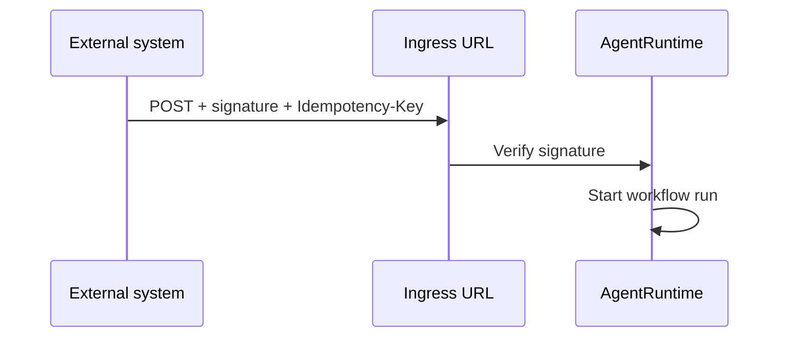

An **inbound webhook** is a web address that starts a workflow run when an outside system sends it a request. This page is for developers who need to connect a system such as a payment provider, a CI job, or their own backend to a workflow. Each webhook (called a **subscription**) is linked to one workflow in your project.

**What you need:** a saved workflow, the **project_contributor** role, and an API key under **Settings → API keys**. The Console steps are in the [Inbound webhook wizard](/integrations/inbound-webhook-wizard).

<Note>
  **Generally available.** If the **Inbound** tab or the Settings list is missing in your workspace, contact [support@agentruntime.io](mailto:support@agentruntime.io).
</Note>

## How it works



1. You create a **subscription** linked to a workflow
2. AgentRuntime returns an **ingress URL** and **signing secret** (shown once at creation)
3. Senders POST to the ingress URL with a signature header and an `Idempotency-Key`
4. AgentRuntime verifies the signature and starts a run with the POST body as workflow input. The run executes as the **automation API key** you chose when creating the subscription

Saved **Run setup** defaults from Workflow Studio are **not** applied to webhook runs. The run gets only the request body and what you set in the subscription `extras`. See [Run setup](/workflows/run-setup).

## Create a subscription in the Console

<Steps>
  <Step title="Open Workflow Studio">
    Open the target workflow at `/workflow/{workflow_id}`. Save it first — unsaved drafts cannot subscribe.
  </Step>
  <Step title="Workflow config → Inbound tab">
    In the workflow configuration panel, open the **Inbound** tab. (The same subscriptions also appear under **Settings → Inbound webhooks** for workspace-wide management.)
  </Step>
  <Step title="Name and automation API key">
    Enter a subscription name. Choose the **Automation API key** the runs should execute as, or paste the `pat_…` secret once if the Console cannot load it automatically.
  </Step>
  <Step title="Create and copy secrets">
    Click **Create subscription**. Copy the **Signing secret** and **Ingress URL** immediately — the secret is not shown again.
  </Step>
  <Step title="Test">
    POST a signed test request from your external system (see [Verify signatures](#verify-signatures)).
  </Step>
</Steps>

<Warning>
  Never expose signing secrets or automation PATs in client-side code or public repositories. Rotate immediately if compromised.
</Warning>

## Create via API

Requires **project_contributor**:

```
POST /v1/inbound-webhooks
```

Request body:

```json
{
  "workflow_id": "your-workflow-uuid",
  "name": "shopify-orders",
  "automation_pat_id": "optional-pat-id",
  "automation_bearer": "pat_…"
}
```

Use `automation_pat_id` to reference an existing API key, or `automation_bearer` to pass the `pat_…` secret directly. The response includes `ingress_url`, `ingress_path`, `signing_secret`, and `subscription`. List and delete:

```
GET /v1/inbound-webhooks
DELETE /v1/inbound-webhooks/{id}
```

Public ingress (no session cookie; authenticated by the signature):

```
POST /v1/inbound-webhooks/{subscription_id}
```

## Verify signatures

Senders must include:

| Header | Value |
|--------|--------|
| `X-Agentruntime-Signature` | `t=<unix seconds>,v1=<hex HMAC-SHA256>` |
| `Idempotency-Key` | A unique key per event, so retries do not start duplicate runs |
| `Content-Type` | `application/json` for JSON bodies |

Compute the HMAC-SHA256 of `"<t>." + raw body` with the signing secret, where `<t>` is the same Unix timestamp you put in the header. Requests whose timestamp is more than about five minutes from the current time are rejected.

```python
import hmac
import hashlib
import time

def sign_body(payload_body: bytes, secret: str) -> str:
    t = int(time.time())
    msg = f"{t}.".encode() + payload_body
    digest = hmac.new(secret.encode(), msg, hashlib.sha256).hexdigest()
    return f"t={t},v1={digest}"
```

You do not need to send the automation API key on ingress requests; it is stored with the subscription.

### Responses

| Status | Meaning |
|--------|---------|
| `202` | Run started; the body contains the run details |
| `200` with `"duplicate": true` | An earlier request with the same `Idempotency-Key` already started a run; its `run_id` is returned |
| `400` | Missing `Idempotency-Key` or signature header, invalid signature, or invalid JSON |
| `404` | Unknown subscription |
| `409` | A request with the same `Idempotency-Key` is still in progress |
| `429` | Rate limit exceeded; honor the `Retry-After` header |

Request bodies are limited in size (1 MB by default).

## Payload and workflow input

For a JSON object body, the fields are mapped to **`trigger_payload`** (for `{{input.*}}`). Reference fields in steps with `{{input.field_name}}`.

Saved **Run setup** defaults from Studio are never merged into a webhook run. To give every run a fixed value, put it in the subscription `extras` as shown below; the request body wins where both set the same key. See [Run setup](/workflows/run-setup) and [External triggers](/workflows/external-triggers).

Set `extras` on create (`POST /v1/inbound-webhooks`) or update later (`PATCH /v1/inbound-webhooks/{id}`):

```json
{
  "extras": {
    "trigger_payload": { "source": "shopify" }
  }
}
```

Design workflows with a first step that validates required input (a `lua` step) before calling external tools.

## Example request

```bash
BODY='{"order_id": "5678901234"}'
T=$(date +%s)
SIG=$(printf '%s.%s' "$T" "$BODY" | openssl dgst -sha256 -hmac "$SIGNING_SECRET" | sed 's/^.* //')

curl -X POST 'https://api.agentruntime.io/v1/inbound-webhooks/{subscription_id}'   -H 'Content-Type: application/json'   -H "Idempotency-Key: order-5678901234"   -H "X-Agentruntime-Signature: t=$T,v1=$SIG"   -d "$BODY"
```

A `202` response means a run started.

## Console walkthrough

For the Console screens (Workflow Studio **Inbound** tab, **Settings → Inbound webhooks**, and Autopilot chat), see the [Inbound webhook wizard](/integrations/inbound-webhook-wizard).

## Common problems

| Problem | What to do |
|---------|------------|
| `400` "invalid signature" | Sign the exact raw body bytes, with the timestamp from the header, using the signing secret. Check that your server clock is correct (the timestamp must be within about five minutes). |
| `400` about `Idempotency-Key` | Add an `Idempotency-Key` header with a unique value per event. |
| `200` with `"duplicate": true` | You sent the same `Idempotency-Key` twice. Use a new key for a new event. |
| `429` | You are sending too fast. Wait for the `Retry-After` period. |
| No run appears | Check that the workflow is saved and, if you chose **Last published**, that a version is published. |

## Related

- [Inbound webhook wizard](/integrations/inbound-webhook-wizard) — Console UI walkthrough
- [API examples — inbound webhooks](/api/examples#create-inbound-webhook-subscription)
- [End-to-end guides](/guides/overview) — recipes that start with webhooks
- [Workflow patterns](/workflows/patterns#inbound-webhook-triggers)
- [API reference — inbound webhooks](/api/reference#inbound-webhooks)
- [Feature availability](/platform/feature-availability)
