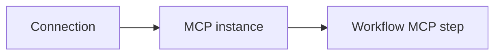

This guide is for anyone who wants a workflow to use an outside service such as Gmail, Postgres, or Shopify. By the end you will have one working connector that a workflow step can call.

## How integrations fit together

Three things work together:

1. **Connection** — your saved credentials (an OAuth sign-in or an API key). Secrets are stored in the Vault and are not shown again after you save them.
2. **MCP instance** — your workspace's copy of a connector from the catalog. A connector is a set of **tools**, such as "send email" or "run query". The instance remembers which connection it should use.
3. **Workflow step** — an MCP step in a workflow that calls one tool on the instance.

## Before you begin

- The **project_contributor** role (or higher) in your project. Without it, the buttons on the **Connections** and **MCP** pages are disabled and show "You need MCP write permission".
- A workspace selected in the Console header.
- The credentials for the tool you want to connect: a Google account, an API key, or a WhatsApp Business account.

## Steps

<Steps>
  <Step title="Save your credentials as a connection">
    1. Open **Connections** in the [Console](https://console.agentruntime.io).
    2. Click **Add from template** and pick your service. Services that sign in with OAuth (Google, WhatsApp) are listed under **Accounts**. API-key services are listed under **API keys & credentials**.
       If your service is not listed, click **New custom connection** instead.
    3. Follow the prompts and click **Save**.

    You should see the new connection under **Saved connections**. See [Connections](/integrations/connections) for each flow.
  </Step>
  <Step title="Add the connector to your workspace">
    1. Open **MCP** in the sidebar. The page is titled **MCP connectors**.
    2. Click **Add connectors**. The **App catalog** opens.
    3. Select a connector (for example `gmail` or `postgres`) and click **Add to workspace**.

    A new instance appears on the **MCP connectors** page.
  </Step>
  <Step title="Tell the instance which connection to use">
    1. Open the instance. You land on **Instance config**.
    2. Under **Profiles for this connector**, click **New profile** (or open an existing one).
    3. Choose your connection in the credentials section, set **Status** to **Active**, and click **Save**.
    4. Click **Use this profile for workflows**.

    The profile now shows an **active** badge. Workflows use the active profile.
  </Step>
  <Step title="Check that it works (recommended)">
    Open the connector's server page and its **MCP validation** page, then click **Run checks**. Or run a small workflow that calls a single read-only tool.
  </Step>
  <Step title="Call the tool from a workflow">
    1. In **Workflow Studio**, add an MCP step. (In workflow JSON the step type is `mcp`.)
    2. Choose your instance and a tool.
    3. Fill in the tool arguments. You can use values from earlier steps with template variables.

    See [Workflow Studio](/workflows/studio) for the editor.
  </Step>
  <Step title="Run it">
    Click **Dry-run** to check the workflow, publish it, and start a run. Open the run's event log to see what the tool returned.
  </Step>
</Steps>

## Common problems

| Problem | What to do |
|---------|------------|
| **New custom connection** or **Add connectors** is greyed out | You need MCP write permission (the `project_contributor` role or higher), and a workspace must be selected. |
| The tool is not offered in Workflow Studio | Make sure the instance has an **active** profile with a connection, then reload the workflow. |
| A run fails with an authorization error | Open the connection and click **Test**, or re-enter the key with **Rotate**. For Google, click **Reconnect**. |

## Next steps

- [Connections](/integrations/connections) — Google, WhatsApp, and API-key flows
- [MCP instances](/integrations/mcp-instances) — profiles in detail
- [Connector catalog](/integrations/connector-catalog) — connectors with their own pages
- [Authentication methods](/integrations/authentication) — OAuth, API keys, and connection strings
