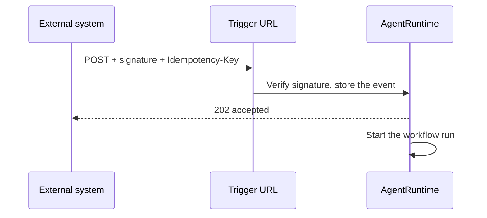

A **trigger** is a saved rule that starts one workflow when something happens. This page is for developers who want to connect a system to a workflow: a payment provider, a CI job, your own backend, or an app such as GitHub. It explains how the signed HTTP call works and how triggers from connected apps behave. To set triggers up step by step in the Console, see [External triggers](/workflows/external-triggers).

**What you need:** a saved workflow and the **project_contributor** role. If you call the API with an API key, see [Scopes](#scopes) for what the key needs.

## The five kinds of trigger

Every trigger is one of these kinds. In the Console you pick one under **What should start this workflow?**

| Kind | What starts the run | Console choice |
|------|---------------------|----------------|
| `schedule` | A cron expression, for example every weekday at 09:00 | **On a schedule** |
| `connector` | An event in an app you connected, such as a Telegram message, a GitHub event, or a WhatsApp message | **In an app you connected** |
| `http` | Another system sends a signed request to a URL | **When another system calls a URL** |
| `platform_event` | Something changes in your workspace, such as an end user or a connection being created | **When something changes in your workspace** |
| `phone` | Someone calls a phone number | **When someone calls a number** |

Each trigger listens for one event, can filter it, and starts one workflow. It also says which version of the workflow to run and who the run is for. A workflow can have several triggers.

## How an HTTP trigger works



1. You create an **HTTP trigger** linked to a workflow.
2. AgentRuntime shows the **URL to call** and the **signing secret**. The secret is shown once.
3. The sender sends a `POST` to that URL with a signature header and an `Idempotency-Key` header.
4. AgentRuntime checks the signature, stores the event, and answers `202`. The run starts right after, with the request body as its input.

A `202` means "accepted", not "started". The run starts a moment later. If AgentRuntime is briefly unavailable, it retries the start for you (see [Retries and Replay](#retries-and-replay)). To see what happened to each request, open the trigger's **Activity**.

The run executes as the person the trigger runs as, not as an API key. See [Who a trigger runs as](#who-a-trigger-runs-as).

The defaults you save with **Save defaults** in Workflow Studio are **not** applied to trigger runs. The run gets the request body plus the start values you saved on the trigger. See [Run setup](/workflows/run-setup).

## Create an HTTP trigger in the Console

<Steps>
  <Step title="Open Workflow Studio">
    Open the target workflow at `/workflow/{workflow_id}`. Save it first, because an unsaved draft cannot have triggers.
  </Step>
  <Step title="Open the Triggers tab">
    Click **Setup**, then **Triggers**. Click **Add a trigger**. If the workflow has no triggers yet, the form is already open.
  </Step>
  <Step title="Choose the HTTP call">
    Under **What should start this workflow?**, pick **When another system calls a URL**.
  </Step>
  <Step title="Fill in the form">
    Type a **Name** if you want one. Under **When it is called**, keep **Start a run** for the usual case. Choose which version **Runs** (**Live** or **Last published**). Leave **Run as** on you unless you are a workspace admin and want a different member. Add start values if every run needs a fixed value.
  </Step>
  <Step title="Create it and copy the secret">
    Click **Create trigger**. A dialog called **Trigger created** opens with **URL to call**, **Signing secret** and an **Example call**. Copy the secret now. Click **Done** when you have saved it.
  </Step>
  <Step title="Test it">
    Send a signed request from your system (see [Verify signatures](#verify-signatures)), or open the trigger and click **Test**.
  </Step>
</Steps>

**What you should see:** the trigger in the list under **Starts this workflow** with the status **Active**. After a request arrives, the trigger's **Activity** list shows it with the status **Started** and an **Open run** button.

<Warning>
  Never put a signing secret in client-side code or a public repository. If it leaks, open the trigger and click **New signing secret**. Systems that use the old secret stop working until you give them the new one.
</Warning>

## Create an HTTP trigger with the API

Needs the `project_contributor` role. With an API key, the key also needs `webhook:manage`.

```
POST /v1/triggers
```

```json
{
  "workflow_id": "your-workflow-uuid",
  "name": "shopify-orders",
  "kind": "http",
  "event": "request",
  "version": "live"
}
```

| Field | What it is |
|-------|------------|
| `workflow_id` | The workflow to start |
| `name` | A label for lists and for the runs the trigger starts |
| `kind`, `event` | `http` and `request` for an HTTP trigger |
| `version` | `live` (the default), `published` (the newest published version), or a version number |
| `start_input` | Fixed start values. See [Payload and workflow input](#payload-and-workflow-input). |
| `run_as` | `{ "user_id": "..." }`. Leave it out to run as you. Naming someone else needs a workspace admin. |
| `config` | `{ "mode": "agent_inbox" }` for [agent inbox mode](#agent-inbox-mode). Leave it out to start runs. |

The response is `201` with the `trigger`, the `ingress_url` to give the sender, and the `signing_secret`. The secret is shown **once**. Read, change, and remove triggers with:

```
GET /v1/triggers?workflow_id=WORKFLOW_ID
GET /v1/triggers/{id}
PATCH /v1/triggers/{id}
DELETE /v1/triggers/{id}
POST /v1/triggers/{id}/rotate-secret
```

The public URL the sender calls (no session cookie; the signature is the authorization):

```
POST /v1/triggers/{trigger_id}/events
```

Every trigger route is in the [API reference](/api/reference#triggers). For a worked example, see [API examples](/api/examples#create-an-http-trigger).

## Verify signatures

Senders must include:

| Header | Value |
|--------|--------|
| `X-Agentruntime-Signature` | `t=<unix seconds>,v1=<hex HMAC-SHA256>` |
| `Idempotency-Key` | A unique key per event, so retries do not start duplicate runs. Required. |
| `Content-Type` | `application/json` for JSON bodies |

Compute the HMAC-SHA256 of `"<t>." + raw body` with the signing secret, where `<t>` is the same Unix timestamp you put in the header. Requests whose timestamp is more than about five minutes from the current time are rejected.

```python
import hmac
import hashlib
import time

def sign_body(payload_body: bytes, secret: str) -> str:
    t = int(time.time())
    msg = f"{t}.".encode() + payload_body
    digest = hmac.new(secret.encode(), msg, hashlib.sha256).hexdigest()
    return f"t={t},v1={digest}"
```

You do not send an API key or token on these requests. The signature is the only credential.

### Example request

```bash
BODY='{"order_id": "5678901234"}'
T=$(date +%s)
SIG=$(printf '%s.%s' "$T" "$BODY" | openssl dgst -sha256 -hmac "$SIGNING_SECRET" | sed 's/^.* //')

curl -X POST 'https://api.agentruntime.io/v1/triggers/TRIGGER_ID/events' \
  -H 'Content-Type: application/json' \
  -H "Idempotency-Key: order-5678901234" \
  -H "X-Agentruntime-Signature: t=$T,v1=$SIG" \
  -d "$BODY"
```

**What you should see:** `202` with a body that has an `event_id`, `"duplicate": false`, and the fires it created. The run starts a moment later and shows in **Runs**.

### Responses

| Status | Meaning |
|--------|---------|
| `202` | Accepted. The event is stored and the run starts right after. |
| `200` with `"duplicate": true` | An earlier request with the same `Idempotency-Key` was already accepted. Nothing new starts. |
| `400` | Invalid signature, missing `Idempotency-Key` or signature header, or invalid JSON |
| `403` | The trigger is disabled or paused |
| `404` | Unknown trigger |
| `413` | The body is larger than 1 MiB |
| `429` | Rate limit exceeded (600 requests a minute for each trigger and sender IP address). Honor the `Retry-After` header. |

## Payload and workflow input

For a JSON object body, the fields become **`trigger_payload`**, which steps read with `{{input.field_name}}`. A body that is not a JSON object, such as plain text, arrives as `{{input.payload_raw}}`.

You can also save fixed start values on the trigger. They are merged under the request body, and the request wins where both set the same key. Set them when you create the trigger or later with `PATCH /v1/triggers/{id}`:

```json
{
  "start_input": {
    "trigger_payload": { "source": "shopify" }
  }
}
```

Keys in the request that would steer the run itself, such as model or credential settings, are ignored. A sender can supply data, not choose how the run executes.

Design workflows with a first step that validates the required input (a `lua` step) before calling external tools. See [Run setup](/workflows/run-setup) and [External triggers](/workflows/external-triggers).

## Retries and Replay

Senders retry, and so does AgentRuntime. Both are safe when you follow these rules.

| What | How it works |
|------|--------------|
| **Sender retries** | Send the same `Idempotency-Key` for the same event. A repeat answers `200` with `"duplicate": true` and starts nothing. |
| **Start retries** | If AgentRuntime is briefly unavailable when a run should start, it tries again, up to six tries over several hours. After the last try the event shows in **Activity** as **Gave up**. |
| **Replay** | A person with the `project_contributor` role can click **Replay** next to an event in **Activity** to start a new run from the stored event. The same call is `POST /v1/triggers/{id}/fires/{fire_id}/replay`. |
| **How long events are kept** | The event body is kept for 7 days. After that **Replay** is switched off for that event. The activity rows are kept for 90 days. |

Make the workflow safe to run twice for the same event: look up whether the order or event was already handled, or pass an external id to the tool so a duplicate does not send twice.

## Agent inbox mode

An HTTP trigger can also add a message to an agent session that is already running, instead of starting a run. In the form, choose **Add a message to a running agent session** under **When it is called**. In the API, set `config.mode` to `agent_inbox`.

The sender calls a second URL with the same signature headers:

```
POST /v1/triggers/{trigger_id}/agent-inbox
```

```json
{ "run_id": "the-running-run-id", "content": "The customer replied: yes" }
```

The **Trigger created** dialog shows this URL for a trigger in this mode. The run must be one that can take messages while it works. If it cannot, the call is refused.

## Triggers from connected apps

A trigger can listen to events in an app you connected. Today this covers Telegram, GitHub, Fathom, payments.lk and WhatsApp. In the form, each connection is its own choice, such as **Telegram, @mybot**. An app you have not connected yet is listed under **Connect an app to use more**.

- Each trigger watches one event of that app. If you tick several events in the form, the Console creates one trigger for each.
- **Filters** narrow the trigger to the events you care about, for example one Telegram chat. An empty filter matches every event of that type.
- Other options, such as which GitHub repository to watch, appear under **Options at the provider**.

How the app learns the address depends on the app:

| App | What happens |
|-----|--------------|
| Telegram, GitHub, Fathom | AgentRuntime registers the webhook with the app for you. There is nothing to copy. |
| payments.lk | A dialog called **One more step at the provider** shows a URL and the steps to paste it into the provider's dashboard. The trigger waits until the provider starts sending events to that URL. |
| WhatsApp | Nothing to do. Messages reach the trigger through your connection, matched by your business phone number. |

When you delete the last trigger on a connection, AgentRuntime removes the webhook at the provider. If registration fails, the trigger is saved with the status **Needs attention** and shows the provider's error. Open the trigger to read it and try again. **Renew route** makes a new address for the connection and registers it again. It affects every trigger on that connection.

To try an app trigger without waiting for a real event, open it and click **Test**. This sends a sample event through the normal path and **starts a real run**.

Create one with the API by naming the app and the connection, using the exact event and filter names from `GET /v1/trigger-catalog`:

```json
{
  "workflow_id": "your-workflow-uuid",
  "name": "Support chat",
  "kind": "connector",
  "event": "message",
  "source": { "server_id": "telegram", "connection_id": "your-connection-id" },
  "filter": { "chat_id": ["123"] }
}
```

For WhatsApp triggers, the **Conversation** options decide whether each contact gets one ongoing conversation. See the [WhatsApp connector](/connectors/whatsapp).

## Who a trigger runs as

A trigger runs as a person. By default that is the person who creates it. A workspace admin can choose another member in the **Run as** field. No API key is stored on a trigger, and none is needed.

AgentRuntime checks that person's access again every time the trigger starts a run. If they are removed from the workspace, or lose the right to run the workflow, the trigger pauses itself. Its status changes to **Needs an owner** and the trigger shows "This trigger paused because (the person) can no longer run it." A workspace admin opens the trigger and clicks **Run it as me**, and the trigger runs again as the admin. An admin can also pick another member in **Edit**.

A trigger on a workspace event runs as the end user the event is about. See [Triggers and run identity](/workflows/trigger-run-identity).

## Scopes

If you use an API key, it needs these scopes. With a Console session, your role decides. See [API authentication](/api/authentication).

| What you do | Scope the key needs |
|-------------|---------------------|
| Read triggers and their activity | `workflow:read` or `webhook:read` |
| Create, change, pause, test, replay, or delete a trigger | `workflow:edit`, `workflow:run`, or `webhook:manage` |
| Create an HTTP, app, or phone trigger, or make a new signing secret | `webhook:manage` as well |

`webhook:manage` includes `webhook:read`.

## Common problems

| Problem | What to do |
|---------|------------|
| `400` "invalid signature" | Sign the exact raw body bytes, with the timestamp from the header, using the signing secret. Check that your server clock is correct (the timestamp must be within about five minutes). |
| `400` about `Idempotency-Key` | Add an `Idempotency-Key` header with a unique value per event. |
| `200` with `"duplicate": true` | You sent the same `Idempotency-Key` twice. Use a new key for a new event. |
| `403` | The trigger is paused or disabled. Open it in **Runs → Triggers** and click **Resume**. If it says **Needs an owner**, click **Run it as me** (workspace admins). |
| `404` | The trigger ID is wrong, or the trigger was deleted. |
| `429` | You are sending too fast. Wait for the `Retry-After` period. |
| `202`, but no run appears | A `202` only means the event was accepted. Open the trigger's **Activity** to see why the start did not happen, for example that the person it runs as lost access, or that your workspace is out of credits. See [Billing and credits](/platform/billing-and-credits). |
| The run uses old behavior | The trigger runs **Last published** or a fixed version. Edit the trigger and choose **Live**, or publish and switch it. |
| You lost the signing secret | Open the trigger and click **New signing secret**. The new secret is shown once. |

## Related

- [External triggers](/workflows/external-triggers): set up each kind in the Console
- [Triggers and run identity](/workflows/trigger-run-identity): who a run is for
- [API examples: create an HTTP trigger](/api/examples#create-an-http-trigger)
- [API reference: triggers](/api/reference#triggers)
- [Workflow patterns: HTTP triggers](/workflows/patterns#http-triggers)
- [End-to-end guides](/guides/overview): recipes that start with triggers
- [Feature availability](/platform/feature-availability)
