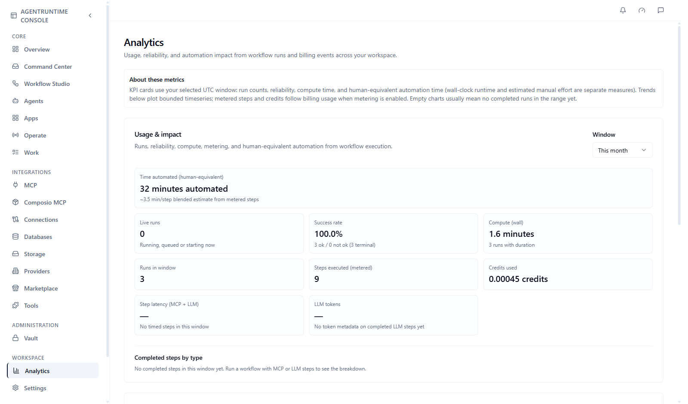

This page is for anyone who wants to know how well their workflows are running. You will learn what each number on the **Analytics** page means and where it comes from.

## Open Analytics

Click **Analytics** in the Console sidebar, in the **Run** group.

**You should see:** a **Usage & impact** section with number cards, then **Workflow and metering trends** with charts.

<Frame caption="The Analytics page">
  
</Frame>
 If you do not see **Analytics**, your role may not include it, or the page is not turned on for your workspace.

## Usage & impact

The cards use the **Window** you choose: **This month**, **This week** or **All time**. Times are in UTC.

| Card | What it shows |
|------|---------------|
| **Time automated (human-equivalent)** | An estimate of the manual effort your finished steps saved. It is the first and largest number on the page, but it is a guess, not a measurement: it multiplies your steps by about 3.5 minutes each (the card says "~3.5 min/step blended estimate from metered steps"). Three short sample runs can read as nearly an hour. Compare it with **Compute (wall)**, the real clock time. |
| **Live runs** | Runs in progress right now. Refreshes about every 25 seconds. |
| **Success rate** | Share of finished runs that succeeded. Shown once there are at least 3 finished runs. |
| **Compute (wall)** | Total clock time your runs took |
| **Runs in window** | Runs started in the chosen window |
| **Steps executed (metered)** | Steps counted for billing |
| **Credits used** | Credits used in the window. Shown in **credits**, for example `0.00015 credits`. Billing shows the same balance in dollars. See [Credits and dollars](#credits-and-dollars). |
| **Step latency (MCP + LLM)** | How long tool and AI model steps took |
| **LLM tokens** | AI model tokens in and out, when recorded |

Below the cards, **Completed steps by type** breaks finished steps down by type, using the same names as the Studio canvas, such as **MCP**, **LLM** and **Human**.

<Warning>
  **A rejected approval counts as a success.** If a person rejects an approval and the run ends as **Success** (see [Human tasks](/workflows/human-tasks#on-reject)), **Success rate** counts it as a success. Five runs, three of them rejected, read **100%** with "5 ok / 0 not ok". The card also shows "ok / not ok (N terminal)" under the percentage.
</Warning>

<Note>
  **Success rate** shows **-** while there are too few finished runs. In testing, one finished run showed **-** with "1 ok / 0 not ok (1 terminal)", and five finished runs showed 100%. The Console does not say what the minimum is.
</Note>

<Note>
  **Steps executed (metered)** counts billing events. It can differ from the number of completed steps, because billing and run history are recorded separately.
</Note>

## Workflow and metering trends

Choose a **Range** (**Last 30 days (UTC)** or **Month to date (UTC)**) and a **Granularity** (**Day** or **Week**). Three charts follow:

- **Runs started over time**
- **Metering volume over time** — steps and credits. It can be empty or zero until usage is recorded.
- **Compute time over time**

## Credits and dollars

One credit is worth $10 of face value, so a dollar amount is a small fraction of a credit: $0.0015 is 0.00015 credits. **Analytics** and **Usage & impact** show **credits**. **Billing** and the credits panel in the top bar show **dollars**. They are the same measure in two units, so a balance of $14.99 on **Billing** and `0.00015 credits` used on **Analytics** are not in conflict. See [Billing and credits](/platform/billing-and-credits#credits-and-dollars).

## Analytics and billing

| Page | Best for |
|------|----------|
| **Analytics** | Trends: success rate, run volume, time saved |
| **Billing → Usage** | Your credit balance and individual charges |

See [Billing and credits](/platform/billing-and-credits).

## For developers

The same numbers are available from the API under `/v1/analytics/`, for example `live-runs`, `success-rate`, `runs-count`, `credits-consumed`, `steps-summary`, `runs-timeseries` and `usage-timeseries`. Use `window=month|week|all`, or `from` and `to`. See the [API reference](/api/reference#analytics).

## Common problems

| Problem | What to try |
|---------|-------------|
| **Analytics** is missing from the sidebar | Ask a workspace admin to check your role. |
| Success rate shows **-** | There are too few finished runs in the window. Try **All time**. |
| Credits show 0 | No usage has been recorded in the window yet. |
| Charts say "No runs in this range" | Run a workflow, or widen the range. |
| A card says it is unavailable | Try again later, then contact [support](mailto:support@agentruntime.io). |

## Next steps

- [Billing and credits](/platform/billing-and-credits)
- [Runs and Command Center](/workflows/runs-and-command-center)
- [Feature availability](/platform/feature-availability)
