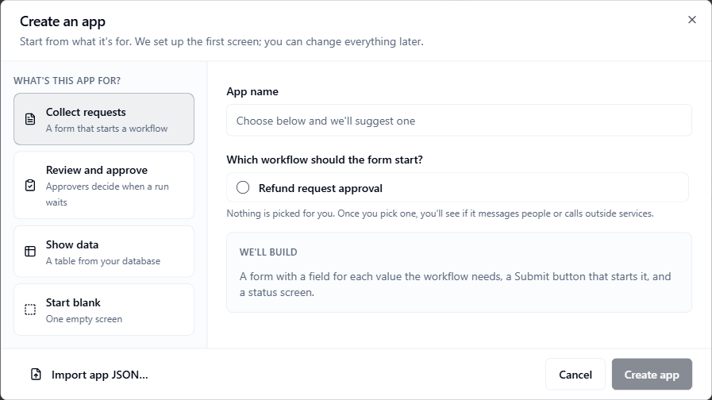
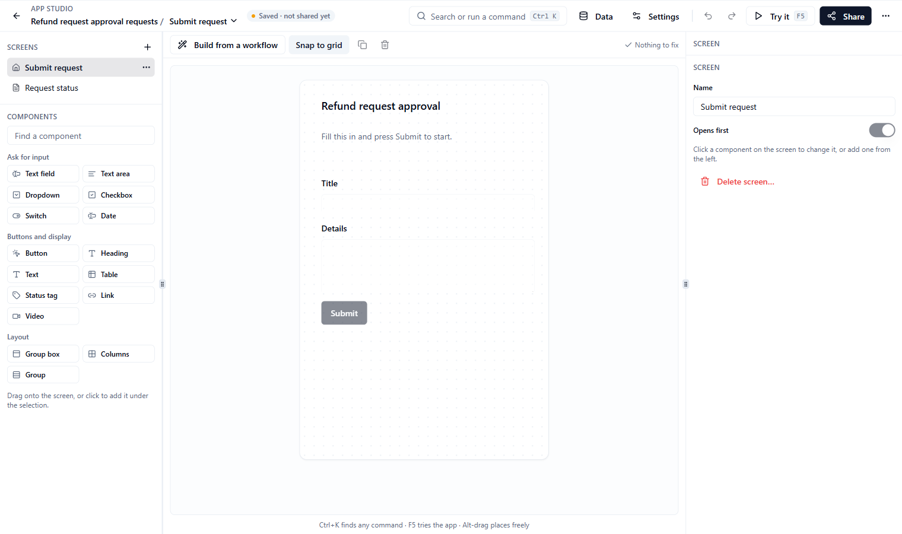

An **app** is a set of screens that people use instead of the workflow editor. A screen can hold a form, a table, and buttons. A button can start a workflow. An approval screen can open when a run waits for a decision. You build apps in **App Studio**, a drag-and-drop editor.

**Who this is for:** anyone who builds screens for teammates on top of workflows. People who only use an app need no setup. They open it from **Apps** in the sidebar, or from a link you send them.

**What you will do on this page:** create an app, add components and screens, connect a button to a workflow, test the app, share it, and link an approval step to a screen.

Most apps work with a workflow, so have one ready. A **Show data** or **Start blank** app does not need one. See [Workflow Studio](/workflows/studio).

## How an app fits together

| Term | What it means |
|------|---------------|
| **App** | The whole thing: a name, its screens, and its data. |
| **Screen** | One page of the app. The screen marked **Opens first** is the one people see first. |
| **Component** | One item on a screen, such as a text field, a table, or a button. |
| **Data** | A table from one of your [databases](/platform/databases-and-storage) that a screen shows. |
| Draft and shared version | Your edits are a draft. When you click **Share**, people see that version. See [Share an app](#share-an-app). |

## Create an app

<Steps>
  <Step title="Open the Apps page">
    In the [Console](https://console.agentruntime.io) sidebar, click **Apps**. When you have no apps yet, the page says **Build your first app**. Click **Create app**. The **Create an app** dialog opens.
  </Step>
  <Step title="Pick a starter">
    Under **What's this app for?**, choose a starter. The **We'll build** box shows what you will get. See the table below.
  </Step>
  <Step title="Name it">
    Type an **App name**. After you pick a workflow or a table, the Console suggests a name. Type your own to replace it.
  </Step>
  <Step title="Create it">
    Click **Create app**. App Studio opens on the first screen.
  </Step>
</Steps>

| Starter | Use it to | What you choose | What you get |
|---------|-----------|-----------------|--------------|
| **Collect requests** | Show a form that starts a workflow | The workflow the form starts | A **Submit request** screen with one field for each input the workflow lists (or, if it lists none, each value its steps read) and a **Submit** button that starts it. A **Request status** screen follows, with a **New request** button. If the workflow neither lists nor reads inputs, the form starts with **Title** and **Details** fields. |
| **Review and approve** | Let approvers decide when a run waits | The workflow that waits, and **The step that waits** if it has more than one approval step | A **Review** screen with the step's editable fields and two buttons, **Approve** and **Send back**. The screen is already linked to the waiting step. |
| **Show data** | Show a table from your database | A **Database** and a **Table** | One screen with a heading and a read-only table. You can add filters or edit the SQL later in **Data**. |
| **Start blank** | Build everything yourself | Nothing | One empty screen named **Main**. |

<Note>
  Nothing is picked for you in the workflow list. After you pick one, the list labels workflows that message people or call outside services. If the picker says the workflow has no saved version, you can still create the app. Its buttons will not run until the workflow has a saved version.
</Note>

**Review and approve** only works with a workflow that has an approval step. If the workflow has none, the dialog says so. Add a human approval step in [Workflow Studio](/workflows/studio), or pick another workflow.

<Frame caption="Create an app: pick a starter and a workflow">
  
</Frame>

### Import an app

Click **Import app JSON…** at the bottom left of the **Create an app** dialog and choose a file you exported earlier. A **From a file** option appears with the app's name. The **We'll build** box shows how many screens and data sources the file holds. Click **Create app**.

Workflow links in the file point at the original workflows. If a workflow does not exist in this workspace, Studio shows **Choose the workflows this screen uses**. Pick a workflow for each one, then click **Use these workflows**. While workflows are unlinked, the app's card on the **Apps** page can say **Needs setup**.

## The Apps page

The **Apps** page lists your apps as cards. Use **Search apps…** to filter them. Each card shows the app's name, its description, how many screens it has, and whether it is shared (for example **Not shared yet** or **v2 shared**). Click a card to open the app. Click **Studio** to edit it.

The **⋯** menu on a card has **Open app**, **Edit in Studio**, **Copy link**, and **Delete app**. A card can also show a badge:

| Badge | Meaning |
|-------|---------|
| **Needs setup** | A screen uses a workflow that is not linked to this workspace yet. Open Studio and choose the workflow to use. |
| **Things to fix** | A screen shows a value from a workflow step that is missing, or from a workflow with no saved version. Open Studio to see what to fix. |

An empty **Apps** page also has a **Browse marketplace** button.

To delete an app, open the **⋯** menu on its card and click **Delete app**. Deleting an app does not affect your workflows or their runs. You cannot undo it.

## Edit an app in App Studio

App Studio opens when you create an app, or when you click **Studio** or **Edit in Studio**. It has four areas.

| Area | What it holds |
|------|---------------|
| Top bar | **All apps** (back to the list), the app name with a screen switcher, a save status chip, **Search or run a command**, **Data**, **Settings**, **Undo**, **Redo**, **Try it**, **Share**, and a **More** menu |
| Left panel | The **Screens** list and the **Components** palette |
| Middle | The canvas, with a toolbar above it |
| Right panel | Settings for the open **Screen**, or for the **Selected** component |

In a narrow window, some top bar buttons show only an icon.

<Frame caption="App Studio, editing the first screen of a new app">
  
</Frame>

### Save as you go

Studio saves your changes for you after a short pause. The chip in the top bar shows where you are: **Saving…**, **Saving soon**, **Saved · not shared yet**, **Saved · v2 shared, draft has changes**, or **Saved**. If a save fails, the chip says **Save failed · Retry**. Click it to try again. Press Ctrl+S to save right away.

### Add components

The **Components** palette has three groups:

| Group | Components |
|-------|------------|
| **Ask for input** | **Text field**, **Text area**, **Dropdown**, **Checkbox**, **Switch**, **Date** |
| **Buttons and display** | **Button**, **Heading**, **Text**, **Table**, **Status tag**, **Link**, **Video** |
| **Layout** | **Group box**, **Columns**, **Group** |

Drag a component onto the canvas, or click it to add it under the selected component. Type in **Find a component** to filter the palette.

**Snap to grid** is on by default. Hold Alt while you drag to place a component freely. Click a component to select it, then change it in the right panel. Use **Duplicate** or **Remove** in the toolbar, or press Ctrl+D or Delete.

To rename a screen, or to choose which screen opens first, press Esc to clear the selection. The right panel then shows the **Screen** settings: **Name** and **Opens first**. To rename the whole app or change its description, click **Settings** in the top bar, open the **Details** tab, and click **Save details**.

### Connect a button to a workflow

When you add a **Button** to the canvas, Studio asks what the button should do. Pick one:

| Choice | What it does |
|--------|--------------|
| **Start a workflow** | Sends what is typed on this screen to a workflow |
| **Go to another screen** | Opens another screen in this app |
| **Show a message** | Shows a short note at the top of the screen |
| **Open a link** | Opens a web page in a new tab |
| **Decide later** | Keeps a **Set action** tag on the button until you choose |

**More options…** opens the full list of steps you can add. To set or change a button's action later, select the button. In the right panel, under **When clicked**, click **Set action…** (or **Edit steps…** if it already has steps). The steps run in order, top to bottom. A table has the same kind of setting under **When a row is clicked**, and a **Dropdown**, **Checkbox** or **Switch** has one under **When it changes**.

### Build a screen from a workflow

Click **Build from a workflow** above the canvas. The **Import from workflow** dialog opens. Pick a **Workflow**, then choose a tab:

- **Workflow inputs** adds a field for each input the workflow lists. **Add Start button** is ticked at first. Leave it ticked to also add a **Submit** button that starts the workflow. Click **Import inputs**.
- **Gate fields** adds the editable fields of an approval step. Pick the **Human task gate**, then click **Import gate fields**.

If the workflow has no inputs or no such approval step, the tab tells you.

### Fill a component with data

Next to a component's value, rows, or options, click **Fill from…**. The dialog asks where the component gets its value. The choices that appear depend on the component:

| Choice | What it does |
|--------|--------------|
| **The person types it** or **Fixed text** | A starting value, or text that never changes |
| **A workflow step's result** | A value from the run this screen shows |
| **The run's status** | Running, waiting, done, and so on |
| **Your data** | Rows from a table, for tables and dropdowns |
| **An app setting** | A value you set once for the whole app |
| **Write the binding** | Advanced: write the binding as JSON |

Click **Use this value** (or **Use this data**) to save it.

To manage the tables an app shows, click **Data** in the top bar. The **Data** dialog lists each one and whether a screen uses it. Click **Add data** for a new one, or **Edit as SQL** to change the query by hand. To set values once for the whole app, click **Settings**, open the **Settings** tab, and click **Add setting**.

### Add and remove screens

- **Add a screen:** click **Add screen** (the **+** next to **Screens**), type a **Screen name**, and click **Add**.
- **Choose the first screen:** open the **⋯** menu next to a screen and click **Open this screen first**.
- **Delete a screen:** open the **⋯** menu and click **Delete screen**. This also unlinks any approval steps that open it, and you cannot undo it. An app always keeps at least one screen.

### Fix problems before you share

The toolbar shows **Nothing to fix** or a button such as **2 things to fix**. Click it to see a list. Each row says what is wrong and has a button that takes you to the fix, for example a button with no action yet.

## Test an app with Try it

Click **Try it** (or press F5). Studio saves your edits and opens the app in a dialog. Use the app exactly as people will.

**Test mode** is on when the dialog opens. In test mode, buttons check what they would send and run nothing. The **What happened** list shows each click and the fields it would send. Open **Technical details** to see the full request.

To run for real, turn **Test mode** off and confirm **Turn off test mode**. The dialog then shows **Real runs**. Real runs can message people and use credits. You can also click **Run it for real** under a tested click and confirm **Start real run**. A real run links to its run in Workflow Studio. Use **Reset the form** to clear the fields, and **Back to design** to close the dialog.

## Share an app

Click **Share** in the top bar. The **Share** dialog shows an **App link** with a **Copy** button. People in your workspace can open the app from **Apps**, or with the link.

Under **Before you share**, the dialog lists your screens and anything still to fix. You can share anyway. People will run into those problems.

Click **Share** in the dialog to create a version. Click **Add a note for version history** first if you want to say what changed. After you share:

- People see the shared version.
- Your later edits stay in draft. The chip in the top bar says **draft has changes**, and the button changes to **Share changes**.
- Click **Share changes** when you want people to see the new edits. When everything is shared, the button in the dialog says **Everything is shared** and is disabled.

Before your first share, people who open the app see your latest saved changes.

### Version history

Every time you share, Studio keeps a version. Open **More**, then **Version history…** (or use the link in the **Share** dialog) to see them. Click **Restore** on a version and confirm to copy it into your draft. This replaces your current draft, and screens that are not in that version are removed from the draft. People keep seeing the shared version until you share again.

## Publish to marketplace

To give an app to other workspaces, open **More** and click **Publish to marketplace…**. The **Publish app to marketplace** dialog asks for:

| Field | What to enter |
|-------|---------------|
| **Package ID** | A name for the package, such as `mp-my-app` |
| **Version** | A version number. It starts at `1`. |
| **Visibility** | **Share link only (unlisted)**, **Organization marketplace** (the default), or **Public marketplace** |

Click **Publish**. The dialog says it snapshots the app, its screens, and the workflow packages it links. The workflows must already be published as workflow packages.

## Export and edit as JSON

- **Export app JSON** (in **More**) downloads the app as a `.json` file. It holds the app, its screens, and its data. It does not include your workflows. Use it to back up an app or to move it with **Import app JSON…**.
- **Edit screen as JSON…** (in **More**) shows the open screen as JSON. Click **Apply** to replace the screen. **Undo** brings the old screen back.
- In **Settings**, the **Settings** tab has an **Edit as JSON** toggle for the app's settings values.
- **Delete app…** (in **More**) opens the **Danger zone** tab of **App settings**. Deleting removes every screen, its data, and its approval links. Your workflows are not touched. People lose access right away.

## Link an approval step to a screen

A workflow with a human approval step waits for a person to decide. You can show that person a screen from your app. Command Center then has an **Open app** button on the task.

<Steps>
  <Step title="Build the screen">
    The easiest way is the **Review and approve** starter. It makes the screen and links it for you. You can also build a screen yourself, for example with **Build from a workflow** and **Gate fields**.
  </Step>
  <Step title="Link the step">
    In Studio, click **Settings**, then open the **Approval steps** tab. It lists the approval steps of the workflows that the open screen uses, and any step you already linked. For each step, pick a screen under **Choose a screen**. Pick **Don't show a screen** to unlink it.
  </Step>
  <Step title="Save">
    Click **Save approval steps**. You should see "Approval steps saved".
  </Step>
</Steps>

When a run reaches that step, its task in [Command Center](/workflows/command-center) appears under **Needs your attention** with an **Open app** button. The button opens the app on that screen, for that run and task. The task can still be answered from Command Center.

If the step has already finished, the screen can say "This step is closed — nothing left to do here." If the screen cannot be changed right now, it can say "This screen is read-only right now." See [Human tasks](/workflows/human-tasks) for how approvals work.

## Keyboard shortcuts

Press ? in Studio (when you are not typing in a field) to see the list. On a Mac, use ⌘ instead of Ctrl.

| Action | Keys |
|--------|------|
| Search and commands | Ctrl K |
| Try it | F5 |
| Save now | Ctrl S |
| Undo | Ctrl Z |
| Redo | Ctrl Y |
| What happens when clicked | Enter |
| Duplicate | Ctrl D |
| Remove | Delete |
| Nudge one grid step | Arrows |
| Nudge one pixel | Shift Arrows |
| Place freely while dragging | Alt |
| Clear the selection | Esc |
| This list | ? |

A few details:

- Ctrl K, Ctrl S and F5 work even while you type. The other shortcuts are ignored while you type in a field or have a dialog open.
- Enter opens the click steps of a selected **Button** or **Table**.
- The arrow keys move a selected component by one grid step when **Snap to grid** is on, and by one pixel when it is off.
- Ctrl Shift Z also redoes, and Backspace also removes a selected component.

### The command palette

Press Ctrl K, or click **Search or run a command**, to open the palette. While Studio is open, it replaces the Console's usual Ctrl K search. Type to filter. Press Enter to run a command and Esc to close. Commands come in five groups:

| Group | What it holds |
|-------|---------------|
| **Add to this screen** | Every component in the palette |
| **Commands** | **Try it**, **Share**, **Undo**, **Redo**, snap to grid on or off, **Build from a workflow**, **Edit screen as JSON**, **Export app JSON**, **Version history**, **Publish to marketplace**, **Keyboard shortcuts** |
| **Go to** | Each screen in the app |
| **Select** | Each component on the open screen |
| **Data and settings** | **Data**, **App settings**, **Approval steps**, and an edit-as-SQL entry for each data item |

## Build apps with an AI assistant

An AI assistant can build apps for you through [Platform MCP](/api/platform-mcp). Its `surfaces_*` tools build and publish apps. An assistant works best when it reads the [Platform MCP authoring skills](/api/platform-mcp-authoring-skills), which include a guide for apps. Apps it builds appear in **Apps** like any other.

## Common problems

| Problem | What to try |
|---------|-------------|
| People do not see my latest edits | You shared a version earlier. Click **Share changes**. |
| The card says **Needs setup** | Open Studio and pick the workflow to use in **Choose the workflows this screen uses**. |
| A button does nothing | It has no action yet. Select it and click **Set action…** under **When clicked**. The **things to fix** list also points to it. |
| Try it starts nothing | **Test mode** is on. That is the default. Turn it off to run for real. |
| The chip says **Save failed · Retry** | Click it to try again. If it keeps failing, copy your work out with **Edit screen as JSON…** before you leave. |
| There is no **Open app** button in Command Center | The approval step is not linked. Link it in **Settings**, **Approval steps**, and click **Save approval steps**. |
| A shortcut does nothing | You are typing in a field, or a dialog is open. Click the canvas and try again. |

## Next steps

- [Databases, Storage and Work](/platform/databases-and-storage): the tables an app can show
- [Command Center](/workflows/command-center): where approval tasks and **Open app** appear
- [Human tasks](/workflows/human-tasks): how approvals and replies work
- [Workflow Studio](/workflows/studio): build the workflows your app uses
- [Platform MCP authoring skills](/api/platform-mcp-authoring-skills): guides for AI assistants that build apps
