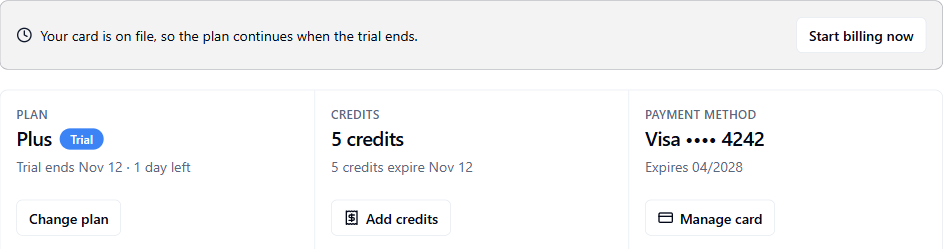

This page is for people who pay for AgentRuntime or want to understand what uses credits. You will learn where billing lives in the Console, who can change it, and where to find the details.

<Note>
  Billing is in early access. Plans, prices and how usage is counted in credits may change. [Plans and credits](/platform/plans-and-credits) holds the current prices and amounts, and the **Plans** tab in the Console always shows what applies to your workspace today.
</Note>

## Credits in one minute

AgentRuntime measures usage in **credits**. When your workflows run, they use credits from your workspace balance. There are two kinds:

- **Model credits** pay for AI model calls that AgentRuntime pays the provider for.
- **Platform credits** pay for what AgentRuntime itself does, such as running workflow steps.

Credits come from a free trial, from your plan, from top-ups you buy, and from referral rewards. Top-up credits do not expire. See [Plans and credits](/platform/plans-and-credits) for the details and the current numbers.

## Where to manage billing

Open **Settings** in the [Console](https://console.agentruntime.io). Billing has three tabs:

| Tab | What you can do |
|-----|-----------------|
| **Billing Overview** | See your plan, credits and card, add credits, move credits, read your billing history, and see who is billed |
| **Plans** | Compare plans, start a trial, subscribe, upgrade, downgrade or cancel. Enter a **Promo or referral code** here. |
| **Usage & History** | See **Credits remaining** and the **Usage history** list |

<Frame caption="Billing Overview: an alert about the trial, then your plan, credits and payment method">
  
</Frame>

**Billing Overview** has:

- **An alert at the top**, only when something needs you: a payment that is past due, a payment waiting for your bank, a trial that is running or has ended, or a subscription that is ending.
- **A summary row** with three boxes: **Plan** (the plan name, a status label such as **Active**, **Trial** or **Ending**, and the next date), **Credits** (your balance, with **Add credits**) and **Payment method** (your card, with **Add card** or **Manage card**). A line under it says who is billed.
- **Billing history**, one line per payment. See [Billing history and invoices](/platform/billing-history-and-invoices).
- **Billing contact and who pays**, a section you can open to see the billing contact and switch between workspace billing and personal billing.

## Who can change billing

Everyone with project access can look at plans and usage. Only workspace admins (`tenant_admin`) and people with billing write access can change plans, manage the card, add credits or apply codes. If the buttons are disabled, ask an admin.

## Billing guide

<CardGroup cols={2}>
  <Card title="Plans and credits" icon="layers" href="/platform/plans-and-credits">
    The two kinds of credit, where credits come from, and all current prices and amounts.
  </Card>
  <Card title="Free trial" icon="clock" href="/platform/trials">
    What the trial includes and what happens when it ends.
  </Card>
  <Card title="Subscribe, change plan and cancel" icon="sliders-horizontal" href="/platform/subscribe-and-change-plan">
    When each change takes effect.
  </Card>
  <Card title="Add credits" icon="zap" href="/platform/top-up-credits">
    Top up, split a top-up, move credits and see the limits.
  </Card>
  <Card title="Bank confirmation (3-D Secure)" icon="shield-check" href="/platform/bank-confirmation">
    What to do when your bank asks you to confirm a payment.
  </Card>
  <Card title="Payment methods" icon="credit-card" href="/platform/payment-methods">
    Add or update a card and see who is billed.
  </Card>
  <Card title="Billing history and invoices" icon="file-text" href="/platform/billing-history-and-invoices">
    How to read each row and status.
  </Card>
  <Card title="Taxes on your payments" icon="globe" href="/platform/taxes">
    What is charged today and what to expect.
  </Card>
  <Card title="Referrals and affiliates" icon="users" href="/platform/referrals-and-affiliates">
    Share a code and earn referral rewards.
  </Card>
  <Card title="Billing FAQ" icon="circle-help" href="/platform/billing-faq">
    Short answers to common questions.
  </Card>
  <Card title="Billing troubleshooting" icon="life-buoy" href="/platform/billing-troubleshooting">
    Declined cards, past due payments, missing credits.
  </Card>
</CardGroup>

## See what you used

Open **Settings → Usage & History**. **Credits remaining** shows your balance. **Usage history** lists each charge with its date.

**Analytics** also shows credits used over time, next to your run counts. See [Analytics](/platform/analytics).

## For developers

You can read billing data from the [API](/api/reference#billing-endpoints), for example `GET /v1/billing/usage` for your balance and `GET /v1/billing/usage-history` for charges. Changing plans and adding credits should be done in the Console.

## Next steps

- [Plans and credits](/platform/plans-and-credits)
- [Billing troubleshooting](/platform/billing-troubleshooting)
- [Analytics](/platform/analytics)
- Legal terms: [Billing and Credits Policy](https://agentruntime.io/legal/billing-and-credits-policy)
