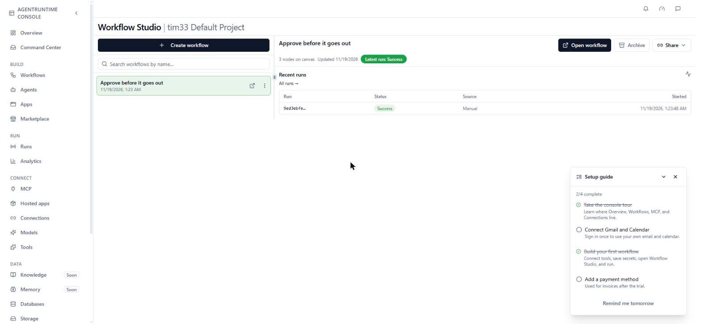
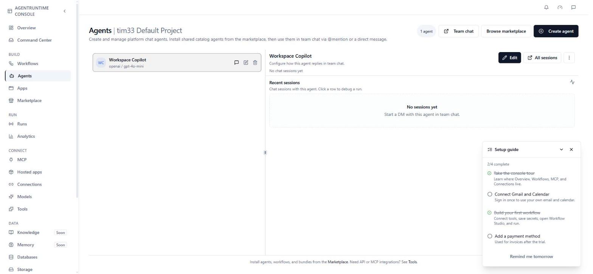
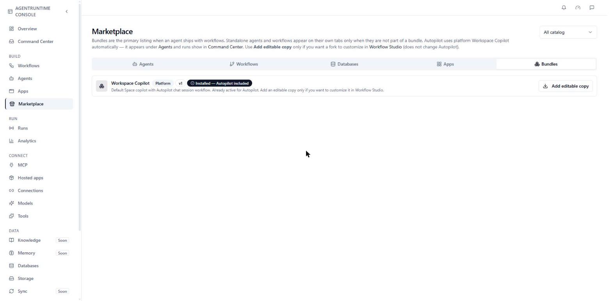
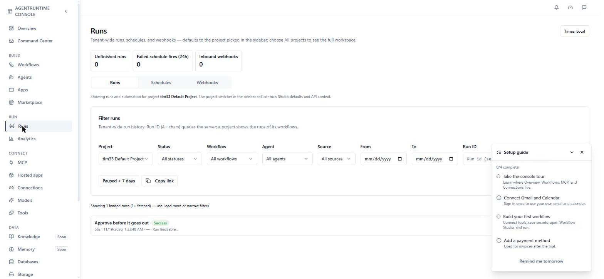

The sidebar on the left is your map of the [Console](https://console.agentruntime.io). This page lists each item in the order you see it and points to the guide for it.

**Who this is for:** anyone new to the Console who wants to know what each sidebar item is for.

<Frame caption="The Console sidebar next to the Workflows page">
  
</Frame>

## At the top

| Item | What it is | Guide |
|---|---|---|
| **Overview** | Your home page. It shows **Get started** until your first successful run, then your workspace metrics. | [Run your first workflow](/platform/first-run) |
| **Command Center** | The inbox for tasks that wait for a person, and for runs in progress. A badge shows how many need you. | [Command Center](/workflows/command-center) |

## Build

| Item | What it is | Guide |
|---|---|---|
| **Workflows** | Create, open, share, and archive workflows. Opens Workflow Studio. | [Workflow Studio](/workflows/studio), [Create a workflow](/workflows/create-a-workflow) |
| **Agents** | AI agents that your workflows and chat can use. | [Agents](/ai/agents) |
| **Apps** | Simple pages, such as request forms and approval screens, built on your workflows. | [Apps](/platform/apps) |
| **Marketplace** | Ready-made workflows and other packages to install. | [Apps](/platform/apps), [Feature availability](/platform/feature-availability) |

<Frame caption="Agents">
  
</Frame>

<Frame caption="Marketplace">
  
</Frame>

## Run

| Item | What it is | Guide |
|---|---|---|
| **Runs** | Every run in the selected project, with filters and a **Times** toggle for local or UTC time. | [Runs and Command Center](/workflows/runs-and-command-center), [Operate](/platform/operate) |
| **Analytics** | Usage and results over time. | [Analytics](/platform/analytics) |

<Frame caption="Runs">
  
</Frame>

## Connect

These four pages are close relatives: each one sends you to another. Start with the guide on how connecting works.

| Item | What it is | Guide |
|---|---|---|
| **MCP** | The connectors installed in your workspace, with their settings. | [MCP instances](/integrations/mcp-instances) |
| **Hosted apps** | A second view of the same area for managed third-party apps. | [Hosted apps](/integrations/mcp-instances#hosted-apps) |
| **Connections** | Saved sign-ins and credentials for outside services. | [Connections](/integrations/connections) |
| **Models** | The AI models your agents and workflows can use, and where their keys come from. | [LLM providers](/ai/llm-providers) |
| **Tools** | A library of the tools your connectors provide. | [How connecting works](/integrations/how-connecting-works) |

## Data

| Item | What it is | Guide |
|---|---|---|
| **Knowledge** | Marked **Soon**. Not available yet. | [Feature availability](/platform/feature-availability) |
| **Memory** | Marked **Soon** in the Console. Memory works through the API only. | [Memory](/ai/memory) |
| **Sync** | Marked **Soon**. Not available yet. | [Feature availability](/platform/feature-availability) |
| **Databases** | Tables of structured data your workflows and agents can read and write. | [Databases and storage](/platform/databases-and-storage) |
| **Storage** | Files your workflows and agents can use. Deleting a file asks for no confirmation. | [Databases and storage](/platform/databases-and-storage) |

<Warning>
  **Knowledge**, **Memory**, and **Sync** carry a **Soon** badge. Do not plan around them yet.
</Warning>

## Admin

| Item | What it is | Guide |
|---|---|---|
| **Secrets** | API keys and passwords you keep for your agents and tools. It appears only when you have access. | [Settings](/platform/settings) |
| **Billing** | Plan, credits, payment method, and invoices. | [Billing and credits](/platform/billing-and-credits) |
| **Settings** | Workspace name, members, API keys, webhooks, audit log, and your own access. | [Settings](/platform/settings), [Invite a teammate](/platform/invite-a-teammate) |

The sidebar can also show **Work**, and **Referrals** when the referral program is on for your workspace. Which pages appear depends on what is turned on for your workspace. See [Shortcuts and links](/platform/shortcuts-and-links).

## The top bar and the project switcher

Three icons sit at the top right with no text labels: the bell, the credits icon, and the speech bubble. The bell and credits icon are explained in [Notifications and the credits panel](/platform/notifications-and-credits-panel). The speech bubble opens the chat panel: see [Autopilot and chat](/ai/autopilot-and-chat).

Under the sidebar groups, the **Working in** switcher chooses the workspace and the project. Every page shows the project you pick there. On a short window it can sit below the visible part of the sidebar: scroll down to find it.

Your own profile has its own page: see [Your profile and account](/platform/your-profile-and-account).

## Next steps

- [Run your first workflow](/platform/first-run)
- [Key concepts](/platform/key-concepts)
- [Shortcuts and links](/platform/shortcuts-and-links)
- [Use the Console on a phone or tablet](/platform/phone-and-tablet)
