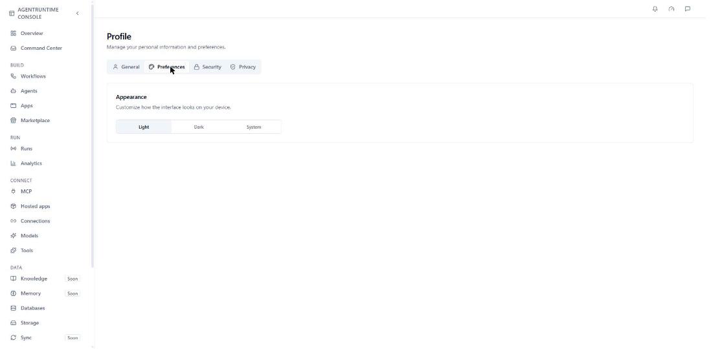
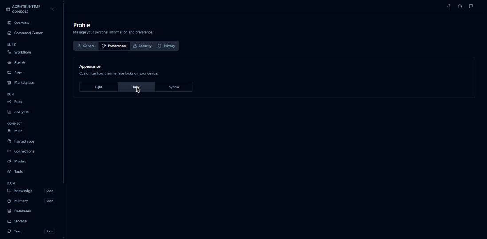

The only setting under **Preferences** is **Appearance**. It controls whether the Console is light or dark on your device.

**Who this is for:** anyone who prefers a dark interface or wants the Console to follow the operating system.

## Change the theme

<Steps>
  <Step title="Open Preferences">
    Open your profile and click **Preferences**. **Appearance** reads "Customize how the interface looks on your device."
  </Step>
  <Step title="Pick a theme">
    Click **Light**, **Dark**, or **System**. **System** follows your device setting.

    **You should see:** the Console change immediately. The choice stays when you move between pages.
  </Step>
</Steps>

| Option | Result |
|---|---|
| **Light** | Light interface. The default. |
| **Dark** | Dark interface on Overview, Workflow Studio, Billing, Connections, and the other Console pages. |
| **System** | Follows the light or dark setting of your device. |

The setting belongs to you, not to the workspace. There is no theme switch in the top bar, so you always change it from your profile.

<Note>
  Two screens ignore your choice. The page you reach from a workspace invite link is always dark, and the confirmation pages you see when you [verify your email](/platform/sign-up-and-verify) are always dark.
</Note>

## What else is in Preferences

Nothing else. There are no language, time zone, or email notification settings under **Preferences** today. The **Runs** page has its own **Times** toggle for local or UTC times.

In dark mode, small grey text can be harder to read. This includes the sidebar group labels (**Build**, **Run**, **Connect**, **Data**) and the lines under the credits panel. If it is a problem, switch back to **Light**.

<Frame caption="Profile, Preferences tab: the Appearance switch">
  
</Frame>

<Frame caption="The same tab after choosing Dark">
  
</Frame>

## Next steps

- [Your profile and account](/platform/your-profile-and-account)
- [Use the Console on a phone or tablet](/platform/phone-and-tablet)
