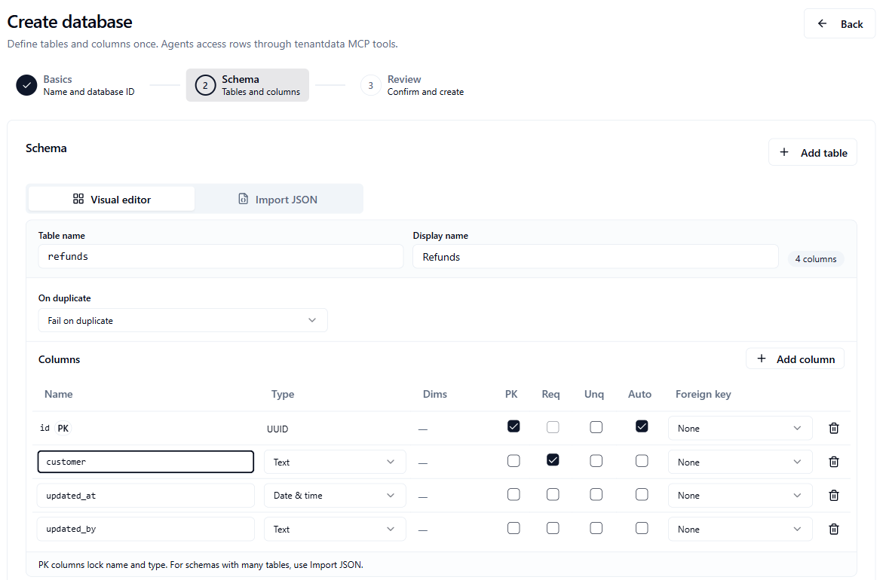
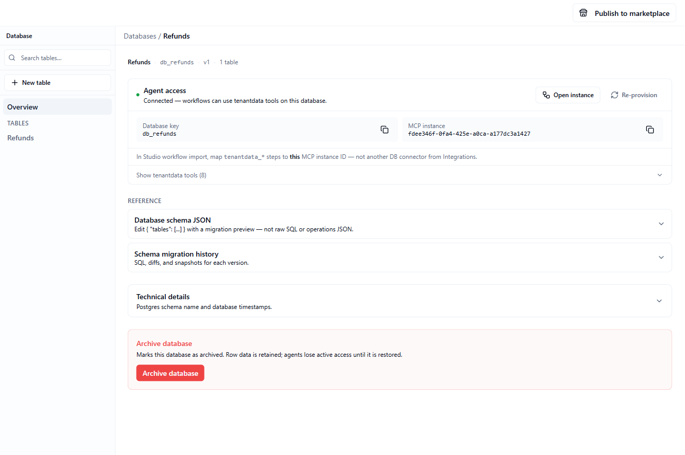
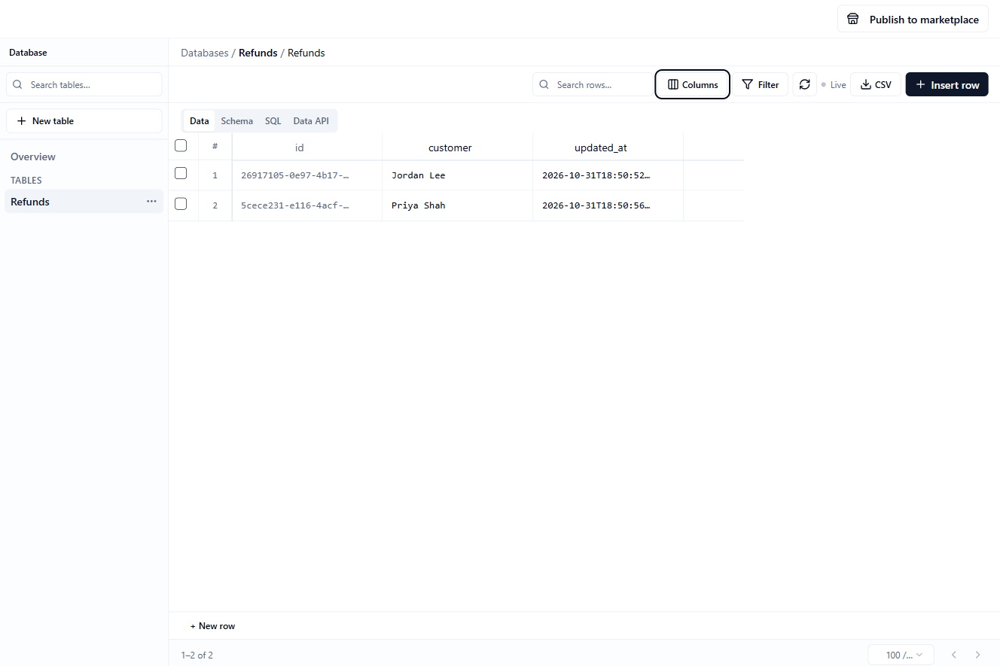

Three areas of the Console hold your workspace's data and work items:

| Area | What it holds | Where to open it |
|------|---------------|------------------|
| **Databases** | Tables of rows and columns, such as customers or orders | **Databases** in the sidebar |
| **Storage** | Files, such as PDFs and spreadsheets | **Storage** in the sidebar |
| **Work** | Tasks and files that you follow here and edit in Space | **Work** in the sidebar |

**Who this is for:** anyone who sets up data for workflows, agents and apps, or who needs to check what is in it.

**What you will do on this page:** create a database, edit its rows, import and export CSV files, run SQL, upload files, follow tasks, and connect all of it to a workflow.

## Databases

A **database** is a set of tables. Databases belong to your workspace, not to a single project. Agents and workflows in any project can use them once the database has an MCP instance, which the Console sets up when you create the database. See [How workflows use databases and storage](#how-workflows-use-databases-and-storage).

### Who can use Databases

- To see databases, you need `tenant_admin` or any project role (`project_viewer` and up).
- To create a database, you need `tenant_admin`, `project_contributor` or `project_admin`.

If you cannot create databases, the **Create database** button is greyed out. See [Roles and permissions](/platform/roles-permissions).

### Create a database

<Steps>
  <Step title="Start">
    Open **Databases** in the sidebar and click **Create database**. In an empty workspace you can also click **Create your first database**.
  </Step>
  <Step title="Basics">
    Enter a **Display name**, such as `Sales CRM`. The Console suggests a **Database ID** from it, such as `db_sales_crm`. You can change it. Click **Continue**.
  </Step>
  <Step title="Schema">
    Define your tables and columns. Use **Visual editor** and click **Add table** and **Add column**. For many tables, switch to **Import JSON**. There you can paste a schema and click **Apply JSON**, click **Load example**, or click **Upload file**. Click **Continue**.
  </Step>
  <Step title="Review">
    Check the tables. Click **Create database**.
  </Step>
</Steps>

You should see "Database and workflow MCP instance created" and the new database. If you see "Database created, but workflow MCP setup failed", the database exists but workflows cannot reach it yet. Open its **Overview** and click **Provision MCP**.

<Frame caption="The Schema step of Create database">
  
</Frame>

### Find your way around a database

Click a database in the list to open it. The left panel has:

- **Search tables…** to filter the table list.
- **New table** to add a table. Enter a **Name** and a **Display name**, then click **Add table**. A new table starts with `id`, `updated_at` and `updated_by` columns, and opens on its **Schema** tab.
- **Overview**, which shows the database's key, its table count, and its **Agent access** card.
- **Tables**, a list of your tables. The **⋯** menu on a table has **Remove table**. Removing a table permanently deletes it and all its rows.

Click a table to open it. Four tabs appear: **Data**, **Schema**, **SQL**, and **Data API**.

On **Overview** the **Agent access** card says **Connected** when workflows can use the database. If it says **MCP not provisioned**, click **Provision MCP**. When connected, **Open instance** takes you to the MCP instance, and **Re-provision** sets it up again. **Show tenantdata tools (8)** lists the tools workflows can call. To stop agents using a database, click **Archive database** and confirm. Archiving keeps the row data, and agents lose access.

<Frame caption="A database overview, with Agent access connected">
  
</Frame>

### The Data tab

<Frame caption="The Data tab">
  
</Frame>

The **Data** tab shows a table's rows in a grid. Above the grid:

| Control | What it does |
|---------|--------------|
| **Search rows…** | Finds rows that match your text |
| **Columns** | Shows or hides columns with checkboxes |
| **Similarity** | Searches by closeness to a vector. It appears only when the table has a vector column. |
| **Filter** | Narrows the rows with conditions. The button shows how many are active, for example **2 filters**. |
| Refresh button | Reloads the rows |
| **Live** | The dot next to it shows whether the grid is receiving live updates. Rows refresh when the table changes. |
| **CSV** | Opens **Export page**, **Export all (filtered)**, and **Import CSV** |
| **Insert row** | Opens a form to add one row |
| **Delete (N)** | Appears when you select rows. It deletes them. |

Below the grid, you see which rows are showing, for example `1–25 of 120`. Choose **25 / page**, **100 / page** or **500 / page**, and use the arrows to move between pages.

#### Filters

Click **Filter**, then **Add condition**. Pick a column, an operator (**equals**, **not equals**, **contains**, `>`, `<`, **is null**, **is not null**), and a value. Conditions in one group must all match (**Match group (AND)**). Click **Add OR group** to add another group. A row matches if it fits any group. Active filters, searches and similarity searches appear as chips under the toolbar. Click the **×** on a chip to remove it.

#### Edit rows

- **Edit a cell:** double-click it, or click it and press Enter. Press Enter to save, or Esc to cancel. Clicking elsewhere also saves.
- **Boolean columns** are switches. They save as soon as you flip them.
- **JSON columns** open an **Edit JSON** dialog. Click **Save**.
- **Primary key columns** cannot be edited.
- **Long values** show an expand icon when you hover. A cell that links to another table shows an icon that opens the matching row there.
- **Add a row:** click **+ New row** under the grid, type values, and press Enter or click **Save**. Or click **Insert row** and fill in the form. Empty fields are skipped.
- **Duplicate or delete a row:** hover over the row and use the icons at its right. Deleting asks you to confirm.
- **Delete many rows:** tick the checkboxes at the left, then click **Delete (N)**.

#### Grid keys

Click a cell to focus it, then use:

| Keys | What they do |
|------|--------------|
| Arrow keys | Move to the next cell |
| Enter | Edit the focused cell |
| Ctrl+C (⌘+C on a Mac) | Copy the focused cell's value. You see "Copied". |

The keys do nothing while you edit a cell or type in a field.

#### Sort, pin and hide columns

Click a column header to sort. The first click sorts ascending, the second descending, and the third clears the sort. Right-click a header to open a menu:

| Menu item | What it does |
|-----------|--------------|
| **Sort ascending** | Sorts from low to high |
| **Sort descending** | Sorts from high to low |
| **Clear sort** | Appears only on the sorted column |
| **Pin column** or **Unpin column** | Keeps the column at the left while you scroll sideways |
| **Hide column** | Hides the column. Bring it back with **Columns**. |

The Console remembers pinned and hidden columns, and your page size, in your browser. They are not shared with teammates.

#### Export and import CSV

Click **CSV** above the grid.

- **Export page** downloads the rows on the current page as `<table>.csv`.
- **Export all (filtered)** downloads every row that matches your current search and filters.
- **Import CSV** adds the rows from a `.csv` file to the table.

Exports include every column, including hidden ones, with a header row.

To import, the first row is read as the header only if every name in it matches a column of the table. If not, the file is read in the table's column order and the first row counts as data. Empty cells and empty rows are skipped. You should see "Imported N rows". If the file has no usable rows, you see "No rows found in CSV".

#### Vector similarity search

If a table has a **vector** column, **Similarity** appears. It orders rows by how close they are to a vector you give.

<Steps>
  <Step title="Turn it on">
    Click **Similarity**, then turn on the **Similarity search** switch.
  </Step>
  <Step title="Choose how to compare">
    Pick the **Vector column** and a **Distance metric**: **L2 distance**, **Cosine distance**, or **Inner product**.
  </Step>
  <Step title="Enter the vector">
    Type a **Query vector** as a JSON array of numbers, such as `[0.1, 0.2, 0.3]`. The label tells you how many numbers the column expects. Click **Apply**.
  </Step>
</Steps>

A chip such as `similarity: embedding (L2 distance)` shows above the grid. Click **Clear** in the popover, or the **×** on the chip, to turn it off. Column sorting is off while a similarity search is active.

### The Schema tab

The **Schema** tab shows the selected table's columns. You can change a column's type, whether it can be empty, its default, whether it is unique, and its references to other tables, or rename it. Primary key columns are fixed after the table is created.

Under **Add column**, enter a **Name** and a **Type**, tick **Required** if the column must always have a value, and click **Add**. Column types are `string`, `short_text`, `email`, `integer`, `number`, `boolean`, `date`, `datetime`, `uuid`, `json` and `vector`. A vector column also needs its **Dimensions**, a whole number from 1 to 16000. The tab also has **Rename table** and **Relationships**.

Schema changes apply as soon as you make them. You see "Schema updated". Dropping a column asks you to confirm and cannot be undone.

### The SQL tab

The **SQL** tab runs SQL against the selected database. It starts with a query for the open table, such as `SELECT * FROM "schema"."table" LIMIT 100`.

<Steps>
  <Step title="Choose the mode">
    **Read-only mode** is on by default. In this mode you can run `SELECT` queries only. Turn it off to also run `INSERT`, `UPDATE` and `DELETE`. With it off, DDL (changes to the structure) and multi-statement SQL are blocked. The Console remembers your choice in your browser, for each database.
  </Step>
  <Step title="Run the query">
    Edit the SQL and click **Run**. Results appear below as a table, with a summary such as "12 rows" or "3 rows affected".
  </Step>
</Steps>

If the query fails, the tab shows **Query failed** with the reason.

### The Data API tab

The **Data API** tab helps you call a table over HTTP from your own code. It builds an example request. It does not send one.

1. Choose an **Operation**: **List rows**, **Count rows**, **Insert row**, **Update row**, or **Delete row**.
2. Choose an **Example language**: **cURL**, **PowerShell**, **JavaScript**, **Python**, or **Go**.
3. For listing and counting, add **Filters**. For other operations, edit the **Request body (JSON)**.
4. Copy the **Request URL** or the **Example request** with the **Copy** and **Copy example** buttons.

When you open the tab, it starts from the search, filters, sorting and page size you set on the **Data** tab.

The example uses a placeholder (`YOUR_TOKEN_HERE`) in place of a real key. Replace it with an [API key](/api/authentication). Listing and counting need the `mcp:read` scope. Insert, update and delete need `mcp:write`. If you can edit project resources (`project_contributor` or higher), the tab also lists your keys that have the right scope under **API key (reference)**, or links to **Settings → API keys** if you have none.

## Storage

**Storage** holds files for your workspace. The files are stored separately from other workspaces.

<Steps>
  <Step title="Open Storage">
    Click **Storage** in the sidebar. A new workspace shows **No files yet**.
  </Step>
  <Step title="Upload a file">
    Click **Upload file** (or **Upload your first file**) and choose a file. You should see "File uploaded".
  </Step>
</Steps>

| Task | How |
|------|-----|
| **Search** | Type in **Search by name, type, or ID…**. It matches the file name, the type, and the ID. |
| **Download** | Click the download icon on a file's row. The file opens in a new tab. |
| **Delete** | Click the trash icon on a file's row. The file is removed straight away, and you are not asked to confirm. You should see "File removed". |

Each row shows the file name, its size, its type, and when it was added, plus a short ID chip. The list shows up to 200 files.

To see the list you need `tenant_admin` or any project role (`project_viewer` and up). To upload and delete you need `tenant_admin`, `project_contributor` or `project_admin`. Without that, **Upload file** is greyed out and the trash icon is hidden.

The page also has a **View MCP instance** link once the workspace's `storage` MCP instance exists. Opening **Storage** asks the Console to set that instance up if needed.

## Work

**Work** shows the tasks and files for your workspace. You follow them here, and you open **Space** for full editing. Space is the team workspace at [space.agentruntime.io](https://space.agentruntime.io).

The page has two lists and a **Detail** panel:

- **Open tasks** lists every task that is not done, with a count such as "5 active".
- **Files** lists up to 12 of the workspace's files. These are the files you also see in **Storage**.
- **Detail** shows the task or file you click.

For a task, the **Detail** panel shows its title and description. You can:

- Change its **Status** to **To do**, **In progress**, **Review** or **Done**. The change saves at once and you see "Status updated". A task set to **Done** leaves **Open tasks**.
- Click **Open in Space** to edit it there.
- Click **Archive**, then **Archive** again to confirm. The task is archived (soft-deleted), but links to it in chat remain. You see "Task archived".

For a file, **Detail** shows the file's name, type and last update, with an **Open in Space** button.

This page does not create tasks. Create and edit them in Space. Links from chat can open this page on a specific task or file.

## How workflows use databases and storage

Workflows reach a database or the file store through an MCP instance, the same way they reach any connector. See [MCP instances](/integrations/mcp-instances) and [step types](/workflows/step-types).

- **Databases.** Each database has its own MCP instance, called a `tenantdata` instance. The Console creates it with the database. Add an `mcp` step, choose that database's instance, and choose one of the `tenantdata_*` tools: `tenantdata_health`, `tenantdata_get_contract`, `tenantdata_select`, `tenantdata_select_one`, `tenantdata_insert`, `tenantdata_update`, `tenantdata_delete`, or `tenantdata_count`. When you import a workflow that uses these tools, map them to the instance of the database you want to use, not to another database connector.
- **Storage.** The workspace has one `storage` MCP instance. Add an `mcp` step, choose that instance, and choose a tool whose name starts with `storage_`, such as `storage_list` or `storage_presign_put`.
- **Apps.** An [app](/platform/apps) can show a table from a database. Use the **Show data** starter, or click **Data** in App Studio.

## AI assistants

An AI assistant can work with databases and files through [Platform MCP](/api/platform-mcp). The `tenantdata_*` tools list and create databases and change their schema. The `files_*` tools list, upload and download work files. The [Platform MCP authoring skills](/api/platform-mcp-authoring-skills) include a guide for designing a database.

## Common problems

| Problem | What to try |
|---------|-------------|
| **Create database** is greyed out | You need the `project_contributor` role or higher. Ask a workspace admin. |
| Workflows cannot reach a database | Open its **Overview**. If the **Agent access** card says **MCP not provisioned**, click **Provision MCP**. |
| **Similarity** is missing | The table has no vector column. Add one in the **Schema** tab. |
| The query vector is rejected | It must be a JSON array of numbers with exactly as many numbers as the column's dimensions. |
| **Query failed** on the **SQL** tab | Read the message. To change data, turn off **Read-only mode**. Structure changes and several statements at once are blocked. |
| The CSV import adds nothing | You see "No rows found in CSV" if the file has no data rows. Check that the file has a header row with the column names, or rows in the table's column order. |
| A cell will not edit | Primary key columns cannot be edited, and a table may not allow updates. |
| **Upload file** is greyed out | You need the `project_contributor` role or higher. Ask a workspace admin. |
| A task is missing from **Work** | **Open tasks** hides tasks that are **Done**. |

## Next steps

- [Apps and App Studio](/platform/apps): show a table on a screen
- [MCP instances](/integrations/mcp-instances): how instances and profiles work
- [Step types](/workflows/step-types): the `mcp` step
- [API authentication](/api/authentication): API keys and scopes
- [Platform MCP](/api/platform-mcp): let an AI assistant manage databases and files
