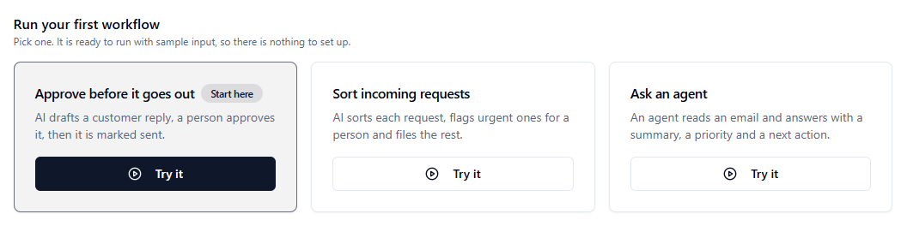
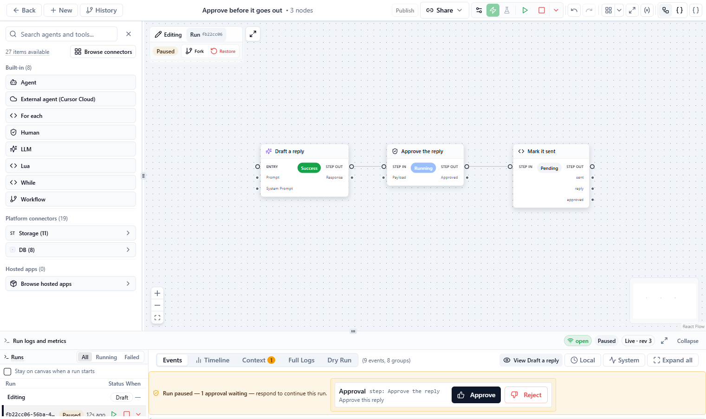
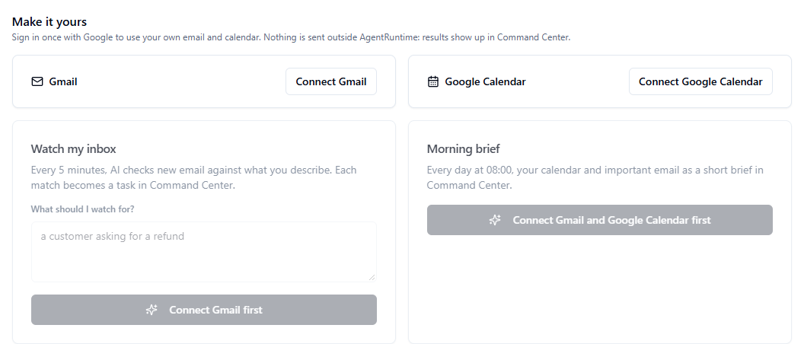

The **Get started** page gives you a working workflow in about a minute. Each recipe comes with sample input and uses AgentRuntime's platform AI model, so you need no API key and no connected tool.

**Who this is for:** anyone new to AgentRuntime. The [Quickstart](/platform/quickstart) is the longer path, where you connect a tool and build a workflow yourself.

## Open Get started

Sign in to the [Console](https://console.agentruntime.io). Until your workspace has a successful run, **Overview** shows the Get started page.

After that, **Overview** shows your workspace's metrics instead. To come back to Get started, click **Get started** under the welcome line at the top of **Overview**. **Back to overview** takes you back to the metrics.

## Run a recipe

<Frame caption="The three recipes under Run your first workflow">
  
</Frame>

<Steps>
  <Step title="Pick a recipe">
    Click **Try it** on one of the cards. If you are not sure, start with **Approve before it goes out**.

    AgentRuntime creates the workflow in your project and opens it in [Workflow Studio](/workflows/studio). Each click on **Try it** creates a new copy of the workflow.
  </Step>
  <Step title="Run it">
    Click **Run** in the toolbar. The sample input is already saved in the workflow's **Setup**, so there is nothing to fill in.

    **You should see:** each step turn green as it finishes, and the run's events in the panel under the canvas.
  </Step>
  <Step title="Answer the task, if the run asks for one">
    Some recipes wait for a person. The panel under the canvas then shows the task with its buttons, and the task also appears in [Command Center](/workflows/command-center). Answer it in either place and the run carries on.
  </Step>
</Steps>

| Recipe | What it does | What you do |
|---|---|---|
| **Approve before it goes out** | **Draft a reply** writes a reply to a sample customer complaint. **Approve the reply** waits for a person. **Mark it sent** runs only after the reply is approved. | Click **Approve**. You can approve a run you started yourself. |
| **Sort incoming requests** | **Classify** asks AI for a category (billing, bug, question, or other) and whether the request is urgent. **Read the answer** turns that answer into fields. An urgent request goes to **Flag urgent**, which asks a person to look at it. Anything else goes to **File the others**. | If the request is urgent, an **Urgent request** task appears. Approve it to finish the run. The sample request is an urgent one. |
| **Ask an agent** | **Ask the agent** gives a sample email to an agent that answers in three fields: `summary`, `priority`, and `next_action`. The recipe creates this agent, **Email summarizer**, under **Agents**, or reuses it if it is already there. | Nothing. Read the answer in the step's output. |

<Frame caption="Approve before it goes out, waiting for approval">
  
</Frame>

A recipe is an ordinary workflow. Change its steps, its prompt or its sample input as you like. [Workflow Studio](/workflows/studio) shows how.

### After your first successful run

**Overview** shows a card that starts with **Your first workflow ran.**, followed by one suggested next step for the recipe you ran:

| Recipe | Suggested next step | Button |
|---|---|---|
| Approve before it goes out | Turn it into a form your team can use | **Build a request form** opens [Apps](/platform/apps) |
| Sort incoming requests | Run it on real messages by giving it a web address other tools can call | **Open the workflow** |
| Ask an agent | Give the agent a tool, so it can look things up as well as read | **Open your agents** |
| Watch my inbox | Change how often it checks, or what it looks for | **Open the workflow** |
| Morning brief | Change the time it arrives | **Open the workflow** |

The card appears only in the browser you installed the recipe from. Click **×** to hide it.

## Use your own email and calendar

Under **Make it yours**, sign in once with Google, and two more recipes work with your own Gmail and Google Calendar. They only read your email and calendar: the results appear as tasks in Command Center, and nothing is sent outside AgentRuntime.

<Frame caption="Make it yours, before Gmail and Google Calendar are connected">
  
</Frame>

<Steps>
  <Step title="Connect Gmail and Google Calendar">
    Click **Connect Gmail**. A sign-in window opens: sign in with your Google account and allow access. Do the same with **Connect Google Calendar** if you want the morning brief.

    **You should see:** **Connected** on the card. The connection is also listed on **Connections**, as **Gmail** or **Google Calendar**. It runs through [Hosted apps](/integrations/mcp-instances#hosted-apps).
  </Step>
  <Step title="Start a recipe">
    - **Watch my inbox** needs Gmail. Under **What should I watch for?**, describe the email in plain words, for example "a customer asking for a refund", and click **Start watching**.
    - **Morning brief** needs Gmail and Google Calendar. Click **Schedule it**.

    The new workflow opens in Workflow Studio.
  </Step>
</Steps>

| Recipe | When it runs | What you get |
|---|---|---|
| **Watch my inbox** | Every 5 minutes | AI checks the email that arrived since the last check against your description. Each match becomes a task in Command Center with the sender, the subject, a snippet, the reason it matched, and a link to the email. |
| **Morning brief** | Every day at 08:00, in your browser's time zone | AI writes a short brief of today's calendar and your important or unread email from the last 24 hours. It arrives as a task in Command Center. |

Each email is checked once: every check covers the 5 minutes before it starts. If a check does not run, the email from those 5 minutes is not checked later.

### Schedules need an API key

Both recipes run on a schedule, and a schedule runs with an API key from **Settings → API keys** (see [Authentication](/api/authentication)).

- If your workspace already has an active key that can run workflows, the recipe uses it without asking.
- If not, the Console asks **Create an API key for schedules?** Click **Create key and continue** to create a key named **Schedules** and finish the setup. The key can read and run workflows and call their tools. **Cancel** stops without creating anything.
- If you are not allowed to create API keys, you see **This recipe needs an API key**. Ask a workspace admin to create one, or to start the recipe for you.

## Other ways to start

- **Connect WhatsApp** opens **Connections**. See [WhatsApp](/connectors/whatsapp).
- **Start from a blank canvas** and **Browse all recipes** open the **Find a workflow recipe** dialog in Workflow Studio. Choose **Blank canvas** to start empty, or pick a recipe. See [Build your first workflow](/workflows/build-your-first-workflow).

## The Setup guide

The **Setup guide** panel in the corner of the Console lists what is left to do: **Take the console tour**, **Connect Gmail and Calendar** (which opens Get started), **Build your first workflow**, and **Add a payment method**. Finished items are crossed out. **Remind me tomorrow** hides the panel until the next day.

## Common problems

| Problem | What to try |
|---|---|
| **Start watching** reads **Connect Gmail first** | Click **Connect Gmail** above it and finish the Google sign-in. |
| **Schedule it** reads **Connect Gmail and Google Calendar first** | Connect both, then click **Schedule it**. |
| "This recipe needs an API key" | Ask a workspace admin to create an API key, or to start the recipe. |
| "Gmail isn't in the app catalog yet." (or Google Calendar) | That Hosted app is not available in your workspace yet. Contact support. |
| The run fails | Open the step that failed in the run's events. If the workspace is out of credits, see [Billing and credits](/platform/billing-and-credits). For other errors, see [Troubleshooting](/platform/troubleshooting). |

## Next steps

- [Quickstart](/platform/quickstart): connect a tool and build a workflow yourself.
- [Command Center](/workflows/command-center): answer tasks and watch runs.
- [Key concepts](/platform/key-concepts): workspaces, projects, workflows, and runs.
