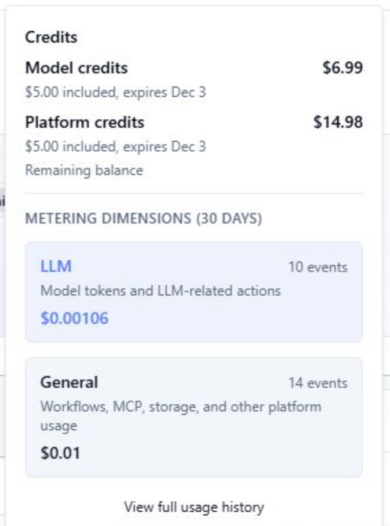

The top bar has three icons with no text labels. This page covers two of them: the bell and the credits icon. The third, the speech bubble, opens the chat panel: see [Autopilot and chat](/ai/autopilot-and-chat).

**Who this is for:** anyone who wants to know where their balance is and where alerts go.

## The bell: notifications

Click the bell. A panel opens with **Notifications** and **Mark all read**. When there is nothing new it says **No new notifications**.

<Note>
  The bell does not collect everything you might expect. In testing it stayed empty after runs, approvals, and a rejection. Approvals waiting for you show as a badge on **Command Center** in the sidebar, not in the bell. Check [Command Center](/workflows/command-center) for tasks and **Runs** for failures. A new member can see a count on the bell right after joining a workspace; which events appear there is not documented yet.
</Note>

## The credits icon: your balance

The middle icon, which looks like a gauge, shows your credits. Click it to open a panel headed **Credits**.

<Steps>
  <Step title="Click the credits icon">
    **You should see:** two balances and a usage summary.
  </Step>
  <Step title="Read the balances">
    | Line | Meaning |
    |---|---|
    | **Model credits** | Credits for AI model use. A small line under it shows how much is included in your plan and when it expires, for example "$5.00 included, expires Dec 3". |
    | **Platform credits** | The remaining balance for platform usage. |
  </Step>
  <Step title="Read the usage">
    Under **Metering dimensions (30 days)** you see two rows with the number of events and the cost: **LLM** ("Model tokens and LLM-related actions") and **General** ("Workflows, MCP, storage, and other platform usage").
  </Step>
  <Step title="See the full history">
    Click **View full usage history**.
  </Step>
</Steps>

<Frame caption="The credits panel opened from the gauge icon in the top bar">
  
</Frame>

## Why the numbers can look odd

<Warning>
  The Console shows the same credits in two units. The credits panel and **Billing** show dollars. **Analytics** shows credits. One credit is $10 of face value, so $0.0015 in the panel is 0.00015 credits in Analytics. Very small costs can show as $0.00.
</Warning>

<Note>
  **LLM** can show 0 events and $0.00 after you ran an AI step. AI usage is charged only for models that have a price. The default model in the recipes and in the chat panel does not have one yet, so those calls are recorded but cost nothing. Only Claude Haiku 5.5 has a price today. If you rely on this panel to see AI costs, choose a model that has a price. See [Models and providers](/ai/llm-providers).
</Note>

## Next steps

- [Billing and credits](/platform/billing-and-credits): plans, balances, and top-ups.
- [Analytics](/platform/analytics): usage over time.
- [Top up credits](/platform/top-up-credits)
- [Models and providers](/ai/llm-providers)
