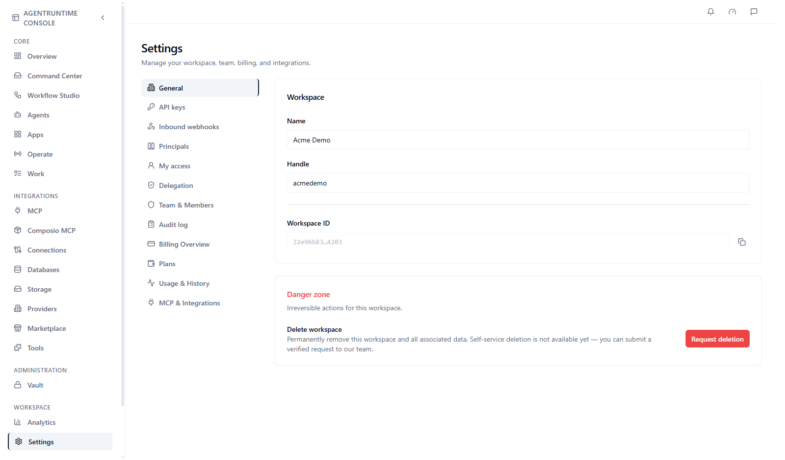
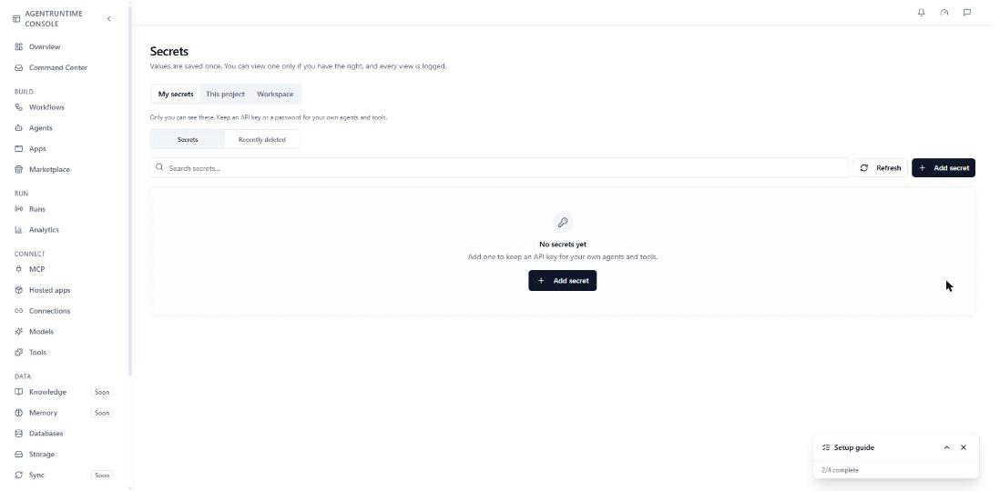
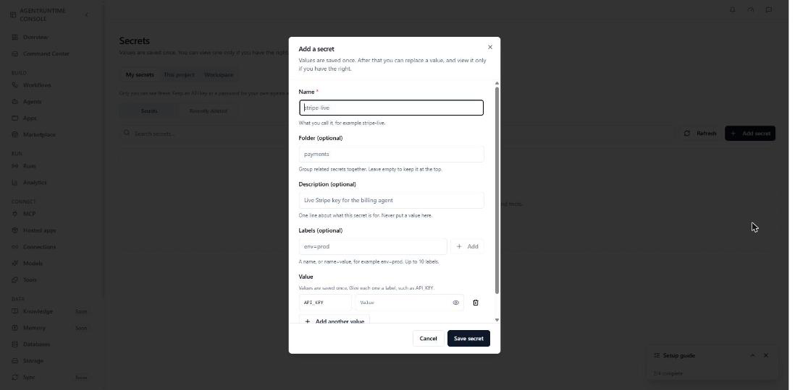

This page is for workspace admins and anyone who wants to know where things live in **Settings**. It explains each tab and what you can do there. Your own settings (theme, password, product tours) and the notification bell are covered at the end: see [Your profile and preferences](#your-profile-and-preferences) and [Notifications](#notifications).

## Open Settings

In the [Console](https://console.agentruntime.io) sidebar, click **Settings**. The tabs are listed down the left side. You see only the tabs your role allows. For example, **Team & Members** and **Audit log** are for admins.

<Frame caption="Settings, General tab: the tab list is on the left">
  
</Frame>

The tabs are in three groups.

| Group | Tab | What it is for |
|-------|-----|----------------|
| **You** | **My access** | Your own roles in this workspace |
| **You** | **Delegation** | Let someone else approve on your behalf |
| **Workspace** | **General** | Workspace name, handle and ID, plus the danger zone |
| **Workspace** | **Safe actions** | When agents must ask for approval and what they may say aloud during a conversation (see [Safe actions](#safe-actions)) |
| **Workspace** | **CI sign-in** | Sign-in for CI systems (admins). These docs do not cover this tab yet. |
| **Workspace** | **Team & Members** | Invites, members, sign-in policy and domain verification (admins) |
| **Workspace** | **Audit log** | Admin actions: invites, membership, access policy and domain verification |
| **Developers** | **API keys** | Keys for scripts, CI and integrations |
| **Developers** | **Principals** | End users who connected through Embedded Connect |
| **Developers** | **Integrations** | Your own Google and TikTok OAuth apps, and connector diagnostics |

Billing is not part of Settings. Open **Billing** in the sidebar for your plan, credits, card and usage. See [Billing and credits](/platform/billing-and-credits).

## General

Open **Settings → General** to see:

- **Name** — the display name of your workspace
- **Handle** — the short identifier used in links and API calls. The Console tells you if a handle is already taken.
- **Workspace ID** — read-only, handy when you contact support

Only users with permission to edit the workspace can change these fields.

<Warning>
  The **Danger zone** at the bottom of **General** holds irreversible actions for the workspace. Today it has **Delete workspace**. Self-service deletion is not available yet: the **Request deletion** button lets you submit a verified request to the AgentRuntime team.
</Warning>

To choose which project opens by default, use the project switcher. Open the **⋮** menu next to a project and click **Set as default project**.

## API keys

Open **Settings → API keys** and click **Create API key**. With no keys yet, the page says **No active API keys** and tells you to create one for scripts, CI or integrations that call the AgentRuntime API, and to copy the secret once, because it will not be shown again. Revoke a key at any time from the same list. API keys are personal access tokens and work with the [API](/api/authentication) and [Platform MCP](/api/platform-mcp). Treat them like passwords. The page calls them "secrets", which is a different thing from the **Secrets** page in the sidebar.

A workspace **Member** sees the **Create API key** button too, together with the message "You don't have access to that. Ask a workspace admin if you need this permission." The click is refused.

## Principals

**Settings → Principals** lists the end users of your own product who connected their accounts through Embedded Connect. Only workspace admins can see it. See [Embedded Connect](/integrations/embedded-connect).

## Safe actions

**Settings → Safe actions** controls how agents act while someone is talking to them: when they must ask for approval, and what they may say aloud. Agent authors can only tighten these rules for their own agent. The tab has:

- **Money threshold**: changes above this amount need approval, even if they could be undone. Leave it empty for no limit. The page does not show a currency, so check it before you rely on a value.
- **Tools that need two people**: add tool names. For these, one person asks and a second person approves.
- **Allow spoken approvals**: when off, a change that cannot be undone, made during a call, waits for an approval outside the call.
- **Allow personal data in a group call**.
- **Approvers** and **Approver role** (**Workspace admins** by default).
- **Discard** and **Save**.

<Note>
  These settings are about voice-call behaviour, such as "spoken approvals" and "group call". Voice is not available in production, so the tab is shown in every workspace for a feature you cannot use yet.
</Note>

## My access and Delegation

- **My access** is a read-only view of your workspace role and your project roles. See [Roles and permissions](/platform/roles-permissions).
- **Delegation** lets another user or an agent approve or reject approval steps on your behalf when you are a required approver. Create a delegation here and revoke it when you no longer need it.

## Team & Members

Admins use **Settings → Team & Members** to:

- invite people by email and set their workspace role (**Member**, **Admin** or **Owner**). The invite form is far down the page. The tab is one long page with about ten sections, all open at once.
- group members into **Teams**, and create child workspaces under **Workspace hierarchy**
- see current members, change roles and remove people
- choose how people may join: **Allow self-serve signups**, **Require invites**, **Auto-join matching domains**
- turn on **Full access on private projects** for workspace owners and admins
- review **Access requests** from people with a matching email domain
- verify your email domain with a DNS TXT record

[User management](/platform/user-management) walks through these tasks step by step.

## Audit log

**Settings → Audit log** lists admin actions in the workspace: invites, membership changes, access policy and domain verification. You can filter by **Action**, **Actor**, **From** and **To**, click **Refresh** and **Export CSV**. A row shows the action (for example **User assigned to workspace**), when it happened, the **Actor** and the **Target** (both as email addresses), and the raw details as JSON.

<Warning>
  **The Audit log does not record approvals, rejections, model changes or publishes.** It covers admin actions only. To see who approved or rejected a task, look at the run. A workspace **Member** can also open the Audit log.
</Warning>

## Integrations

**Settings → Integrations** has a **Google OAuth application** card and a **TikTok OAuth application** card. Each lets you use your own OAuth client instead of AgentRuntime's: it shows a redirect URI to copy, **Display name**, **Client ID**, **Client secret** and a **Use workspace OAuth app** switch. The client secret is stored in the vault only. Below them, **MCP diagnostics** shows live checks for connectors: **MCP instances**, **MCP tool catalog** and **MCP connections**. The wording there mentions internal header names (`X-Tenant-Id`, `X-Project-Id`) and is meant for support. A workspace **Member** can see this tab without a role notice.

## Billing, Plans and Usage

Billing is its own page, **Billing**, in the sidebar. See [Billing and credits](/platform/billing-and-credits).

## Sign-in methods

People sign in to the Console with email and password (with email verification) or with Google. The policy options above control who may join your workspace.

## Secrets

**Secrets** is in the sidebar under **Admin**. Every member can open it. It has up to four tabs, and you see only the ones you may use:

- **My secrets**: yours alone. Keep an API key or a password for your own agents and tools.
- **Shared with me**: secrets other people chose to share with you.
- **This project**: the selected project's secrets, for project admins.
- **Workspace**: the workspace's secrets, for workspace admins. This tab also has the setting **Who can view secret values**.

A value is saved once. It stays hidden unless you have the right to view it. By default that is the person who owns the secret and admins, and a workspace admin can change it to nobody, or to also include the people a secret is shared with. Every view is recorded for your admins. To change a value, save a new one.

Save everyday tool credentials in **Connections** instead, as described in [Connections](/integrations/connections).

<Frame caption="Secrets with nothing saved yet">
  
</Frame>

<Frame caption="The Add a secret dialog">
  
</Frame>

## Your profile and preferences

Your own settings are not in **Settings**. They are on the **Profile** page. Click your avatar in the sidebar footer. The menu has **Profile**, **Billing**, **Settings**, **Theme** and **Log out**. Your email shows at the top of the menu.

**Profile** has three tabs:

| Tab | What it holds |
|-----|---------------|
| **General** | **Personal Information**: your photo, your name, your **Username**, your **Email Address** and your **User ID**. Below it, the **Product tours** card. |
| **Preferences** | **Appearance** |
| **Security** | **Password** |

### Appearance

Choose how the Console looks. Either open **Profile**, then **Preferences**, then **Appearance**, or use **Theme** in the avatar menu. Pick one of:

| Choice | What it does |
|--------|--------------|
| **Light** | Always light |
| **Dark** | Always dark |
| **System** | Follows your device's light or dark setting |

The Console remembers your choice. Until you pick one, it uses the light theme.

### Change your username

On **General**, edit **Username**. Use letters and digits only, 3 to 64 characters. The Console checks the name as you type and tells you if it is available. Click **Save username**. Your name and email are read-only.

### Change your password

<Steps>
  <Step title="Open Security">
    Open **Profile**, then the **Security** tab. The **Password** card is for your email and password sign-in.
  </Step>
  <Step title="Fill in the form">
    Enter your **Current password**, a **New password** (at least 8 characters), and the same password in **Confirm new password**. If you forgot your current password, click **Forgot your current password?**.
  </Step>
  <Step title="Save">
    Click **Change password**. You should see "Password updated".
  </Step>
</Steps>

The button stays disabled until the current password is filled in, the new password has at least 8 characters, and both new passwords match. The **Two-factor authentication** card below the password form turns an authenticator-app code on or off for your own sign-in: see [Your profile and account](/platform/your-profile-and-account#two-factor-authentication).

### Product tours

**Product tours** are short guided walk-throughs that highlight parts of the Console. Find them on **Profile**, **General**, in the **Product tours** card. It lists three tours:

| Tour | What it covers |
|------|----------------|
| **Console overview** | The sidebar, Autopilot, and the setup guide on Overview |
| **Build your first workflow** | Connecting tools, saving secrets, opening Workflow Studio, and running |
| **Workflow Studio** | The palette, the canvas, run controls, and the execution log |

Click **Start tour** to begin one. After you finish a tour, its row shows **Completed** and the button changes to **Replay tour**. The Console remembers in your browser which tours you finished and which you closed or skipped. A tour you closed does not start by itself again, and no tour starts by itself on a phone; **Start tour** still runs it. The card also has **Open setup guide**, which brings the setup guide back (even after **Don't show again**), and **Remind me tomorrow**, which snoozes it.

## Notifications

The bell at the right end of the top bar shows notifications for you. A red number on the bell counts the ones you have not read. The number reads **99+** when there are more than 99.

Click the bell to open the **Notifications** list.

- A notification can have a title, a message, and an **Open** link that takes you to the right page.
- Click a notification to mark it read.
- Click **Mark all read** to clear the list.
- An empty list says "No new notifications".

The list refreshes every 30 seconds and when you return to the browser tab. When your credit balance runs low, a warning also pops up, usually with an **Open billing** button. See [Billing and credits](/platform/billing-and-credits).

If a member left and their connectors were handed over to you, the list also shows **Reconnect N connectors** until you finish. Click **Open** to go to **Connections**. See [Connections](/integrations/connections#when-a-member-leaves).

## Common problems

| Problem | What to try |
|---------|-------------|
| A tab is missing | Your role does not include it. Ask a workspace admin. |
| You cannot edit the workspace name or handle | You need permission to edit the workspace. Ask an admin or owner. |
| **Handle** shows "That handle is already in use" | Choose a different handle. |
| **Change password** is greyed out | The new password needs at least 8 characters, and **Confirm new password** must match it. |
| **Save username** is greyed out | The username needs 3 or more letters or digits, and it must be different and available. |
| The theme looks wrong | Open **Theme** in the avatar menu and pick **Light**, **Dark** or **System**. |

## Next steps

- [User management](/platform/user-management)
- [Roles and permissions](/platform/roles-permissions)
- [Billing and credits](/platform/billing-and-credits)
