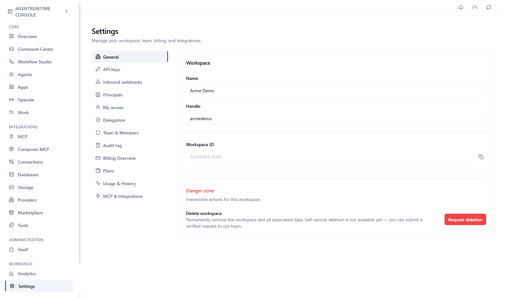

This page is for workspace admins and anyone who wants to know where things live in **Settings**. It explains each tab and what you can do there. Your own settings (theme, password, product tours) and the notification bell are covered at the end: see [Your profile and preferences](#your-profile-and-preferences) and [Notifications](#notifications).

## Open Settings

In the [Console](https://console.agentruntime.io) sidebar, click **Settings**. The tabs are listed down the left side. You see only the tabs your role allows. For example, **Team & Members** and **Audit log** are for admins.

<Frame caption="Settings, General tab: the tab list is on the left">
  
</Frame>

| Tab | What it is for |
|-----|----------------|
| **General** | Workspace name, handle and ID, plus the danger zone |
| **API keys** | Keys for scripts, CI and integrations |
| **Inbound webhooks** | Webhook subscriptions that start workflows |
| **Principals** | End users who connected through Embedded Connect |
| **My access** | Your own roles in this workspace |
| **Delegation** | Let someone else approve on your behalf |
| **Team & Members** | Invites, members, sign-in policy and domain verification (admins) |
| **Audit log** | Admin actions in this workspace (admins) |
| **Billing Overview** | Subscription, payment card and **Add credits** |
| **Plans** | Compare plans and change your plan |
| **Usage & History** | Credits remaining and usage history |
| **MCP & Integrations** | Connector diagnostics |

## General

Open **Settings → General** to see:

- **Name** — the display name of your workspace
- **Handle** — the short identifier used in links and API calls. The Console tells you if a handle is already taken.
- **Workspace ID** — read-only, handy when you contact support

Only users with permission to edit the workspace can change these fields.

<Warning>
  The **Danger zone** at the bottom of **General** holds irreversible actions for the workspace. Today it has **Delete workspace**. Self-service deletion is not available yet: the **Request deletion** button lets you submit a verified request to the AgentRuntime team.
</Warning>

To choose which project opens by default, use the project switcher. Open the **⋮** menu next to a project and click **Set as default project**.

## API keys

Open **Settings → API keys** and click **Create API key**. Copy the secret straight away, because it is shown only once. Revoke a key at any time from the same list. API keys are personal access tokens and work with the [API](/api/authentication) and [Platform MCP](/api/platform-mcp). Treat them like passwords.

## Inbound webhooks

**Settings → Inbound webhooks** lists the webhook subscriptions in your workspace. You create a subscription from a workflow in Workflow Studio. See [Inbound webhooks](/integrations/inbound-webhooks).

## Principals

**Settings → Principals** lists the end users of your own product who connected their accounts through Embedded Connect. Only workspace admins can see it. See [Embedded Connect](/integrations/embedded-connect).

## My access and Delegation

- **My access** is a read-only view of your workspace role and your project roles. See [Roles and permissions](/platform/roles-permissions).
- **Delegation** lets another user or an agent approve or reject approval steps on your behalf when you are a required approver. Create a delegation here and revoke it when you no longer need it.

## Team & Members

Admins use **Settings → Team & Members** to:

- invite people by email and set their workspace role (**Member**, **Admin** or **Owner**)
- group members into **Teams**, and create child workspaces under **Workspace hierarchy**
- see current members, change roles and remove people
- choose how people may join: **Allow self-serve signups**, **Require invites**, **Auto-join matching domains**
- turn on **Full access on private projects** for workspace owners and admins
- review **Access requests** from people with a matching email domain
- verify your email domain with a DNS TXT record

[User management](/platform/user-management) walks through these tasks step by step.

## Billing, Plans and Usage

These three tabs manage credits and subscriptions. See [Billing and credits](/platform/billing-and-credits).

## Sign-in methods

People sign in to the Console with email and password (with email verification) or with Google. The policy options above control who may join your workspace.

## Vault

Workspace admins also see **Vault** in the sidebar under **Administration**. It manages secret paths for workspace admins. Save everyday tool credentials in **Connections** instead, as described in [Connections](/integrations/connections).

## Your profile and preferences

Your own settings are not in **Settings**. They are on the **Profile** page. Click your avatar in the sidebar footer. The menu has **Profile**, **Billing**, **Settings**, **Theme** and **Log out**. Your email shows at the top of the menu.

**Profile** has three tabs:

| Tab | What it holds |
|-----|---------------|
| **General** | **Personal Information**: your photo, your name, your **Username**, your **Email Address** and your **User ID**. Below it, the **Product tours** card. |
| **Preferences** | **Appearance** |
| **Security** | **Password** |

### Appearance

Choose how the Console looks. Either open **Profile**, then **Preferences**, then **Appearance**, or use **Theme** in the avatar menu. Pick one of:

| Choice | What it does |
|--------|--------------|
| **Light** | Always light |
| **Dark** | Always dark |
| **System** | Follows your device's light or dark setting |

The Console remembers your choice. Until you pick one, it uses the light theme.

### Change your username

On **General**, edit **Username**. Use letters and digits only, 3 to 64 characters. The Console checks the name as you type and tells you if it is available. Click **Save username**. Your name and email are read-only.

### Change your password

<Steps>
  <Step title="Open Security">
    Open **Profile**, then the **Security** tab. The **Password** card is for your email and password sign-in.
  </Step>
  <Step title="Fill in the form">
    Enter your **Current password**, a **New password** (at least 8 characters), and the same password in **Confirm new password**. If you forgot your current password, click **Forgot your current password?**.
  </Step>
  <Step title="Save">
    Click **Change password**. You should see "Password updated".
  </Step>
</Steps>

The button stays disabled until the current password is filled in, the new password has at least 8 characters, and both new passwords match. Two-factor authentication is not available yet. The **Two-Factor Authentication** card on this tab is greyed out.

### Product tours

**Product tours** are short guided walk-throughs that highlight parts of the Console. Find them on **Profile**, **General**, in the **Product tours** card. It lists three tours:

| Tour | What it covers |
|------|----------------|
| **Console overview** | The sidebar, Autopilot, and the setup guide on Overview |
| **Build your first workflow** | Connecting tools, saving secrets, opening Workflow Studio, and running |
| **Workflow Studio** | The palette, the canvas, run controls, and the execution log |

Click **Start tour** to begin one. After you finish a tour, its row shows **Completed** and the button changes to **Replay tour**. The Console remembers which tours you finished in your browser. The card also has **Open setup guide**, which brings up the setup guide, and **Remind me tomorrow**, which snoozes it.

## Notifications

The bell at the right end of the top bar shows notifications for you. A red number on the bell counts the ones you have not read. The number reads **99+** when there are more than 99.

Click the bell to open the **Notifications** list.

- A notification can have a title, a message, and an **Open** link that takes you to the right page.
- Click a notification to mark it read.
- Click **Mark all read** to clear the list.
- An empty list says "No new notifications".

The list refreshes every 30 seconds and when you return to the browser tab. When your credit balance runs low, a warning also pops up, usually with an **Open billing** button. See [Billing and credits](/platform/billing-and-credits).

If a member left and their connectors were handed over to you, the list also shows **Reconnect N connectors** until you finish. Click **Open** to go to **Connections**. See [Connections](/integrations/connections#when-a-member-leaves).

## Common problems

| Problem | What to try |
|---------|-------------|
| A tab is missing | Your role does not include it. Ask a workspace admin. |
| You cannot edit the workspace name or handle | You need permission to edit the workspace. Ask an admin or owner. |
| **Handle** shows "That handle is already in use" | Choose a different handle. |
| **Change password** is greyed out | The new password needs at least 8 characters, and **Confirm new password** must match it. |
| **Save username** is greyed out | The username needs 3 or more letters or digits, and it must be different and available. |
| The theme looks wrong | Open **Theme** in the avatar menu and pick **Light**, **Dark** or **System**. |

## Next steps

- [User management](/platform/user-management)
- [Roles and permissions](/platform/roles-permissions)
- [Billing and credits](/platform/billing-and-credits)
