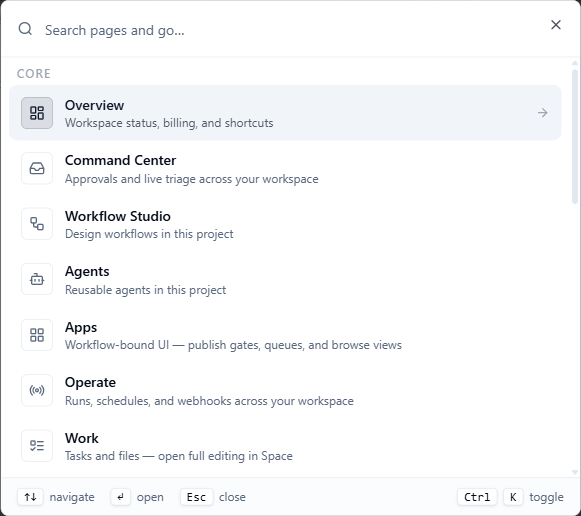

This page lists the keyboard shortcuts in the [Console](https://console.agentruntime.io) and the page addresses (links) you can bookmark or send to a teammate.

**Who this is for:** anyone who uses the Console every day. Studio shortcuts need the `project_contributor` role (or higher) in the project, because they edit the workflow. A link opens the page only for people who have access to that workspace and project.

**What you will do on this page:** open the command palette, edit a workflow without the mouse, send a reply from the keyboard, and build links to runs, tasks and filtered lists.

## Open the command palette

Press **Ctrl+K** (**Cmd+K** on a Mac) on any page in the Console. A search box opens with the placeholder "Search pages and go…".

<Steps>
  <Step title="Open the palette">
    Press **Ctrl+K** (**Cmd+K** on a Mac).
  </Step>
  <Step title="Type to find a page">
    Type part of a page name, its short description, or its path, for example `operate`. If nothing matches, the palette says "No matching page".
  </Step>
  <Step title="Open it">
    Use the up and down arrow keys to move, then press **Enter**. Press **Esc** to close the palette without going anywhere. Pressing **Ctrl+K** (**Cmd+K**) again also closes it.
  </Step>
</Steps>

The palette lists pages only. It has the same pages as the Console sidebar, in the same groups, plus **Profile**:

| Group | Pages |
|---|---|
| **Core** | **Overview**, **Command Center**, **Workflow Studio**, **Agents**, **Apps**, **Operate**, **Work** |
| **Integrations** | **MCP**, **Hosted apps**, **Connections**, **Databases**, **Storage**, **Providers**, **Marketplace**, **Tools** |
| **Administration** | **Vault**. This group appears only for people with admin-level access. |
| **Workspace** | **Analytics**, **Settings** |
| **Account** | **Profile** |

**Workflow Studio** opens the last workflow you opened in this browser tab, or the workflow list if you have not opened one. The palette does not search inside pages, so it cannot find a single workflow, run or agent by name.

<Frame caption="The command palette (Ctrl+K)">
  
</Frame>

## Workflow Studio shortcuts

These keys work on the canvas in [Workflow Studio](/workflows/studio). Where a key below starts with **Ctrl**, you can press **Cmd** instead on a Mac.

| Action | Keys |
|---|---|
| Delete the selected step | **Delete** |
| Duplicate the selected step | **Alt+D** |
| Undo | **Ctrl+Z** |
| Redo | **Ctrl+Y** or **Ctrl+Shift+Z** |
| Save now | **Ctrl+S** |

What each one does:

- **Delete** removes the selected step and the connections to it. There is no confirmation. Press **Ctrl+Z** to bring it back. You can also point at a step and click the **X** in its corner.
- **Alt+D** adds a copy named like the original with "(Copy)" after it, a little below and to the right of it. The copy does not get the original's connections. It does not work on steps inside a loop.
- **Undo** and **Redo** step back and forward through your edits: changes to steps, connections and where steps sit on the canvas, and changes in **Setup**. Studio keeps up to 50 changes. Edits that come fast, such as typing, count as one change. A workflow you have just opened has nothing to undo. The **Undo** and **Redo** buttons in the Studio toolbar do the same thing and are greyed out when there is nothing to undo or redo.
- **Save now** saves your edits straight away. Studio also saves on its own.

Some rules apply to all of them:

- **Backspace** does not delete a selected step. Studio blocks it so you do not remove a step by accident. Use **Delete**.
- When you type in a text box, a code editor or any other field, the keys above do nothing, except the save key. It works there too.
- If you cannot edit workflows, for example with the `project_viewer` role, the editing keys do nothing and the save key shows "View only".
- In the **Run** view of the canvas, or on a published version, the save key shows "Run inspect is read-only" or "Published versions are read-only". See [Workflow Studio](/workflows/studio).

## Send a reply from the keyboard

When a task waits for you, press **Ctrl+Enter** (**Cmd+Enter** on a Mac) in its text box to send, instead of clicking the button.

| Task | Text box | Sends the same as |
|---|---|---|
| A question from an agent | The answer box ("Your answer") | **Send answer** |
| A reply task | The reply box | **Send** |

An answer needs some text. A reply needs text or an attached file when the task requires a reply. On a wide screen, "Ctrl+Enter to send" shows next to the buttons as a reminder. This works wherever the box appears in [Command Center](/workflows/command-center): the list, the **View** panel and the **Conversation** panel. It does not work in the **Reject** reason box or in the **Correct it** box.

## App Studio shortcuts

App Studio has its own keys. See [Apps](/platform/apps).

## Share a link to a page

The address of a Console page can carry settings, such as which run is open or which filters are on. Copy the address from your browser, or use a **Copy link** button where the Console has one. The Console host is `https://console.agentruntime.io`. In the tables below, text in angle brackets such as `<workflow-id>` is a value you fill in.

<Note>
  Links carry IDs, not names. To find an ID, open the item in the Console and copy it from the address bar. The sections below say where each one shows up.
</Note>

### Workflow Studio links

Start from the address of a workflow:

```
https://console.agentruntime.io/workflow/<workflow-id>
```

Add settings after a `?`, and join more than one with `&`:

| Setting | Values | What it does |
|---|---|---|
| `run` | A run ID | Opens the run panel, selects that run, and switches the canvas to the **Run** view |
| `tab` | `events`, `timeline`, `context`, `logs`, `dryrun` | Opens that tab of the run panel: **Events**, **Timeline**, **Context**, **Full Logs** or **Dry Run**. Without `tab`, it opens on **Events**. |
| `version` | A whole number such as `3` | Opens published version 3, read-only |

For example, to open a run on its **Timeline** tab:

```
https://console.agentruntime.io/workflow/<workflow-id>?run=<run-id>&tab=timeline
```

- Picking a run in Studio does not change the address. To get a run's full ID, point at the run in the **Runs** list and click the copy button next to **Run ID** in the card that opens, or read it on the **Context** tab. Then build the link as above.
- For a published version, open **History**, then use **Copy link** on the version. It gives you the `version` link.

### Command Center links

| Link | What it does |
|---|---|
| `https://console.agentruntime.io/command-center?tab=approvals` | Opens the **Needs you** list |
| `...?tab=missed` | Opens **Missed** |
| `...?tab=active` | Opens **In progress** |
| `...?tab=failed` | Opens **Issues today** |
| `...?run_id=<run-id>&workflow_id=<workflow-id>` | Opens **Needs you** and the **View** panel of that run, when the run has a task waiting for someone. If it has none, Command Center opens as usual. |

Without `tab`, Command Center opens on the first list that has something in it.

### Operate links

Links to [Operate](/platform/operate) can carry a tab and filters. The quickest way to get one is to set the filters on the page and click **Copy link**. To build one by hand, start from:

```
https://console.agentruntime.io/operate
```

| Setting | Values | What it does |
|---|---|---|
| `tab` | `runs`, `schedules`, `webhooks` | Opens that tab. Without it, **Runs** opens. |
| `project_id` | A project ID | Filters to that project. Without it, Operate opens on the project picked in the sidebar. |
| `status` | A list of run statuses separated by commas (see below) | Sets the **Status** filter on the **Runs** tab |
| `workflow_id` | A workflow ID | Sets the **Workflow** filter |
| `agent_id` | An agent ID | Sets the **Agent** filter |
| `triggered_by` | `chat`, `cron`, `webhook`, `api` or `manual` | Sets the **Source** filter |
| `stale_paused` | `1` | Turns on **Paused > 7 days**. Use it with `status=paused`. |
| `from`, `to` | A date and time such as `2026-10-01T00:00:00Z` | Limits the runs to a date range |
| `failed_fires` | `1` | On the **Schedules** tab, opens the **Failed schedule fires (24h)** list |

To make the **Status** box show a choice, use one of these values:

| Choice in **Status** | Value of `status` |
|---|---|
| **In progress** | `running,pending,queued,starting,draining` |
| **Paused** | `paused` |
| **Unfinished** | `running,pending,queued,starting,draining,paused` |
| **Completed** | `completed` |
| **Failed / stopped** | `failed,stopped,cancelled` |

For example, runs started by a schedule that failed or were stopped:

```
https://console.agentruntime.io/operate?tab=runs&status=failed,stopped,cancelled&triggered_by=cron
```

### Links to other pages

| Page | Link | What it does |
|---|---|---|
| **Settings** | `/settings?tab=<tab>` | Opens a tab of [Settings](/platform/settings). Values: `general`, `apiKeys`, `inboundWebhooks`, `principals`, `access`, `delegation`, `team`, `audit`, `billing`, `plans`, `usage`, `mcp`. They match **General**, **API keys**, **Inbound webhooks**, **Principals**, **My access**, **Delegation**, **Team & Members**, **Audit log**, **Billing Overview**, **Plans**, **Usage & History** and **MCP & Integrations**. |
| **Connections** | `/connections?connection=<connection-id>` | Opens the details of that connection. The Console adds this to the address when you open a connection. If the ID is not in this workspace, you see "Connection not found". |
| **MCP** | `/mcp?instance=<instance-id>` | Opens the details panel of that MCP instance. The Console adds this to the address when you open an instance. |
| **Work** | `/work?task=<task-id>` or `/work?file=<file-id>` | Selects that task, or that file. Selecting one clears the other. |
| **Vault** | `/vault?scope=<scope>&path=<folder>` | Opens a folder in the Vault. `scope` is `tenant` (**Workspace**), `project` or `user`. Without a valid `scope`, `tenant` is used. `path` is the folder inside that scope, for example `providers/llm`. |

In these links, put `https://console.agentruntime.io` in front of the path. The **Team & Members** and **Audit log** tabs open only for people who may use them. Everyone else lands on **General**. **Vault** shows "Vault access required" to people who cannot view it.

## Common problems

| Problem | What to try |
|---|---|
| **Delete** does nothing on the canvas | Click the step first so it is selected, and make sure your cursor is not in a text box. **Backspace** never deletes a step. |
| A Studio link opens on **Events**, not the tab you chose | Check that `tab` is one of `events`, `timeline`, `context`, `logs` or `dryrun`. |
| A Command Center link with `run_id` opens the normal page | The run has no task waiting. The link opens the **View** panel only for runs that wait for a person. |
| The **Status** filter looks blank after you open an Operate link | The `status` value does not match a choice in the table above. The filter still applies. |
| A link says an item was not found | The item may belong to another workspace, or someone deleted it. The person who opens the link needs access to the workspace and project. |

## Next steps

- [Workflow Studio](/workflows/studio): the canvas, undo and redo, and the run view
- [Operate](/platform/operate): runs, schedules and webhooks across the workspace
- [Command Center](/workflows/command-center): answer tasks and control runs
- [Settings](/platform/settings): a tour of every Settings tab
