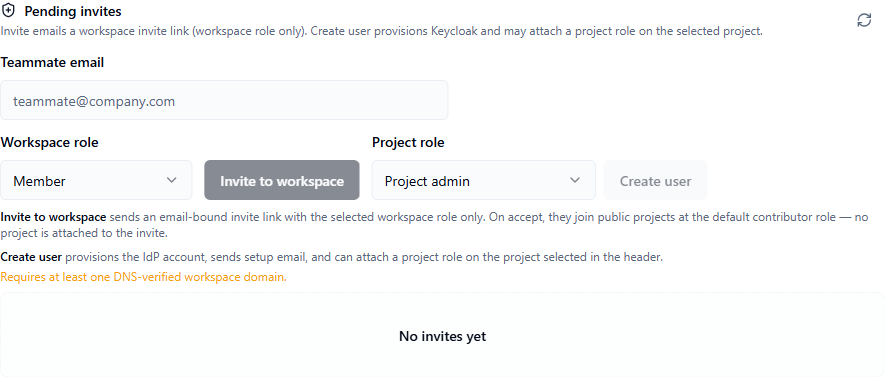
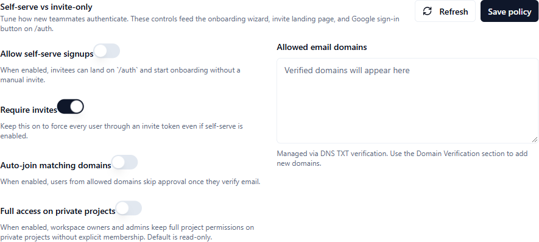

This page is for workspace admins and owners. You will learn how to invite teammates, give them the right access, and remove them when they leave.

## Before you begin

- You need the **Admin** or **Owner** workspace role. A **Member** does not see **Team & Members** in Settings: opening it by address quietly shows **General** instead.
- The invite form is far down a long page, below **Workspace hierarchy**, **Teams**, **Invite Center**, **Self-serve vs invite-only** and **Allowed email domains**. Scroll to **Pending invites**.
- Read [Roles and permissions](/platform/roles-permissions) first if the words **workspace role** and **project role** are new to you.

## Invite someone by email

<Steps>
  <Step title="Open Team & Members">
    Go to **Settings → Team & Members**.
  </Step>
  <Step title="Enter the email address">
    Find the **Pending invites** card on the tab. Type the address in **Teammate email**. **Invite to workspace** stays greyed out until you do.

    <Frame caption="The invite form, with the email field empty">
      
    </Frame>
  </Step>
  <Step title="Choose a workspace role">
    Pick **Workspace role**: **Member**, **Admin** or **Owner**. Most people should be **Member**. If you pick **Admin** or **Owner**, the Console asks you to confirm before it sends the invite.
  </Step>
  <Step title="Send the invite">
    Click **Invite to workspace**. AgentRuntime emails the invite link to that address. The Console also tries to copy the link to your clipboard. The link only works for the invited email address.

    **You should see:** an "Invite created" message and the invite in the invites list on the same tab. If the email doesn't arrive, send the link yourself: click **Copy link** on the invite. Click **Delete** to cancel an invite.
  </Step>
</Steps>

An email invite sets the workspace role only. When the person accepts, they get **Contributor** access to every **public** project. To give access to a **private** project, add them to it as described below.

The pending invite shows the address, a **Pending** label, the role (for example **Member**), when it was created and **Expires in 2 days**.

### What the person you invited does

<Warning>
  **Join workspace on the invite page does not join the workspace.** It takes the person to onboarding and then to the Overview of the workspace they were already in, with no message. The invite stays pending until they accept it a second time, in the workspace switcher.
</Warning>

<Steps>
  <Step title="Open the invite link">
    The invite page reads **You're almost in** and shows the workspace handle, **Valid** and an expiry date, with **Join workspace**. It does not say who invited them or which role they get. The page uses a dark theme, whatever the Console is set to.
  </Step>
  <Step title="Click Join workspace">
    If they already have an account, they land on the Overview of their current workspace. If this is their first workspace, they go through onboarding.
  </Step>
  <Step title="Accept in the workspace switcher">
    They open the workspace switcher. Under **Invites** they see your workspace with an **Accept** button. Clicking **Accept** makes your workspace the active one. There is no "You joined" message.
  </Step>
</Steps>

Tell people to expect these two steps. If you do not want to rely on the email, click **Copy link** on the pending invite and send the link yourself. **Delete** cancels an invite.

## Set a project role

1. Select the project in the project switcher.
2. On **Settings → Team & Members**, find the person under **Current members**.
3. Use the project role menu on their row to choose **Project admin**, **Contributor** or **Project viewer**.

<Note>
  A person who has only the default access to a public project does not appear under **Project members**, and the role menu on **Current members** offers only **Member**, **Admin** and **Owner**. In testing there was no obvious way to give such a person **Project viewer**. See [Roles and permissions](/platform/roles-permissions#role-names-in-the-console-and-in-these-docs).
</Note>

Use **Remove from project** on the same row to take back their project access. You can also manage a project's members from **Project settings** (the **⋮** menu next to the project).

## Create a user directly

**Invite to workspace** and **Create user** sit side by side and do different things. **Invite to workspace** sends a link and sets only the workspace role. **Create user** creates the account, sends a setup email and attaches the **Project role** you choose.

If your workspace has a DNS-verified email domain, **Create user** sets up an account for someone and can attach the **Project role** you choose in the selected project. If no domain is verified yet, the button is disabled, and the requirement is in small print after the buttons. Verify a domain under **Verify ownership via DNS TXT** on the same tab.

## Who should get which role

| If they need to… | Give them |
|------------------|-----------|
| Look at workflows, runs and analytics only | **Project viewer** |
| Build workflows, connect tools and start runs | **Contributor** |
| Manage who is in a project | **Project admin** |
| Manage billing, team and workspace policy | Workspace **Admin** or **Owner** |

## Change a workspace role

On **Current members**, use the workspace role menu on the member's row. Promoting someone to **Admin** or **Owner** shows a confirmation that explains what they will be able to do. Only promote people who need that control.

## Remove someone from the workspace

1. Go to **Settings → Team & Members → Current members**.
2. Click **Remove from workspace** on their row. You cannot remove yourself.
3. Read the prompt and confirm.

The person loses access to the workspace and their account is disabled until you invite them again. This does not permanently delete data.

## Control how people join

Under **Self-serve vs invite-only** on **Team & Members**, set:

- **Allow self-serve signups** — whether people can start onboarding without an invite
- **Require invites** — force everyone to use an invite
- **Auto-join matching domains** — people with a verified company email domain skip approval after verifying their email
- **Full access on private projects** — see [Roles and permissions](/platform/roles-permissions)

Click **Save policy** to apply.

<Frame caption="The Self-serve vs invite-only settings">
  
</Frame>

People who match your domain but need approval appear under **Access requests**, where you can approve or deny them.

## Common problems

| Problem | What to try |
|---------|-------------|
| The invited person clicked **Join workspace** and nothing changed | They must also click **Accept** under **Invites** in the workspace switcher. See [What the person you invited does](#what-the-person-you-invited-does). |
| **Team & Members** is missing | You need the workspace **Admin** or **Owner** role. |
| An invitee cannot accept | The link is tied to the invited email address. They must sign in with that address. |
| **Create user** is disabled | Verify a workspace domain first. |
| A new member cannot see a project | The project is private. Add them to it. |

## Next steps

- [Roles and permissions](/platform/roles-permissions)
- [Quickstart](/platform/quickstart) for new members
- [Workspace settings](/platform/settings)
