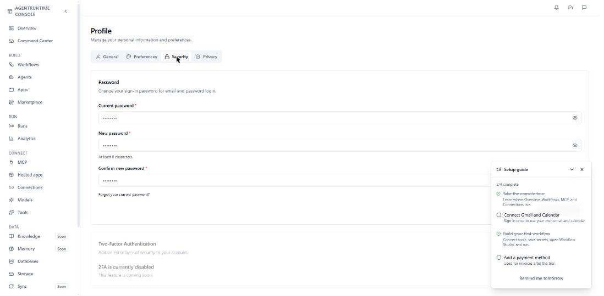

Your profile is personal to you and applies to every workspace you belong to. It has four tabs: **General**, **Preferences**, **Security**, and **Privacy**.

**Who this is for:** every user. Workspace settings, such as the workspace name and members, are on a different page: see [Settings](/platform/settings).

## Open your profile

Open your profile in the Console (the page is at `/profile`). The tabs are **General**, **Preferences**, **Security**, and **Privacy**.

| Tab | What you do there |
|---|---|
| **General** | See your name, email, and user ID. Change your username with **Save username**. Restart the **Product tours**. |
| **Preferences** | Choose **Light**, **Dark**, or **System** under **Appearance**. See [Dark theme and preferences](/platform/dark-theme-and-preferences). |
| **Security** | Change your password. See where two-factor authentication stands. |
| **Privacy** | Download your data. Delete your account. |

<Note>
  First name, last name, and email are greyed out and cannot be edited on this page. The Console does not say why. Your username accepts letters and digits only, 3 to 64 characters, and **Save username** stays disabled until you type a new one.
</Note>

## Change your password

<Steps>
  <Step title="Open Security">
    Go to your profile and click **Security**. Under **Password** you see: "Change your sign-in password for email and password login."
  </Step>
  <Step title="Fill in the three fields">
    Enter **Current password**, **New password** (at least 8 characters), and **Confirm new password**. If you forgot the current one, click **Forgot your current password?**.
  </Step>
  <Step title="Click Change password">
    **You should see:** the password change confirmed. Use the new password the next time you sign in.
  </Step>
</Steps>

<Note>
  The password form is for email and password sign-in. If you sign in with Google, this page may not apply to you. The Console does not describe what a Google-only account sees here.
</Note>

<Frame caption="Profile, Security tab: password change and two-factor authentication (coming soon)">
  
</Frame>

## Two-factor authentication

The **Security** tab has a **Two-Factor Authentication** section. It reads "2FA is currently disabled" and "This feature is coming soon." The **Enable 2FA** button is shown, but the feature is not available yet.

<Warning>
  Two-factor authentication is **coming soon**. Do not rely on it to protect your account yet. Use a strong, unique password.
</Warning>

The Security tab does not list your active sessions and has no **Sign out everywhere** control.

## Export your data

Open **Privacy**. **Export your data** explains what you get: your profile and workspace memberships cover your whole account, and everything else is limited to your current workspace.

| Included | Notes |
|---|---|
| Profile | Your name, email, and username. |
| Workspace memberships | All workspaces you belong to. |
| API keys | Metadata only (name, scopes, expiry). Never the key itself. |
| Connections | Never includes credentials. |
| Workflows | The workflows you own. |
| Agents | The agents you own. |

Click **Download my data**.

<Note>
  The export does not include runs, approvals and their decisions, secret metadata, billing history, or the audit log. If you belong to several workspaces, switch to each one and export again, because everything except your profile and memberships is scoped to the current workspace.
</Note>

<Frame caption="Profile, Privacy tab: export your data and delete your account">
  
</Frame>

## Delete your account

**Delete your account** says "Permanently close your account. This cannot be undone." Before you can delete it, the page lists what you must resolve first.

The most common blocker: you are the only owner of a workspace. The card then reads, for example, "You're the only owner of 'Acme Demo' — promote another member to owner there before deleting your account." To fix it:

<Steps>
  <Step title="Promote another owner">
    Open **Settings → Team & Members** in that workspace and change another member's workspace role to **Owner**. See [Invite a teammate](/platform/invite-a-teammate).
  </Step>
  <Step title="Come back to Privacy">
    **You should see:** the blocker gone from the list.
  </Step>
  <Step title="Delete">
    Click **Delete my account** only when you are sure. Account deletion cannot be undone, and it is refused when you have paid-for credits.
  </Step>
</Steps>

<Warning>
  While blockers are listed, the **Delete my account** button is faded and cannot be used. Read the list first, resolve each item, and export your data before you delete anything.
</Warning>

Deleting a workspace is a separate action under **Settings → General**. Self-service workspace deletion is not available yet: the page directs you to support. See [Settings](/platform/settings).

## Next steps

- [Dark theme and preferences](/platform/dark-theme-and-preferences)
- [Settings](/platform/settings): workspace name, members, API keys.
- [Roles and permissions](/platform/roles-permissions)
- [Security and compliance](/platform/security-and-compliance)
