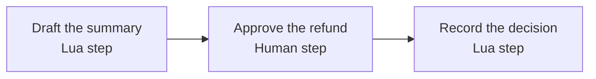

In this tutorial you build a small approval workflow in [Workflow Studio](/workflows/studio). It drafts a refund request, waits for a person to approve it, and records the decision. You will create it, check it, run it, approve it in Command Center, and read the result.

**Who this is for:** anyone new to AgentRuntime. You do not need to write code, but you will read a few lines of JSON and a short script.

**What you will build:**



| Step | Type | What it does |
|------|------|--------------|
| **Draft the summary** | `lua` | Builds a one-line summary of a refund request |
| **Approve the refund** | `human` | Pauses the run and asks a person to approve or reject |
| **Record the decision** | `lua` | Runs only after approval and records the outcome |

This workflow needs no connections and no AI model key, so it runs in a brand-new workspace. When you finish, you can [add an AI step](#optional-add-an-ai-step) or [connect a real tool](/integrations/how-connecting-works).

## What you need

- Access to the [Console](https://console.agentruntime.io) and a workspace and project selected in the header.
- The `project_contributor` role or higher. `project_viewer` can look but not build or run. See [Roles and permissions](/platform/roles-permissions).
- Credits in your workspace. Runs use credits according to your plan. See [Billing and credits](/platform/billing-and-credits).

## Build and run it

<Steps>
  <Step title="Create the workflow">
    In the Console sidebar, open **Workflow Studio** and click **Create workflow**. The **Find a workflow recipe** dialog opens. Recipes are ready-made starting points. You will start empty instead.

    To name your workflow, scroll to **Workflow name** at the bottom of the right-hand panel and type a name, such as `Refund request approval`. Then click **Blank canvas** at the top right. You can rename the workflow later.

    <Frame caption="Type a name under Workflow name, then click Blank canvas.">
      
    </Frame>

    **You should see:** an empty canvas with a toolbar along the top and a green **Live** chip. A card in the middle asks **What should this workflow do?** It can build steps from a description. You do not need it for this tutorial.

    <Frame>
      
    </Frame>
  </Step>
  <Step title="Import the three steps">
    The quickest way to get exactly the right steps is to import them. Copy the [workflow JSON](#the-workflow-as-json) from the end of this page. In the toolbar, open the **JSON** menu (the `{ } JSON` button with an arrow, at the far right) and click **Import**. In the **Import Workflow** dialog, choose **From clipboard** and paste the JSON. The **Review import** preview appears. Click **Import**.

    <Note>
      The toolbar adapts to your window width. In a narrower window, the **JSON** menu is folded into **More** (the `⋯` button at the far right), which also has **Import**.
    </Note>

    <Frame caption="Import is in the toolbar's JSON menu.">
      
    </Frame>

    <Frame caption="After you paste, Review import shows the steps before you import them.">
      
    </Frame>

    **You should see:** three steps connected left to right: **Draft the summary**, **Approve the refund**, **Record the decision**.

    <Frame>
      
    </Frame>

    <Note>
      Import replaces whatever is on the canvas. It does not change the workflow's name. Studio replaces the short step IDs in the JSON (`draft`, `review`, `decision`) with its own long IDs, and it updates every reference to them. If you see long IDs in a step's settings or in the JSON, that is why.
    </Note>
  </Step>
  <Step title="Look at each step">
    Click a step to open its settings on the right.

    - **Draft the summary** has a **Lua script** field. Lua is a small scripting language for reshaping data. This script returns a table with the customer, the order, the amount, and a `summary` sentence. A Lua step must return a table.
    - **Approve the refund** is a **Human** step. It pauses the run and creates a task. The message the reviewer sees is `{{steps.draft.result.summary}}`. Under **If no response (timeout policy)** it says **Keep waiting**, and under **When rejected** it says **Stop this branch**.
    - **Record the decision** reads the reviewer's answer. In a script, the answer is `steps["review"].result.approved`.

    <Frame caption="The Lua script of Draft the summary.">
      
    </Frame>

    <Frame caption="The settings of Approve the refund, a Human step.">
      
    </Frame>

    The double braces in `{{steps.draft.result.summary}}` are a **template**. At run time AgentRuntime replaces it with the `summary` field that the **Draft the summary** step returned. The pattern is `{{steps.<step id>.result.<field>}}`. To insert one without typing it, type `{{` in a field and pick a suggestion. See [Template intellisense](/workflows/template-intellisense).

    <Note>
      The reviewer's message is set in the step's JSON (`task_payload`), not in the step settings. To change it, click **JSON** next to **Canvas** in the toolbar (or **Edit JSON** in the **JSON** menu), edit the text, then click **Apply to canvas**. Click **Canvas** to go back. **View JSON** shows the same JSON read-only. In a narrower window, **More** only offers **View JSON**, so widen the window to edit.
    </Note>

    <Frame caption="The JSON view. The reviewer's message is under task_payload.">
      
    </Frame>
  </Step>
  <Step title="Connect the steps">
    The import already drew the lines. A line means "run after". **Approve the refund** starts only when **Draft the summary** has finished, and **Record the decision** starts only after the approval. Steps with no line between them run at the same time.

    To build a line yourself, draw it from one step to the next. See [Step types](/workflows/step-types) for what each type does and the settings every step shares.
  </Step>
  <Step title="Dry-run it">
    Click **Dry-run** in the toolbar. A dry-run checks that the workflow is well-formed without running anything: required fields, connections between steps, templates, and Lua syntax. See [Dry-run validation](/workflows/dry-run).

    **You should see:** the **Dry Run** tab of the run panel at the bottom with **Dry-run passed** and **no issues**, and a "Workflow dry-run passed" message. If it lists an issue, it names the step and often suggests a fix.

    <Frame>
      
    </Frame>
  </Step>
  <Step title="Save it">
    Studio saves your edits automatically after a couple of seconds; the chip next to the workflow name shows **Live · saved**. You can also click the **Save** button (the disk icon) in the toolbar. There is nothing to publish yet: **Run** always runs your latest saved edits, which are called **Live**. See [Live copy and published versions](/workflows/studio#live-copy-and-published-versions).
  </Step>
  <Step title="Run it">
    Click the green **Run** button in the toolbar. Studio starts a run of your **Live** copy, and the run panel at the bottom (**Run logs and metrics**) lists the new run. Click the run, then the **Events** tab.

    **You should see:** **Draft the summary** with the status **Success**, **Approve the refund** waiting, and the run marked **Paused**. This is expected: the run is waiting for a person, not stuck. While it waits, the toolbar shows **Resume** and **Stop**. You do not need either: the run continues on its own when someone answers the task.

    <Frame>
      
    </Frame>
  </Step>
  <Step title="Approve it in Command Center">
    Open **Command Center** in the sidebar. The **Needs you** chip shows **1**.

    **You should see:** a row with your workflow's name, the label **Approval**, and the summary line "Refund $49.00 to Dana Lee for order A-1042 (item arrived damaged)."

    <Frame>
      
    </Frame>

    Click **Approve**. The task leaves the list and the run continues. To see the task's details first, click **View**. See [Command Center](/workflows/command-center) and [Human tasks](/workflows/human-tasks).

    <Frame caption="Approving the task in Command Center.">
      <video autoPlay muted loop playsInline src="/images/workflows/build-first-approve.mp4"></video>
    </Frame>
  </Step>
  <Step title="Read the result">
    Go back to your workflow in Workflow Studio. In the run panel, click the run, which now shows **Success**, then open the **Events** tab.

    **You should see:** every step marked **Success**. Under **Record the decision**, **Output** shows what the step returned:

    ```json
    {
      "approved": true,
      "message": "Refund of $49.00 for order A-1042 was approved."
    }
    ```

    <Frame>
      
    </Frame>

    The **Events** tab lists every step in order, including when the task was created and answered.
  </Step>
  <Step title="Try a rejection">
    Click **Run** again. This time, click **Reject** in Command Center. A **Reason (optional)** box opens next to the button. Type a reason if you like, then click **Reject** again to confirm.

    <Frame>
      
    </Frame>

    **You should see:** in the run's **Events**, **Approve the refund** marked **Skipped · Approval rejected**, with `"approved": false` and your reason as `comment` in its output. **Record the decision** never runs. This is what **When rejected: Stop this branch** does: the steps after the approval are skipped. The run itself still finishes with the status **Success**. Other choices, such as sending the work back for changes, are in [Human tasks](/workflows/human-tasks#on-reject).
  </Step>
  <Step title="Publish a version (optional)">
    When you want a frozen copy that does not change while you keep editing, click **Publish** in the toolbar. The **Publish v1** dialog explains that a published version never changes and that Live stays editable. Add a note and click **Publish v1**, then **Done**.

    <Frame>
      
    </Frame>

    Triggers such as schedules and webhooks can then run **Last published** instead of **Live**. Studio's **Run** button always runs Live. See [Workflow Studio](/workflows/studio#publish-a-version).
  </Step>
</Steps>

## Optional: add an AI step

You can make the draft smarter by adding an **LLM** step. It sends a prompt to a model.

<Steps>
  <Step title="Add the step">
    In the step palette, search for **LLM** under **Built-in** and click it, or drag it onto the canvas.
  </Step>
  <Step title="Choose the model and key">
    In its settings choose a **Model**, then an **API key**: the platform default or one of your workspace keys. Platform models depend on your plan. If your plan does not include them, add your own key on **Providers** first. See [LLM providers](/ai/llm-providers).
  </Step>
  <Step title="Write the prompt">
    Type a prompt and use a template to include the summary, for example: `Write a friendly two-sentence reply to the customer about this refund: {{steps.<id>.result.summary}}`. Type `{{` to pick the **Draft the summary** step instead of typing its ID.
  </Step>
  <Step title="Wire it in and show it to the reviewer">
    Connect **Draft the summary** to the LLM step, and the LLM step to **Approve the refund**. The model's reply is on the step as `result.text`, so a template such as `{{steps.<id>.result.text}}` reads it. Dry-run again, then run.
  </Step>
</Steps>

An LLM step fails the run if the model call fails, so check the failed step's error in **Events**. See [Troubleshooting](/platform/troubleshooting).

## Run it other ways

So far you started the run by clicking **Run**. A workflow can also start on its own. Each way is set up in **Setup** in the Workflow Studio toolbar. The **Workflow setup** dialog lists them on the left under **Triggers**: **Manual**, **Inbound**, **Events**, **Cron**, **Sessions**, **API** and **Apps**.

- **On a schedule.** Open **Setup**, then **Cron**. Pick a **Preset** or type a **Cron (5-field)** expression, choose a **Timezone**, choose which version **Runs** (for example **Live**), and pick an **Automation API key** (or click **Create API key**). Then click **Add schedule**. The shortest repeat is every minute. See [Cron schedules](/workflows/external-triggers#cron-schedules).

  <Frame>
    
  </Frame>
- **From a webhook.** Open **Setup**, then **Inbound**, and create a webhook. Another system sends a signed request to its URL, and the request body becomes the run's input. See [Inbound webhooks](/integrations/inbound-webhooks).
- **From the API.** Create an API key (a personal access token) under **Settings**, **API keys** with the `workflow:run` scope, then send a start command. The **API** tab in **Setup** shows your workflow's **Command URL** and a ready-made **Example request** you can copy. See [API authentication](/api/authentication).

  <Frame>
    
  </Frame>

  ```bash
  curl -X POST https://api.agentruntime.io/v1/workflows/WORKFLOW_ID/command \
    -H "Authorization: Bearer YOUR_API_KEY" \
    -H "Content-Type: application/json" \
    -d '{"command": "start"}'
  ```

- **From a channel message.** When a customer writes to you on a channel such as WhatsApp, a message can start a run or join an ongoing one-per-person conversation. See [Conversation sessions](/workflows/conversation-sessions).

Starting a run any of these ways still stops at the **Approve the refund** step until a person answers.

## Common mistakes

| Mistake | What happens | Fix |
|---------|--------------|-----|
| Expecting the run to finish without you | The run shows **Paused** at the **Human** step | Open **Command Center** and answer the task under **Needs you** |
| Walking away from an approval | After the step's **Timeout** (24 hours here) the step fails with "human_task timed out" and the task is listed under **Missed** | Answer sooner, or choose a different **If no response (timeout policy)** |
| Writing `{{…}}` inside a Lua script | Scripts do not use templates, and the braces are not replaced | Use Lua variables such as `steps["draft"].result.summary` |
| Returning a plain value from Lua | The step fails with "must return a table" | End the script with `return { ... }` |
| Reading a step that is not connected | The template stays as literal `{{…}}` text, or dry-run reports `template_missing_dependency` | Draw a line from that step, so it runs first |
| Using the step's display name in a template | The value is empty | Use the step's ID. Type `{{` and pick a suggestion |
| Expecting **Approve** to edit the draft | Later steps still see the original text | Read the draft from the step that wrote it |
| Editing after publishing and expecting triggers to change | A schedule or webhook set to **Last published** or a fixed version keeps running the old copy | Set its **Runs** choice to **Live**, or publish again |
| Expecting a failed step to retry | A failed step fails the run | Fix the cause and start a new run. See [Run recovery](/workflows/run-recovery) |

## The workflow as JSON

This is the same workflow as the graph Studio saves. You can paste it with **Import**, as in step 2. It follows the portable workflow format, so you can also send it through the API or the [Platform MCP authoring skills](/api/platform-mcp-authoring-skills).

```json
{
  "name": "Refund request approval",
  "description": "Summarise a refund request, wait for a person to approve it, then record the decision.",
  "steps": [
    {
      "id": "draft",
      "type": "lua",
      "name": "Draft the summary",
      "script": "local amount = 49\nreturn {\n  customer = \"Dana Lee\",\n  order_id = \"A-1042\",\n  amount = amount,\n  summary = string.format(\"Refund $%.2f to Dana Lee for order A-1042 (item arrived damaged).\", amount)\n}"
    },
    {
      "id": "review",
      "type": "human",
      "name": "Approve the refund",
      "depends_on": ["draft"],
      "task_type": "approval",
      "timeout_s": 86400,
      "task_payload": {
        "title": "Refund request",
        "message": "{{steps.draft.result.summary}}"
      }
    },
    {
      "id": "decision",
      "type": "lua",
      "name": "Record the decision",
      "depends_on": ["review"],
      "script": "local draft = steps[\"draft\"].result\nreturn {\n  approved = steps[\"review\"].result.approved,\n  message = string.format(\"Refund of $%.2f for order %s was approved.\", draft.amount, draft.order_id)\n}"
    }
  ]
}
```

What each part does:

| Field | Meaning |
|-------|---------|
| `id` | A unique name for the step. Other steps use it to read this step's output. |
| `type` | The kind of step: `lua` or `human` here. |
| `name` | A label for people. Never use it in a template. |
| `depends_on` | The steps that must finish first. It sets the order. |
| `task_type` | `approval` gives the reviewer **Approve** and **Reject** buttons. |
| `timeout_s` | How long the step may wait, in seconds. |
| `task_payload` | What the reviewer sees. `message` is the line shown in **Command Center**. Text values can use templates. |

## Next steps

- [Step types](/workflows/step-types): every step type and its settings
- [Run setup](/workflows/run-setup): give a run starting input, and save defaults
- [Human tasks](/workflows/human-tasks): reply boxes, send-back, and what happens when nobody answers
- [How connecting works](/integrations/how-connecting-works) and [Connections](/integrations/connections): call real tools such as Gmail or Sheets
- [End-to-end guides](/guides/overview): complete workflows that connect several tools
- [Limits and quotas](/platform/limits): time limits, loop caps, and size limits
