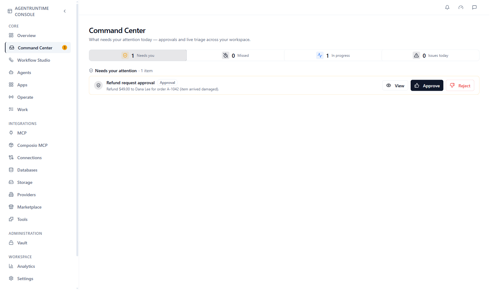
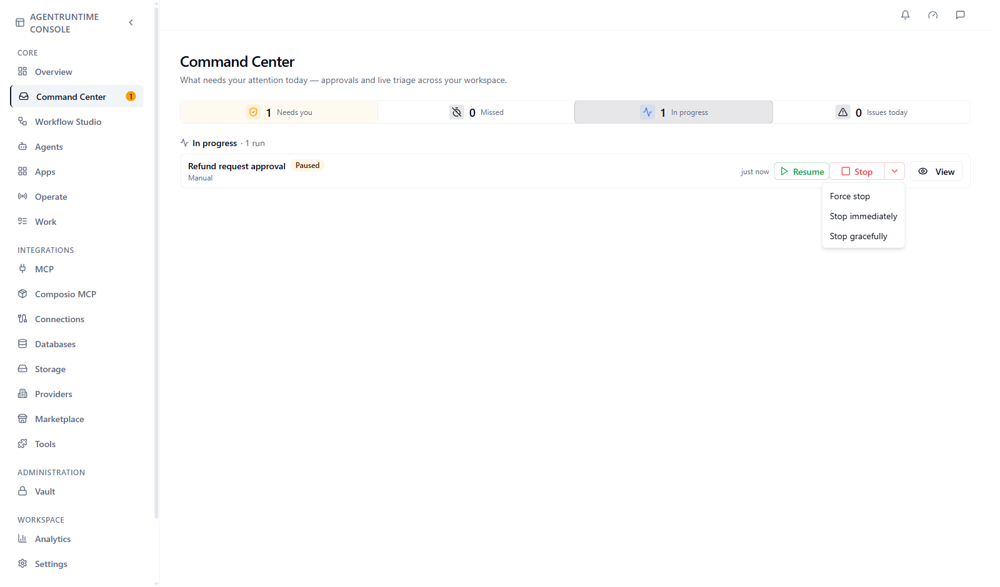
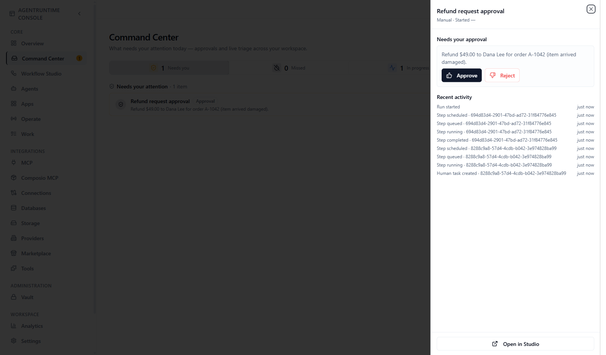

**Command Center** is the inbox for everything running in your workspace. Open it from the Console sidebar (**Command Center**, at `/command-center`).

**Who this is for:** people who answer human tasks (approvals, replies, questions) and people who keep an eye on runs.

**What you will do on this page:** answer tasks, follow up on missed ones, pause or stop a run, and find out why a run stopped.

## What you see

A strip of four chips runs across the top. Each chip shows a count; click one to switch the list below it.

| Chip | What the list shows |
|---|---|
| **Needs you** | Human tasks waiting for a person: approvals, replies, and questions from agents. List title: **Needs your attention**. |
| **Missed** | Tasks that nobody answered before their timeout, and replies that didn't reach the contact, from the last 7 days, that nobody has followed up yet |
| **In progress** | Runs that are running, starting, queued, paused, or stopping. List title: **In progress**. |
| **Issues today** | Runs that failed, were stopped, or were cancelled in the last 24 hours. List title: **Stopped with errors**. |

<Frame caption="Command Center with one task under Needs you">
  
</Frame>

When you open the page, Command Center picks the first chip that has something in it: **Needs you**, then **In progress**, then **Issues today**. The page refreshes by itself: every 3 seconds while something is waiting or running, otherwise every 30 seconds (the **Missed** list every minute).

## Needs you: answer tasks

Tasks are listed oldest first, so the person who has waited longest is answered first. A task waiting more than 10 minutes is highlighted. Each row shows the workflow, a label for the kind of task, and a short line of context. If you have more than three tasks, filter chips appear: **All**, **Replies**, **Questions**, **Approvals**.

There are three kinds of task:

| Kind | What you do |
|---|---|
| **Approval** | Click **Approve** or **Reject**. **Reject** opens an optional **Reason** box. If the workflow sends rejected work back for changes, the button reads **Send back** and asks what should change. |
| **Reply needed** | Click **Reply**, write your message, and click **Send**. Use **Attach file** to add files. **Don't reply** closes the task without sending anything. |
| **Question from the agent** | Click **Answer**, type your answer, and click **Send answer**. **End run** stops the run instead. |

To send a reply or an answer from the keyboard, press **Ctrl+Enter** (**Cmd+Enter** on a Mac) in the text box. See [Keyboard shortcuts and links](/platform/shortcuts-and-links#send-a-reply-from-the-keyboard).

When the workflow ties a task to a screen of an app, its row also shows an **Open app** button, next to **View**. Click it to open that app screen. See [Apps](/platform/apps).

An agent can also leave a **The agent's assumption**: it carried on with a guess and asks you to check it. Click **Looks right**, **Dismiss**, or **Correct it** (then **Send correction**). The run does not wait for these.

For tasks that come from a conversation with a contact (for example on WhatsApp), the row has a **Conversation** button. It opens the whole thread with that contact so you can read it before you answer. See [Conversation sessions](/workflows/conversation-sessions#hand-off-to-a-person).

Click **View** on any row to open the run in a side panel (see [Look at a run](#look-at-a-run)). After you answer, the task leaves the list and the run continues.

<Note>
  Answering here is the same as answering inside Workflow Studio or through the API. See [Human tasks](/workflows/human-tasks).
</Note>

## Missed: follow up on tasks nobody answered

A task can close on its own when its timeout runs out: it was handed back to the agent, approved or rejected automatically, could not be escalated, or simply expired. The person who should have answered may never know. The **Missed** list keeps these for 7 days.

A hand-off you answered also comes back here when your reply doesn't reach the contact. The channel accepts a reply and reports a minute or so later that it wasn't delivered. On WhatsApp this happens when more than 24 hours have passed since the contact's last message: only an approved template can reach them then. The row shows **Reply not delivered** and the reason.

Each row shows the workflow, how the task ended (for example **Handed back**, **Approved automatically**, **Rejected automatically**, **Not escalated (no backup approvers)**, **Expired**, **Reply not delivered**), how long it waited or why the reply wasn't delivered, and the last messages the contact sent while they waited.

- **Conversation** opens the contact's thread (read-only until you send a template from it, see below).
- **View** opens the run.
- **Send template** (on **Reply not delivered** rows) sends the contact an approved message template, which reaches them even after the 24-hour window has closed. See [Send a template when your reply didn't arrive](#send-a-template-when-your-reply-didnt-arrive).
- **Mark followed up** removes the task from the list once you have dealt with it, for example by calling the customer back.

### Send a template when your reply didn't arrive

A free-form reply is rejected once more than 24 hours have passed since the contact's last message. An approved template message is allowed. Open the row's **Send template**:

<Steps>
  <Step title="Pick a template">
    **Template** lists the templates your channel has approved, each with its language and category.
  </Step>
  <Step title="Fill in its values">
    A template's text has numbered placeholders. Enter a **Value for** each one, and check **Preview**, which is what the contact will read.
  </Step>
  <Step title="Send">
    Click **Send template**. The message is added to the contact's conversation as sent by you, with the label *Template: name*, and shows *Sent*, *Delivered* or *Read* as the channel reports it. The task is marked followed up and leaves **Missed**.
  </Step>
</Steps>

The channel may charge for template messages, so check your channel's pricing. When the contact answers, their reply opens a new conversation window and continues the session as any message does.

If the dialog says the workflow's session has no template sending set up, turn it on in **Workflow setup → Sessions → Templates**. See [Send a template to a contact](/workflows/conversation-sessions#send-a-template-to-a-contact).

## In progress: watch and control runs

Runs are grouped by workflow. Use the **Filter…** box to find one workflow, and **Load more runs** to see older ones. Each run shows a status:

| Status | Meaning |
|---|---|
| **Running** | Steps are executing |
| **Paused** | Paused by a person, or waiting for a person. No new steps start until it resumes or the task is answered. |
| **Pending**, **Queued**, **Starting** | Waiting to start |
| **Stalled** | Looks active but has shown no progress for 2 hours or more |

### Run controls

| Control | What it does |
|---|---|
| **Pause** | Stops new steps from starting. Steps already running can finish. People can still answer the run's tasks; the run carries on from there when you resume it. Available while a run is **Running**. |
| **Resume** | Continues a paused run |
| **Stop** | Ends the run. The main **Stop** button is a **Force stop**. The arrow beside it offers **Force stop**, **Stop immediately**, and **Stop gracefully**. |
| **Pause all**, **Resume all**, **Stop all** | The same, for every run in a workflow group |

**Stop gracefully** lets steps that are already running finish (their results are not recorded), never starts the rest, and ends the run as **Stopped**. **Stop immediately** and **Force stop** also cancel the calls in flight: tool calls, model calls, Lua scripts and loops. An agent step stops at its next tool call. A stop does not undo what a call already did, and does not stop child workflows. A stopped run cannot be resumed. See [How runs execute](/workflows/how-runs-execute#stop).

<Frame caption="An in-progress run with the Stop menu open">
  
</Frame>

A run waiting on a person is not stuck. It is designed to wait until the task is answered.

## Issues today: why did a run stop?

Runs that failed, were stopped, or were cancelled in the last 24 hours appear under **Stopped with errors**, with a short reason:

| Reason shown | What it means |
|---|---|
| **MCP tool error** | A tool returned an error |
| **LLM request failed** | A model call failed (key, model, or provider problem) |
| **Insufficient credits** | The workspace is out of credits |
| **Run timed out (no progress)** | The run made no progress within the allowed time |
| **Graceful stop timed out** | A graceful stop did not finish in time |
| **Stopped by operator** | A person stopped the run |
| **Step failed**, **Human review step failed**, **Workflow failed** | A step, a human task, or the workflow itself failed |
| **Service unavailable**, **Could not reach workflow service** | A temporary problem on the AgentRuntime side; start a new run |

Click **View** to see the step-by-step events. See [Troubleshooting](/platform/troubleshooting) for fixes and [Run recovery](/workflows/run-recovery) for what you can do next.

## Look at a run

**View** opens a side panel with the workflow name, how the run started (for example **Manual**), any task waiting on you (with its **Approve** and **Reject** buttons), and **Recent activity**, a short list of the latest run events. For runs that are in progress or have stopped, the panel also shows the status, any problem, and the run controls. Click **Open in Studio** to see the full run in the **Events** tab.

<Frame caption="The View panel of a run that is waiting for approval">
  
</Frame>

## When a run looks stuck

1. Check its chip. If it is in **Needs you**, it is waiting for a person. Answer the task.
2. If it is **Paused**, click **Resume** (unless you paused it on purpose).
3. If it shows **Stalled**, click **View** and read the last events in **Recent activity**. A slow tool or model call is the usual cause.
4. If nothing moves, click **Stop** and start a new run.
5. If the same step keeps failing, check its connection and your credits. See [Troubleshooting](/platform/troubleshooting).

## API equivalents

| Console action | API |
|---|---|
| List waiting tasks | `GET /v1/tasks/pending` |
| List missed tasks | `GET /v1/tasks/missed` |
| Mark a missed task followed up | `POST /v1/tasks/{task_id}/follow-up` |
| Complete a task | `POST /v1/workflows/{id}/runs/{runID}/tasks/{task_id}/complete` |
| List runs | `GET /v1/runs` |
| Stop, pause, resume | `POST /v1/workflows/{id}/command` with `stop`, `pause`, or `resume` |

## Next steps

- [Human tasks](/workflows/human-tasks): build approval and reply steps
- [Runs and observability](/workflows/runs-and-command-center): the run lifecycle and step badges
- [Run recovery](/workflows/run-recovery): after a failure
- [Workflow patterns](/workflows/patterns)
