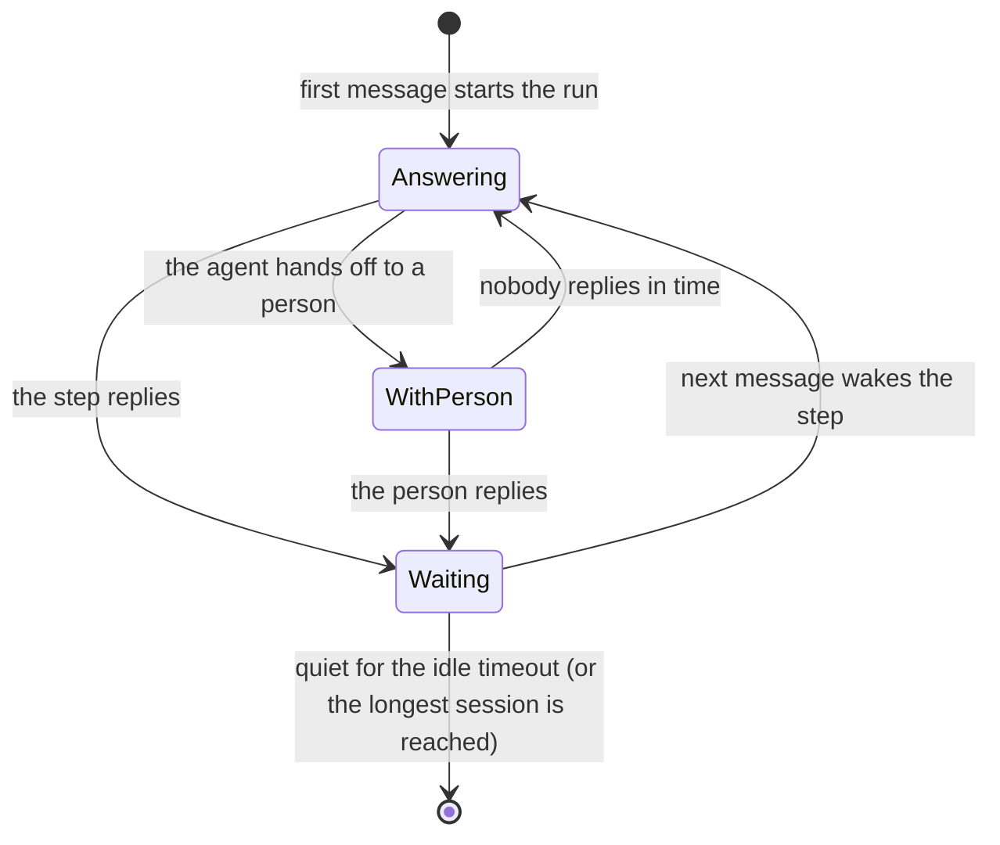

A **conversation session** keeps **one run per conversation**. The first message from a contact starts a run. Every later message from that contact joins the same run and goes to the step that is answering, instead of starting a new run. The run waits between messages and closes after a quiet period that you set.

Use sessions for anything that is a back-and-forth with one person: a WhatsApp support line, an order assistant, a booking flow, or a chat on your own app that you drive through the API.

| Without sessions | With sessions |
|---|---|
| Every message starts a new run | One run holds the whole conversation |
| Each run starts with no memory of the last one | The agent sees the conversation so far |
| Five quick messages make five runs and five replies | A burst of messages is answered together |
| A person can't take over mid-conversation | A step can hand the conversation to a person and get it back |

<Note>
  Sessions are a workflow setting, not a separate workflow type. Your steps, agents, and human tasks work as usual. The session only decides **which run** a new message goes to and **when that run ends**.
</Note>

## How a session works



1. **The first message starts a run** and binds it to the conversation, for example the contact's WhatsApp number.
2. **The step that owns the conversation answers.** Usually that is the agent that talks to the contact. Its reply is sent back through the workflow's reply channel.
3. **The run waits.** Nothing runs while the contact is quiet, and the Console shows *Waiting for the next message*.
4. **The next message wakes the run.** The owning step runs again with the new message and the conversation so far. Messages that arrive while the agent is still working are delivered into its current turn, or it answers again straight after with them.
5. **The run closes** when the conversation has been quiet for the idle timeout, when it reaches the longest session you allow, or when someone stops it. The next message from that contact starts a new session.

A closed session ends as **Success**. That means the run ended cleanly. It does not mean the contact's request was resolved. Closing is not announced to the contact; the run's event list shows a note such as *Conversation closed after 30 min without messages*.

## Turn sessions on

<Steps>
  <Step title="Open Workflow setup">
    In [Workflow Studio](https://console.agentruntime.io), open your workflow and go to **Workflow setup → Sessions**.
  </Step>
  <Step title="Switch on one run per conversation">
    Turn on **One run per conversation**.
  </Step>
  <Step title="Choose how long a conversation stays open">
    Set **Close after idle (minutes)** and, if you want a hard limit, **Longest session (minutes, optional)**. See [Session settings](#session-settings).
  </Step>
  <Step title="Choose the reply channel">
    Under **Reply channel**, pick the **Connection** and **Send tool** that deliver replies to the contact, for example your WhatsApp connection and `whatsapp_send_message`.
  </Step>
  <Step title="Mark the steps that talk">
    On each agent step that talks to the contact, turn on **Talks in the conversation**. On a human step that takes over the chat, turn on **Hand off the conversation to a person**. The **Steps that talk in the conversation** list in the Sessions tab shows which steps you have marked.
  </Step>
  <Step title="Publish">
    Session settings are saved with the draft. **Publish** the workflow so live messages use them.
  </Step>
</Steps>

Then route messages to the workflow. For WhatsApp, follow [WhatsApp customer chat](/guides/whatsapp-customer-chat). For any other source, start runs through the [API](#sessions-from-the-api) with a conversation id.

## Session settings

In the [JSON editor](/workflows/json-editor), sessions live under `settings.session`. The Console's **Sessions** tab writes the same fields.

```json
{
  "settings": {
    "session": {
      "idle_timeout_s": 1800,
      "max_duration_s": 86400,
      "outbound": {
        "type": "mcp",
        "instance_id": "<your WhatsApp MCP instance id>",
        "tool_name": "whatsapp_send_message",
        "tool_args": { "to": "{{input.from}}", "text": "{{message.text}}" },
        "media": {
          "tool_name": "whatsapp_send_media",
          "tool_args": {
            "to": "{{input.from}}",
            "type": "{{message.attachment.type}}",
            "media_url": "{{message.attachment.url}}",
            "caption": "{{message.attachment.caption}}",
            "filename": "{{message.attachment.filename}}"
          }
        }
      }
    }
  }
}
```

| Console field | JSON | What it does | Default |
|---|---|---|---|
| **One run per conversation** | `settings.session` present | Turns sessions on. Remove `session` (or switch it off) to go back to one run per message. | Off |
| **Close after idle (minutes)** | `idle_timeout_s` (seconds) | Closes the session after it has been waiting this long with no new message. The timer restarts every time the run starts waiting again. | 30 minutes |
| **Longest session (minutes, optional)** | `max_duration_s` (seconds) | Closes the session this long after it started, however active it is. If a step is still working at that moment, the session closes at its next wait. | No limit |
| **Connection**, **Send tool** | `outbound.instance_id`, `outbound.tool_name` | The MCP tool that delivers every message the workflow sends to the contact. Choose **None: post in the conversation only** to record replies without sending them anywhere. | WhatsApp send |
| **Tool arguments** | `outbound.tool_args` | Arguments for the send tool. `{{message.text}}` is the text being sent, and `{{input.*}}` reads the contact's latest message. | `to: {{input.from}}`, `text: {{message.text}}` |
| **Send files with** | `outbound.media` | The MCP tool that delivers each file the workflow sends, called once per file after the text. It uses the same connection unless you set `media.instance_id`. See [Files, voice notes, and locations](#files-voice-notes-and-locations). | None: files are recorded but not sent |

<Warning>
  Leaving **Close after idle** blank (or `0`) means the 30-minute default, not "never". To keep conversations open for a long time, set a long idle timeout. See [Recipes](#recipes).
</Warning>

## Steps that talk in the conversation

### Agents

Turn on **Talks in the conversation** for every agent that answers the contact. When that agent finishes a turn, its reply is posted to the conversation and sent through the reply channel.

- **Reply field (optional):** if the agent has an output schema, its `message` is often an internal summary. Set the field that holds the text for the contact, for example `reply`, and only that field is sent.
- **Back-office agents** (order lookup, stock check, CRM update) leave the option off. They never message the contact, even while they work on the contact's request, and the agent that talks to the contact stays the one who answers.
- An agent without a reply field that only hands work to a back-office agent sends nothing on that turn; its message is a note for the other agent. When the back-office agent hands back, the talking agent answers with the result.

<Note>
  If no step has **Talks in the conversation** on, every agent step answers the contact. Turn it on explicitly for the agents that talk to the contact as soon as you add a back-office agent.
</Note>

**What the agent receives on each turn:**

| Template / input | Contents |
|---|---|
| `{{input.*}}` | The contact's **latest** message as it arrived, for example `{{input.text}}`, `{{input.from}}`, and `{{input.contact_name}}` for WhatsApp. It is replaced by each new message. |
| `input.conversation.new_messages` | Every message that arrived since the agent's last turn, oldest first, each with `text`, `type`, `received_at`, and any `attachments`, `location`, or `contacts`. A burst of five messages arrives as one list. |
| Contact history | With [Remember each contact](/guides/whatsapp-customer-chat#4-route-messages-to-the-workflow) on, agent steps also see that contact's earlier messages and replies, including from previous sessions. |

Write prompts against the latest message (`{{input.text}}`) and let the agent read the rest from its history. Avoid templates for fields that a message may not carry; an unfilled template is left out of the prompt and listed in the step result under `unresolved_inputs`.

### Hand off to a person

A human step with **Hand off the conversation to a person** turned on takes over the chat while its task is open:

- New messages from the contact are listed on the task under **New since handoff**, so the person sees everything without opening the chat.
- The person answers in the task's reply box, with text, files, or both. The reply is sent to the contact as the person who wrote it. **Don't reply** closes the task without sending anything.
- When the person replies, the messages that arrived meanwhile count as answered, and the session waits for the contact again. If the task times out instead, the agent takes the conversation back and answers those messages.

To give the person a reply box, add a `response` to the step's `task_payload`:

```json
{
  "type": "human",
  "name": "Person reply",
  "timeout_s": 900,
  "timeout_policy": { "action": "return" },
  "task_payload": {
    "title": "Reply to {{input.contact_name}} on WhatsApp",
    "message": "{{input.contact_name}} needs a person: {{steps.assistant.result.reason}}",
    "response": { "field": "reply", "label": "Reply" }
  },
  "conversation": {
    "while_waiting": [
      { "on_message": 1, "reply": "Thanks! A member of our team will reply here shortly." },
      { "on_message": 4, "reply": "Sorry for the wait, our team is busy right now. We haven't forgotten you." }
    ],
    "return_to": "assistant"
  }
}
```

| Console field | JSON | What it does |
|---|---|---|
| **Replies while nobody has answered** | `conversation.while_waiting` | Automatic replies, each sent once, on the Nth message from the contact after the hand-off. Use them so a waiting contact is never left in silence. |
| **Give the conversation back to (optional)** | `conversation.return_to` | The step that takes the conversation back when the task is done. Default: the step that handed off. |
| **If no response → Hand the conversation back (session workflows)** | `timeout_policy.action: "return"` with `timeout_s` | When nobody replies within the timeout, the task closes as timed out and the agent takes the conversation back. Without it, the contact waits until someone answers. |

The agent decides when to hand off. A common pattern is an agent with an output schema that returns `action: "reply"` or `action: "human"`, and a human step after it with `skip_when` on `action == "reply"`. The [WhatsApp guide](/guides/whatsapp-customer-chat) builds this end to end.

## Files, voice notes, and locations

A message can carry more than text. When a contact sends a photo, video, voice note, audio file, document, or sticker, AgentRuntime stores the file in your workspace's file storage and the message carries it as an **attachment**. A shared location or contact cards come through too. A file that can't be fetched doesn't stop the message: its attachment carries an `error` instead of a `file_id`, and the text still arrives.

**Receiving.** Each attachment has these fields:

| Field | Example | Notes |
|---|---|---|
| `file_id` | `3f9c…` | The stored file in your workspace |
| `type` | `image`, `video`, `audio`, `document`, `sticker` | |
| `mime_type`, `filename`, `size_bytes` | `image/jpeg`, `image-AbC123.jpg`, `284113` | Channels that send no file name get a generated one |
| `caption` | `my cold pizza` | Also the message's `text` |
| `voice` | `true` | A recorded voice note, rather than an audio file |
| `media_id`, `error` | | Set when the file could not be stored |

Where the run sees them:

- `{{input.attachments}}`, `{{input.location}}` (latitude, longitude, name, address), and `{{input.shared_contacts}}` on the latest WhatsApp message. Messages started from the API carry them in `{{input.message.*}}`.
- `input.conversation.new_messages`: each message with its `attachments`, `location`, and `contacts`.
- Agents read a placeholder in the conversation, for example *[image: my cold pizza]*, *[voice note]*, *[document: menu.pdf]*, or *[location: Galle Road]*, together with the caption.

<Note>
  Agents read text. They know a file arrived and what it is called, but they don't see the picture or hear the voice note. Hand those messages to a person, or ask the contact to describe what they sent.
</Note>

**Sending.** Files reach the contact through the **Send files with** tool, after the message's text:

- **A person's reply:** attach files in the task's reply box. They are sent with the reply, or on their own if there is no text.
- **An agent's reply:** an agent with an output schema can return an `attachments` field, a list of file ids (or objects with `file_id` and `caption`), next to its reply text.
- **The tool call:** for each file, `{{message.attachment.url}}` is a short-lived link to the stored file, and `{{message.attachment.type}}`, `.mime_type`, `.filename`, `.caption`, and `.file_id` describe it. The type comes from the file's MIME type: image, video, audio, or document.

Each file's delivery is recorded on the message: *sent*, *failed* (with the error), or *not sent* when **Send files with** is not set. A file that fails doesn't stop the text or the other files.

**From the API**, send a message object with attachments that are already in your workspace's file storage:

```json
"trigger_payload": {
  "conversation_id": "app-user-4821",
  "message": { "text": "Here is the receipt", "attachments": [{ "file_id": "3f9c…" }] }
}
```

## Recipes

Each recipe is a combination of the settings above. Durations are in minutes in the Console and seconds in JSON.

| You want | Close after idle | Longest session | Notes |
|---|---|---|---|
| A quick support chat | 30 (default) | – | The contact comes back later and starts fresh. With **Remember each contact**, the agent still sees their history. |
| One conversation per order or booking, open all day | 1440 (1 day) | – | Good for delivery updates and follow-up questions. |
| An ongoing relationship, open for a month | 43200 (30 days) | – | One run per contact for the month. Changes you publish only reach new sessions (see below). |
| Never close on its own | A very long value, for example 525600 (1 year) | – | There is no "never" setting. Close sessions yourself with **Stop** when you need to. |
| A fixed window, for example a 2-hour booking session | 30 | 120 | Closes after 2 hours even if the contact is still writing; their next message starts a new session. |
| Close soon after the conversation goes quiet | 5 to 10 | – | Keeps runs short when each conversation is one question. |
| A person takes over, but a contact is never left stranded | Any | – | Human step with **Hand the conversation back** and a timeout, plus **Replies while nobody has answered**. |
| A front-desk agent with back-office helpers | Any | – | Turn on **Talks in the conversation** only for the front-desk agent; route work to helpers with [handoffs](/workflows/autonomous-episodes). |
| Record replies without sending them | Any | – | **Connection: None: post in the conversation only**. Read replies from the run (see [API](#sessions-from-the-api)). |

<Note>
  For WhatsApp, Meta only allows free-form messages within **24 hours of the contact's last message**. A long session is fine, because the agent answers right after a contact writes. A reply from a person sent more than a day after the contact's last message is rejected by Meta. Use an approved [template message](/connectors/whatsapp) for those.
</Note>

## Ending a session

| How it ends | Run status | What happens next |
|---|---|---|
| Quiet for the idle timeout | Success | The next message starts a new session. |
| Reached the longest session | Success | Same. If a step was working, the session closes at its next wait. |
| Someone clicks **Stop** in the Console (or the API `stop` command) | Stopped | Same. |
| An [episode](/workflows/autonomous-episodes) closes (`done`, or a `terminal` step completes) | Success | Same. |

## Watching sessions in the Console

Open the workflow in Workflow Studio and expand **Run logs and metrics**.

- **One row per conversation.** A session shows **Running** while it waits for the contact. While a hand-off task is open, the row may show **Paused**; that is the wait for a person, and it continues on its own when they reply or the task times out.
- **Events** list each message as a line: *Contact: …*, *Agent → contact: …*, *Workflow → contact: …* for automatic replies, *Ada → contact: …* for a person's reply, and notes such as *Waiting for a person to reply* or *No reply in time; the conversation is handed back*. Files show as *[image: …]*, *[voice note]*, *[document: …]*, or *[location: …]*.
- Each turn of a step is listed separately (*Pizza assistant · turn 2*), and **Timeline** shows the steps and messages on one time axis.
- The **Open the conversation** button opens the whole thread with that contact, across sessions, with images, audio, and video playable in place and other files as downloads.
- Hand-off tasks appear in [Command Center](/workflows/command-center) and in the run panel, with the reply box and the messages since the hand-off.

## Sessions from the API

Any source can use sessions, not only WhatsApp. Start the workflow with a **conversation id** in the trigger payload. The first start for that id creates the session; later starts with the same id add the message to it.

```json
POST /v1/workflows/{id}/command
{
  "command": "start",
  "params": {
    "trigger_payload": {
      "conversation_id": "app-user-4821",
      "text": "Hi, where is my order?"
    }
  }
}
```

- Use one stable `conversation_id` per conversation, for example your own user or ticket id.
- The message text is read from `text`, or from `message` (a string, or an object with `text`).
- The response's `run_id` is the conversation's run, so later messages return the same `run_id` while the session is open.
- Every message the workflow sends is recorded on the run as a `conversation_message_sent` event. Read them with `GET /v1/workflows/{id}/runs/{runID}/events`, or set a reply channel that delivers them, for example Slack or email.
- Sessions are kept per workflow: two workflows that receive the same conversation id each keep their own session.

## Things to know

- **Published version.** A session runs the workflow version that was published when it started. Changes you publish apply to sessions that start afterwards. To move an open conversation onto the new version, stop its run; the contact's next message starts a new session.
- **Bursts and order.** Messages from one conversation are recorded in the order they arrive, even when they arrive at the same moment, and a burst is answered together rather than message by message.
- **What runs while waiting.** Nothing. A waiting session holds no worker and runs no steps until the next message or its timer.

## Related

- [WhatsApp customer chat](/guides/whatsapp-customer-chat): build a WhatsApp assistant with hand-off to a person
- [Human tasks](/workflows/human-tasks)
- [Autonomous episodes](/workflows/autonomous-episodes): handoffs between agents
- [WhatsApp connector](/connectors/whatsapp)
