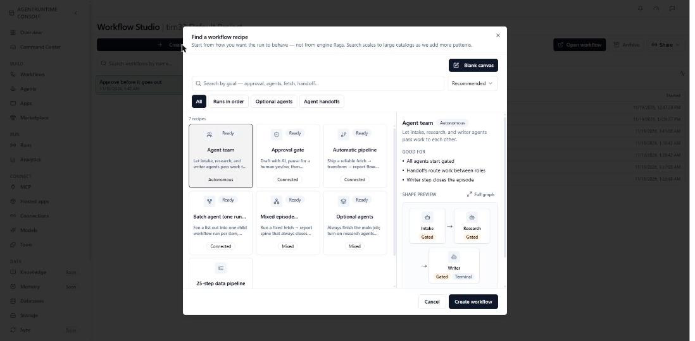
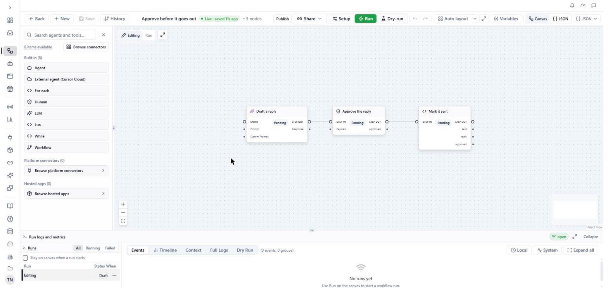
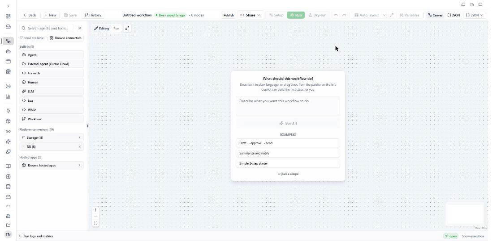

You can start a workflow from a ready-made recipe or from a blank canvas. Both start from **Create workflow** on the **Workflows** page.

**Who this is for:** anyone creating a workflow after the first-run recipes. For your first workflow, see [Run your first workflow](/platform/first-run).

## Start from a recipe

<Steps>
  <Step title="Click Create workflow">
    Open **Workflows** in the sidebar and click **Create workflow**. The **Find a workflow recipe** dialog opens.
  </Step>
  <Step title="Find a recipe">
    Search by goal in **Search by goal — approval, agents, fetch, handoff…**, or use the chips **All**, **Runs in order**, **Optional agents**, and **Agent handoffs**. The dialog lists 7 recipes, each marked **Ready**. Click one to see **Good for**, a **Shape preview** of its steps, and **Full graph**.
  </Step>
  <Step title="Create it">
    Click **Create workflow**. **Cancel** closes the dialog.

    **You should see:** the workflow open in [Workflow Studio](/workflows/studio) with its steps on the canvas.
  </Step>
</Steps>

<Frame caption="The Find a workflow recipe dialog">
  
</Frame>

<Frame caption="A workflow created from a recipe, open in Workflow Studio">
  
</Frame>

The seven recipes are **Agent team**, **Approval gate**, **Automatic pipeline**, **Batch agent (one run per item)**, **Mixed episode**, **Optional agents**, and **25-step data pipeline**.

<Note>
  The recipes here are named for the pattern, not for a business job, and are different from the three on the **Get started** page (**Approve before it goes out**, **Sort incoming requests**, **Ask an agent**). The badges **Autonomous**, **Connected**, and **Mixed**, and the tags **Gated** and **Terminal** on the preview, are not explained in the dialog. [Step types](/workflows/step-types) covers the building blocks.
</Note>

## Start from a blank canvas

Click **Blank canvas** in the recipe dialog. The workflow opens as **Untitled workflow** with 0 nodes. The center of the canvas shows a card:

> **What should this workflow do?**

It offers a text box (**Describe what you want this workflow to do…**), a **Build it** button, example chips (**Draft → approve → send**, **Summarize and notify**, **Simple 2-step starter**), and **or pick a recipe**.

Build the workflow by dragging steps from the palette on the left. See [Build your first workflow](/workflows/build-your-first-workflow) for a complete walkthrough, and [Step types](/workflows/step-types) for what each step does.

<Frame caption="A blank canvas with the Copilot card">
  
</Frame>

## The Copilot box does not add steps yet

<Warning>
  **Build it** and the line "Copilot can build the first steps for you" do not add steps to the canvas today. The Copilot cannot edit the canvas. After you click, the canvas stays empty, even if a message says it is working. The reply in the chat panel may describe a plan or a blueprint to build by hand, or it may leave the canvas for the workflow list.
</Warning>

What to do instead:

- Drag steps from the palette onto the canvas.
- Pick a recipe, either from the **or pick a recipe** link or from **Create workflow**.
- Use the Copilot's reply as a plan, then build the steps yourself.

The example chips send their text to the Copilot immediately, before you can edit it. Type your own sentence in the box if you want to see the plan first. See [Autopilot and chat](/ai/autopilot-and-chat).

<Note>
  Each failed **Build it** can leave an extra empty **Untitled workflow** in the **Workflows** list. Archive it from the list if you do not need it.
</Note>

## Next steps

- [Build your first workflow](/workflows/build-your-first-workflow)
- [Workflow Studio](/workflows/studio)
- [Dry-run before you publish](/workflows/dry-run-before-publish)
- [Patterns](/workflows/patterns)
