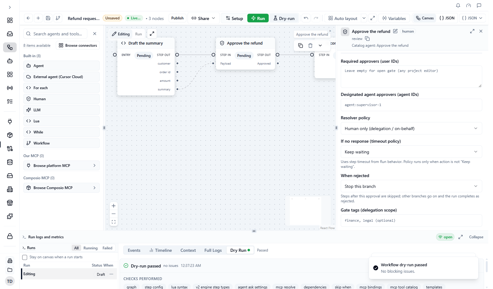

**Dry-run** checks your workflow for problems without running it. Do it before you publish or share a workflow, and after big edits.

**Who this is for:** anyone about to [publish or share](/workflows/share-a-workflow) a workflow. The full reference, including how to fix each message, is in [Dry-run validation](/workflows/dry-run).

## Check before you publish

<Steps>
  <Step title="Click Dry-run">
    Click **Dry-run** in the Studio toolbar, next to **Run**. The button itself gives no feedback, so look at the bottom panel.
  </Step>
  <Step title="Read the Dry Run tab">
    The bottom panel switches to the **Dry Run** tab, marked **Passed** when there is nothing to fix. It reads **Dry-run passed** with "no issues" and the time of the check. **Copy report** and **JSON** are at the top right.

    **You should see:** under **Checks performed**, the list of what was checked: graph, step config, lua syntax, v2 engine step types, agent ask settings, mcp resolve, dependencies, skip when, mcp bindings, mcp tool catalog, and templates.
  </Step>
  <Step title="Fix problems, then publish">
    If the result says it failed, fix the issues and click **Dry-run** again. When it passes, click **Publish**. See [Workflow Studio](/workflows/studio).
  </Step>
</Steps>

<Frame caption="A passed dry-run">
  
</Frame>

## Why the steps show Success

<Warning>
  After a dry-run the canvas marks every step with a green **Success** badge. That is the same badge a real run uses, but **nothing ran**. No model was called, no connected tool was used, and nobody was asked to approve. A dry-run only validates the workflow. To see real results, click **Run**.
</Warning>

## What it does and does not tell you

| A passed dry-run means | It does not mean |
|---|---|
| The steps and links are well-formed. | The workflow produces the answer you want. |
| Templates such as `{{input.customer}}` point at things that exist. | The connected account is signed in or has the right access. |
| The tools and connections the steps use can be found. | A person has approved anything. |

Dry-run is advice: you can still save, run, and publish when it reports problems.

## Next steps

- [Dry-run validation](/workflows/dry-run): every check and message.
- [Share a workflow](/workflows/share-a-workflow): creating an outside link publishes.
- [Workflow Studio](/workflows/studio)
