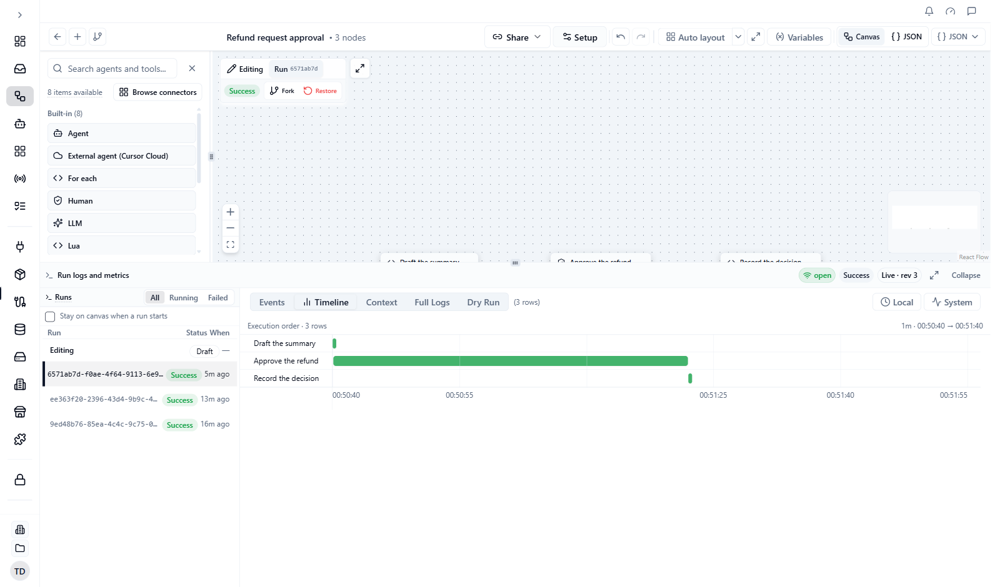

The **Timeline** tab shows a run as bars on a time axis: one bar per step, in the order the steps ran. It answers "where did the time go?". The **Events** tab shows the same activity as a log.

**Who this is for:** anyone checking why a run was slow, or what an agent did during a step.

## Open the Timeline

<Steps>
  <Step title="Open a run">
    In [Workflow Studio](/workflows/studio), open the workflow and expand **Run logs and metrics** at the bottom. Pick a run from the list.
  </Step>
  <Step title="Click Timeline">
    Click the **Timeline** tab next to **Events** and **Context**.

    You should see a row for each step. A step that is still running has a bar that grows to "now".

    <Frame caption="The Timeline tab of a finished run: a long bar for Approve the refund, the step that waited for a person">
      
    </Frame>
  </Step>
</Steps>

## What the Timeline shows

**One row per step.** The step's name is the label. The bar runs from the step's start to its end. Its colour matches the step's status, the same colours as in **Events**.

**Agent activity.** A step that runs an agent has small rows below it for what happened during the turn. Click the row's chevron to expand it.

| Row | What it shows |
|---|---|
| **Round N · tool** | One round of tool calls. Hover for a summary. |
| Status change | A change of phase during the turn |
| **Tool round limit reached** | A marker when the turn used up its tool-round limit |

**Loops (`for_each` and `while`).** Once a loop has finished, the Timeline can show one segment for each item or round. These start collapsed; use the chevron on the loop's row. Segments are labelled **estimated** until exact timing is available.

**Run state markers.** Vertical lines mark changes of the run's state, such as paused, resumed, failed, or stopped. Hover a line for the change and its time.

System events, such as the run starting, are hidden by default. Click **System** in the toolbar to add them as rows between the steps (see [Show system events](#show-system-events)). A step with no agent activity is a single bar with nothing to expand.

## The Context tab

The **Context** tab shows the run's details (run ID, version, start input) and a small graph of the steps in the order they ran. To see what each step returned, use the **Events** tab: expand a step and look at its **Output**. Click **Open graph** to open a larger view where you can pan and zoom, and click a step to select it on the canvas.

The lines between steps look different depending on what they mean: your own wiring, the order steps actually ran in, or a step inside a loop.

## The run panel toolbar

The buttons on the right of the tab row change with the tab. In a narrow panel they show only an icon, so point at one to see its name.

| Button | Tabs | What it does |
|---|---|---|
| **Local** / **UTC** | **Events**, **Timeline**, **Full Logs** | Switches the times in the panel between your local time and UTC. The button shows the mode you are in. It starts on **Local** each time you open Studio. |
| **System** | **Events**, **Timeline** | Shows or hides system events |
| **Expand all** / **Collapse all** | **Events** | Opens or closes every step |
| **Copy context** | **Context** | Copies the run's full context as JSON |
| **Refresh context** | **Context** | Loads the run's context again |
| **Clear Logs** | **Full Logs** | Clears the log list and the latest dry-run result |
| **View** and a step name | Any tab | Opens the output of a step in a reading window. See [Preview a step's output](#preview-a-steps-output). |

### Show system events

Some events are not about a step, such as the run starting. Studio hides them. Click **System** to show them. The button is highlighted while they are on.

- On **Events**, each one is a row labelled **System** with the event names. Click the row to open it.
- On **Timeline**, they appear as extra rows between the steps.

System events are hidden again the next time you open Studio.

### Expand or collapse steps

On **Events**, each step is a group that you open to read its events and its output. When you open a run that has finished, completed and skipped steps start collapsed, except the last step. Failed and cancelled steps stay open.

Click **Expand all** to open every step and every system event. The button then reads **Collapse all**. Click it to close every step except the ones that failed or were cancelled.

### Copy the run context

Click **Copy context** on the **Context** tab to copy the whole run context as JSON. You see "Context copied". The button appears once the run's context has loaded. It is handy when you ask someone for help with a run.

### Search the logs

The **Full Logs** tab has a filter bar above the log lines:

- **Search logs...** keeps only the lines that contain your text. Capital letters do not matter.
- The level chips **info**, **warn**, **error**, **success**, **validate** and **debug** turn a level on or off. **debug** is off until you click it.
- **Show timestamps** adds or removes the time on each line. Studio remembers your choice in this browser.
- A count at the right of the chips, such as "12 logs", says how many lines match.
- The **X** button next to the search box clears the search and puts the levels and timestamps back to their defaults.

### Preview a step's output

A step's full output is on the **Events** tab: expand the step and read its **Output**. For a step whose output is text, such as an LLM step, there is a window that is easier to read.

<Steps>
  <Step title="Open the preview">
    Click the **View** button in the toolbar. It carries a step's name, for example **View Draft the summary**. It opens the output of the latest step in the run that has something to preview. To preview another step, click **Preview** on that step's row in **Events**, or click the step's bar in the **Timeline**. Only steps with something to preview have these.
  </Step>
  <Step title="Choose a view">
    A window opens with the step's name and its status, such as **Completed**. When the output has them, it also shows the model and the time it took. For a plain text output, pick **Markdown** (the first view you see), **Html** or **Source**.
  </Step>
  <Step title="Copy it">
    Click **Copy**. The button reads **Copied** for a moment.
  </Step>
</Steps>

| View | What it shows |
|---|---|
| **Markdown** | The text formatted, with headings, lists and links |
| **Html** | An HTML page found in the text, in a sandbox where scripts do not run. If the text has no HTML page, the window says "No HTML document found in text. Try Source or Markdown." |
| **Source** | The text exactly as the step returned it |

If the output has separate subject, text and HTML fields, for example from a step that builds an email, the window has no switch. It shows three parts, **Subject**, **Text** and **HTML**, and **Copy** copies all of them.

## The runs list, full screen and size

### Stay on canvas when a run starts

When you click **Run** in the Studio toolbar, Studio normally selects the new run and switches the canvas to the **Run** view. See [See a run on the canvas](/workflows/studio#see-a-run-on-the-canvas).

To keep the canvas on **Editing** instead, tick **Stay on canvas when a run starts** at the top of the **Runs** list. The run panel still opens and the new run appears in the list. Click it when you want to look at it. Studio remembers the tick in this browser.

Point at a run in the list to see its full run ID, with a button to copy it.

### Full screen

Click the full-screen icon in the header of **Run logs and metrics** (its tooltip is "Full screen") to make the run panel fill the Studio window. The header then reads "Run logs and metrics — full screen". Click **Exit Full Screen** to go back. The icon shows only while the panel is open.

### Resize or collapse the panel

Drag the thin bar along the top edge of the run panel up or down to change its height. To use the keyboard, focus the bar and press the up or down arrow key. Click the **Run logs and metrics** header, or **Collapse**, to close the panel. The same button reads **Show execution** while the panel is closed.

## Common problems

| Problem | What to try |
|---|---|
| The Timeline is empty | The run has no step events yet, or the events are still loading. Try **Events**. |
| A loop shows no segments | The loop has not finished. Segments appear when it completes. |
| There is no **View** button in the toolbar | None of the run's steps has an output to preview yet. Read step outputs on the **Events** tab instead. |
| The canvas jumped to the **Run** view when you started a run | That is the default. Tick **Stay on canvas when a run starts** to turn it off. |
| A log line you expect is missing in **Full Logs** | **debug** lines are hidden until you click the **debug** chip. Also check the search box and the other chips. |

## Next steps

- [Runs and observability](/workflows/runs-and-command-center)
- [Workflow Studio](/workflows/studio)
- [Keyboard shortcuts and links](/platform/shortcuts-and-links)
- [Step types](/workflows/step-types)
- [Run recovery](/workflows/run-recovery)
