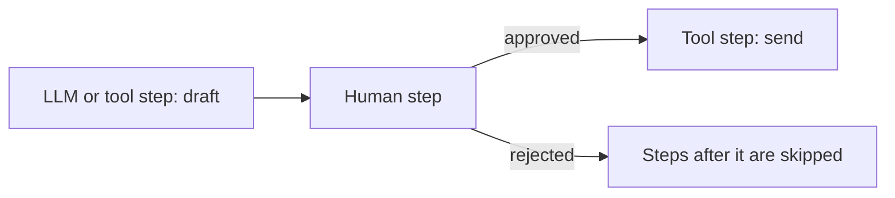
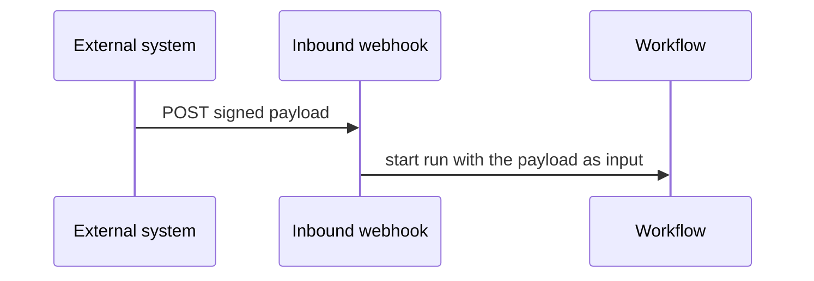
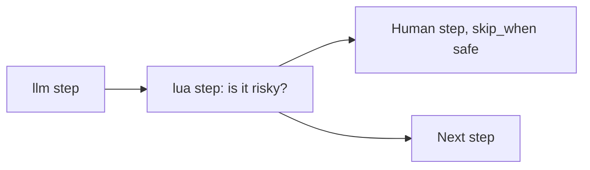

These patterns combine step types, [Command Center](/workflows/command-center), and triggers into workflows you can adapt. For full graph examples see the [JSON cookbook](/workflows/json-schema-cookbook).

**Who this is for:** people who know the basics of [Workflow Studio](/workflows/studio) and want a proven shape for a common job.

## Approve then send {#approve-then-send}

Pause before any message or change that affects customers or production data.



### Build it

1. **Draft step:** an `llm` or `mcp` step produces the content (an email body, a WhatsApp message, a CRM update).
2. **Human step:** `task_type: "approval"`, with the draft in `task_payload`.
3. **Send step:** an `mcp` step that sends the message. It `depends_on` the Human step.

```json
{
  "id": "approve-send",
  "type": "human",
  "name": "Approve order confirmation",
  "task_type": "approval",
  "depends_on": ["draft-email"],
  "task_payload": {
    "title": "Send order confirmation",
    "message": "Review before sending to {{input.customer_email}}",
    "draft_subject": "{{steps.draft-email.result.subject}}",
    "draft_body": "{{steps.draft-email.result.body}}"
  }
}
```

Approve it from [Command Center](/workflows/command-center) (**Needs you**). If the reviewer rejects, the steps after the approval are skipped by default and the run completes as "rejected". Change this with **When rejected**. See [Human tasks](/workflows/human-tasks#on-reject).

<Warning>
  Do not skip the approval for regulated or high-risk messages. Do not set the approval's timeout policy to **Auto-approve** for them either.
</Warning>

## Inbound webhook triggers {#inbound-webhook-triggers}

Start a workflow from an outside system: a CRM, a payment processor, a monitoring alert.



### Build it

1. Create a workflow whose first step checks the `{{input.*}}` fields it needs.
2. Under **Setup → Inbound**, create a webhook. See [Inbound webhooks](/integrations/inbound-webhooks).
3. Configure the outside system to `POST` to the webhook's URL, signed with its secret.
4. The JSON body becomes the run's input.

### Check input first

Check required input before calling any tool:

```json
{
  "id": "validate-input",
  "type": "lua",
  "name": "Validate webhook payload",
  "script": "if not input.order_id then error('order_id required') end\nreturn { order_id = input.order_id }",
  "timeout_s": 5
}
```

To skip a step for some inputs only, use `skip_when`. See [Step types](/workflows/step-types#settings-every-step-shares).

### Be safe to repeat

Senders retry webhooks. Make the workflow safe to run twice for the same event:

- Look up whether the order or event was already handled (a tool step that queries your data).
- Put an external id in the tool arguments so a duplicate does not send twice.

## Scheduled runs

Run a workflow every morning, hour, or week.

1. Open **Setup → Cron**.
2. Choose a preset or type a 5-field cron expression, and a timezone.
3. Choose the start values, which version to run (**Runs**), and an **Automation API key**.
4. Click **Add schedule**.

See [External triggers](/workflows/external-triggers#cron-schedules). A typical scheduled report is: query data, ask a model to summarise, optionally ask a person to approve, then send.

## Handle failures

### Time limits

Every step has a time limit, set with `timeout_s` (**Timeout** in Studio). Studio sets 60 seconds on tool and LLM steps (the engine allows 120 seconds when a step has none); other defaults: agent steps 600 seconds (10 minutes), Human steps 86400 seconds (24 hours), Lua steps 5 seconds (maximum 30). Raise the limit for slow calls.

### When a step fails

When a step fails, the run fails. Steps that were running at the same time show **Cancelled**, and steps that needed the failed step show **Skipped · Blocked**. The run appears under **Issues today** in Command Center. A failed step is not retried (the runtime ignores `retry_count`). Fix the cause, then start a new run. See [Run recovery](/workflows/run-recovery).

### Send risky cases to a person

Have a step decide whether a case is risky, and put a Human step after it that only runs for risky cases:



Use `skip_when` on the Human step with a true/false value that the Lua step returns, for example `{{steps.check.result.safe}}`.

## Parallel fan-out

Use a `for_each` step to process a list. It runs several items at the same time, up to the limit you set:

```json
{
  "id": "notify-each",
  "type": "for_each",
  "name": "Notify each recipient",
  "depends_on": ["fetch-recipients"],
  "for_each_items": "{{steps.fetch-recipients.result.contacts}}",
  "for_each_max_parallel": 5,
  "for_each_body_steps": [
    {
      "id": "send",
      "type": "mcp",
      "name": "Send message",
      "tool_name": "<your send tool>",
      "tool_args": { "to": "{{foreach.item.phone}}", "body": "Hello {{foreach.item.name}}" },
      "timeout_s": 30
    }
  ]
}
```

Keep `for_each_max_parallel` low for services with rate limits, such as WhatsApp or email providers.

## Hand a conversation to a person

For a chat assistant (for example on WhatsApp), keep one run per conversation and let the agent hand the chat to staff when it needs to. See [Conversation sessions](/workflows/conversation-sessions) and the [WhatsApp customer chat guide](/guides/whatsapp-customer-chat).

## Agents that work together

Several agents can hand work to each other inside one run, and an agent can ask a person when it is stuck. See [Autonomous episodes](/workflows/autonomous-episodes).

## Pattern checklist

| Pattern | Human step? | Trigger |
|---|---|---|
| Approve then send | Yes | Manual, API, schedule, or webhook |
| Webhook automation | Optional | Inbound webhook |
| Scheduled report | Optional | Cron |
| Bulk processing | Optional | API or webhook |
| Chat assistant | Optional (hand-off) | Conversation sessions |

## End-to-end guides

These patterns are built step by step in the guides:

- [Form webhook → Postgres → Resend digest](/guides/form-webhook-postgres-resend-digest)
- [Shopify order → WhatsApp template](/guides/shopify-order-whatsapp)
- [GitHub PR → LLM review → comment](/guides/github-pr-review)
- [Scheduled Postgres → Gmail report](/guides/scheduled-postgres-gmail-report)
- [Lead webhook → ActiveCampaign + Notion](/guides/lead-sync-activecampaign-notion)
- [WhatsApp customer chat](/guides/whatsapp-customer-chat)

See [all guides](/guides/overview).

## Related

- [Command Center](/workflows/command-center)
- [Human tasks](/workflows/human-tasks)
- [Inbound webhooks](/integrations/inbound-webhooks)
- [Troubleshooting](/platform/troubleshooting)
