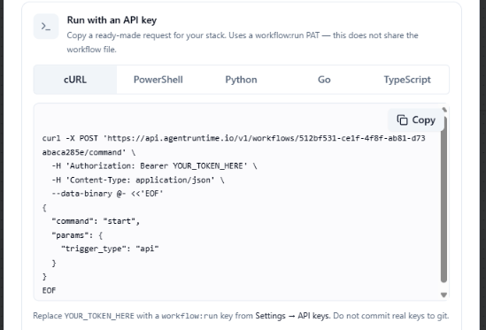

The **API / script** tab of the **Share workflow** dialog gives you a request you can paste into a terminal or a program. It starts a run with an API key.

**Who this is for:** developers who start workflows from their own system. You need a workspace API key with permission to run workflows.

## Steps

<Steps>
  <Step title="Create an API key">
    Open **Settings → API keys** and create a key that can run workflows (`workflow:run`). Copy it when it is shown. See [Authentication](/api/authentication).
  </Step>
  <Step title="Open the API / script tab">
    In Workflow Studio, click **Share → Share settings…** and open the **API / script** tab. It reads: "Run with an API key. Copy a ready-made request for your stack."
  </Step>
  <Step title="Pick your language and copy">
    Choose **cURL**, **PowerShell**, **Python**, **Go**, or **TypeScript**, and copy the request.
  </Step>
  <Step title="Replace the placeholder">
    Replace `YOUR_TOKEN_HERE` with your key. Do not commit real keys to git.

    **You should see:** a response that includes the id of the run that started. Open it under **Runs** or in [Command Center](/workflows/command-center).
  </Step>
</Steps>

## The request

<Frame caption="The API / script tab with a cURL request">
  
</Frame>

The tab shows a `POST` request to the workflow's `command` URL. For example, with cURL:

```bash
curl -X POST "https://api.agentruntime.io/v1/workflows/YOUR_WORKFLOW_ID/command" \
  -H "Authorization: Bearer YOUR_TOKEN_HERE" \
  -H "Content-Type: application/json" \
  -d '{"command":"start","params":{"trigger_type":"api"}}'
```

The dialog fills in your workflow's real id. Use the copy button there rather than typing it.

| Part | Meaning |
|---|---|
| `Authorization: Bearer YOUR_TOKEN_HERE` | A personal access token (PAT) with the `workflow:run` scope. |
| `"command":"start"` | Starts a run. |
| `"trigger_type":"api"` | Records that the run came from the API. |

<Note>
  The sample body has no input values. If your workflow expects start inputs such as `customer` and `message`, the run uses the sample values saved in **Setup**. To send your own values, see [Variables and inputs](/workflows/variables-and-inputs) and the [API reference](/api/reference).
</Note>

<Warning>
  This tab does not share the workflow. It only lets your key start it. Do not paste a real key into a script that you commit or share. Revoke a key under **Settings → API keys** if it leaks.
</Warning>

## Next steps

- [Authentication](/api/authentication): keys and scopes.
- [API examples](/api/examples)
- [API reference](/api/reference)
- [Share a workflow](/workflows/share-a-workflow)
