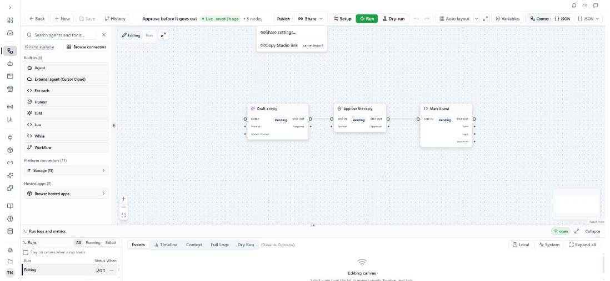
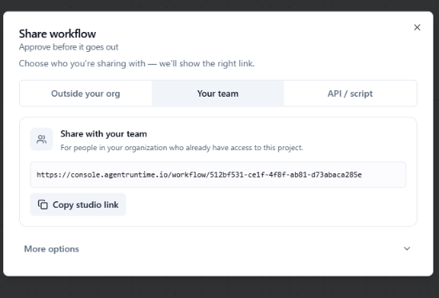
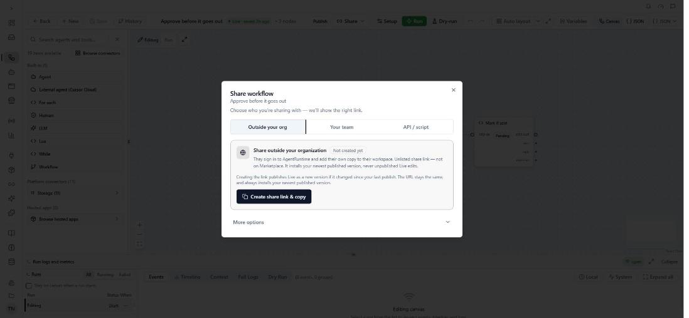
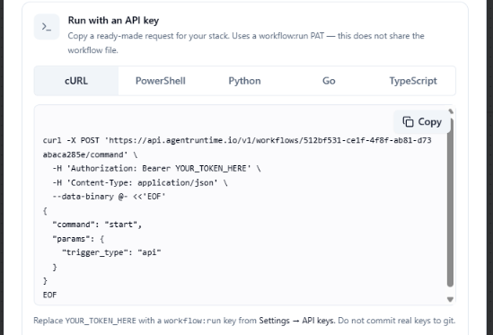

The **Share** menu in Workflow Studio has one dialog with three tabs, one for each audience.

**Who this is for:** anyone who built a workflow and wants someone else to use it.

## Open the Share dialog

<Steps>
  <Step title="Open the workflow in Studio">
    Open your workflow in [Workflow Studio](/workflows/studio).
  </Step>
  <Step title="Click Share, then Share settings">
    The **Share** menu has two items: **Share settings…** and **Copy Studio link** (same workspace). **Share settings…** opens the **Share workflow** dialog: "Choose who you're sharing with — we'll show the right link."

    **You should see:** three tabs: **Outside your org**, **Your team**, and **API / script**.
  </Step>
</Steps>

<Frame caption="The Share menu in the Workflow Studio toolbar">
  
</Frame>

## Your team

Use this tab for people in your organization who already have access to the project. It shows the Studio URL. Click **Copy studio link** and send it. **Copy Studio link** in the **Share** menu does the same.

<Frame caption="The Your team tab">
  
</Frame>

People without access to the project cannot open the link. Add them first: see [Invite a teammate](/platform/invite-a-teammate).

## Outside your org

Use this tab to let someone outside your organization add their own copy of the workflow. The tab shows the status **Not created yet** until you create a link.

- Anyone who has the link signs in to AgentRuntime and adds their own copy to their workspace.
- The link is unlisted. The workflow is not on the Marketplace.
- The link installs your **newest published version**, never unpublished edits.
- The URL stays the same, and always installs your newest published version.

<Warning>
  Creating the link can **publish your workflow**. If the editable copy (the "draft") has changed since your last publish, **Create share link & copy** publishes it as a new version first. The person who opens the link gets that version. The notice is in small print above the button. Check what you changed before you click.
</Warning>

<Note>
  The dialog does not show what a recipient will see, such as your prompts, step settings, and sample input values. It also does not show how to cancel a link; the dialog offers **More options**, which this documentation does not cover yet. Before you share, review the sample input in **Setup** and remove anything private. See [Run setup](/workflows/run-setup).
</Note>

To create a link, click **Create share link & copy**. The link is copied.

<Frame caption="The Outside your org tab, before a link exists">
  
</Frame>

## API / script

This tab gives you a ready-made request that runs the workflow with an API key. It does not share the workflow itself. See [Run a workflow from code](/workflows/run-from-code).

<Frame caption="The API / script tab">
  
</Frame>

## Which tab to use

| You want to | Use |
|---|---|
| Send a colleague who is in the project to the workflow | **Your team** |
| Let a customer or partner install a copy | **Outside your org** |
| Start the workflow from your own system | **API / script** |

## Next steps

- [Workflow Studio](/workflows/studio): the draft, History, and Publish.
- [Run a workflow from code](/workflows/run-from-code)
- [Variables and inputs](/workflows/variables-and-inputs)
