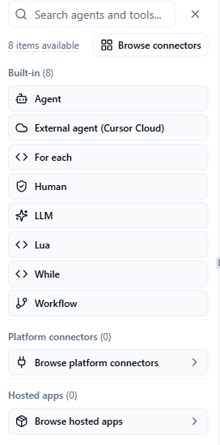
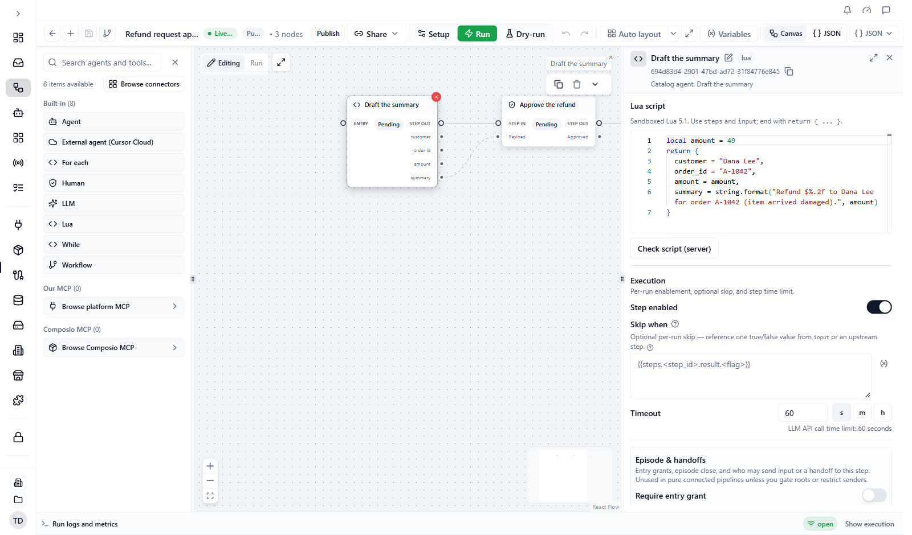

A workflow is a graph of **steps**. Each step does one job: call a tool, ask a model, run an agent, wait for a person, or loop over a list.

**Who this is for:** people building workflows in [Workflow Studio](/workflows/studio), or writing the graph as JSON. In Studio you fill in forms; the JSON shown here is what Studio saves for you.

**What you will learn:** the nine step types, which fields matter, how to read data from an earlier step, and the settings that every step shares.

## The basics

Every step has:

| Field | What it is |
|---|---|
| `id` | A unique name inside the workflow. Other steps use it to read this step's output. Studio gives canvas steps a UUID. |
| `type` | One of the types below. Use the short names exactly as written: `mcp`, `lua`, `llm`, `agent`, `human`, `workflow`, `for_each`, `while`, `external_agent`. |
| `name` | A label for people. Never use the `name` in a template; use the `id`. |
| `depends_on` | The step ids that must finish first. This sets the order. It does not pass data. |

A workflow graph is `{ "steps": [ ... ] }`. The portable workflow schema and authoring rules are published with the [Platform MCP authoring skills](/api/platform-mcp-authoring-skills). For copy-and-paste graphs see the [JSON cookbook](/workflows/json-schema-cookbook).

<Note>
  The canonical names are the short ones above: `mcp`, `lua`, `llm`, `agent`, `human`, `workflow`, `for_each`, `while`, `external_agent`. Older spellings such as `mcp_call`, `lua_script`, `llm_call`, `agent_call`, `human_task`, and `workflow_call` are still read in some places (for example stored graphs and Autopilot plans) and converted, but they are never written. Always use the short names in new graphs.
</Note>

## Step types at a glance

| Studio palette | `type` | Use it to |
|---|---|---|
| Tools under **Platform connectors** or **Hosted apps** | `mcp` | Call a tool on a connected integration (send an email, query a database) |
| **LLM** | `llm` | Send a prompt to a model |
| **Agent** | `agent` | Run one of your agents, with its own tools and memory |
| **Human** | `human` | Pause for a person to approve, reply, or answer |
| **Lua** | `lua` | Reshape data with a small script |
| **For each** | `for_each` | Run steps once per item in a list |
| **While** | `while` | Repeat steps until a condition is met |
| **Workflow** | `workflow` | Run another workflow and use its result |
| **External agent (Cursor Cloud)** | `external_agent` | Start a Cursor Cloud background agent on a GitHub repository |

<Frame caption="The step palette in Workflow Studio">
  
</Frame>

## `mcp`: call a tool

Calls one tool on an MCP instance (an installed integration in your workspace).

| Field | Description |
|---|---|
| `tool_name` | The tool to call |
| `instance_id` | The MCP instance to use. Studio sets this when you pick an instance. |
| `server_url` | A portable alternative that names the server instead. At run start AgentRuntime resolves it to an instance in your workspace. |
| `tool_args` | The tool's arguments. Values can be templates. |
| `contact_message` | Optional. Marks the step as a message to a contact and records it in the contact's conversation after a successful call: `{ "to", "text", "template" }`. `to` and `text` can be templates; `template` is a plain name. See [Messages your workflow starts](/workflows/conversation-sessions#messages-your-workflow-starts). |
| `connection_resolution` | Which connection the tool uses: `workspace`, `principal` (the end user's own, in Embedded Connect), or `inherit` |
| `timeout_s` | Time limit in seconds. Studio sets 60. If a step has no `timeout_s`, the engine allows 120 seconds. |

Examples: send an email with Gmail, query Postgres, create a GitHub issue, send a WhatsApp message. Pick tools from the [connector catalog](/integrations/connector-catalog). To learn how a tool gets its credentials, see [How connecting works](/integrations/how-connecting-works).

## `llm`: ask a model {#llm}

| Field | Description |
|---|---|
| `model_ref` | A model from your [Providers](/ai/llm-providers) catalog. Use this or `model`. |
| `model` | A model name. Use this or `model_ref`. |
| `prompt` | The prompt. Can contain templates. |
| `system_prompt` | Optional instructions that frame the model's behaviour |
| `llm_params` | Settings such as `temperature` and `max_tokens` |
| `llm_credential_id`, `llm_credential_scope` | Optionally pin a specific provider key |
| `timeout_s` | Time limit in seconds. Studio sets 60. With no `timeout_s`, the engine allows 120 seconds. |

The reply is on the step as `result.text`. The text is not parsed. If you asked for JSON, decode it in a following `lua` step with `json.decode` (see [Lua scripts](/workflows/lua#read-and-write-json)). When later steps must rely on the fields, use an `agent` step whose agent has an output schema instead: its reply is checked first. `llm_params` accepts `temperature` (default 0.3) and `max_tokens`.

## `agent`: run an agent

Runs one of your [agents](/ai/agents) for one turn, with its tools and memory.

| Field | Description |
|---|---|
| `agent_id` | Which agent to run |
| `prompt` | The task for this turn. Can contain templates. |
| `input` | Optional structured input for the agent. Values can be templates. It is added to the run's start input; where both have the same key, the step's value wins. |
| `timeout_s` | Time limit in seconds. Studio's default is 600. |

The agent's reply is on the step as `result.message`. If the agent has an **output schema**, it must reply with those fields. The reply is checked against the schema, and an invalid reply gets one chance to be fixed. Each field then sits on the step result, for example `{{steps.triage.result.priority}}`. This is the most reliable way to get structured data (lists, yes/no, scores) from a model into later steps.

Agent steps can also hand work to each other, ask a person a question, or talk to a contact in a conversation. See [Autonomous episodes](/workflows/autonomous-episodes) and [Conversation sessions](/workflows/conversation-sessions).

## `human`: wait for a person

Pauses the run and creates a task for a person in [Command Center](/workflows/command-center).

| Field | Description |
|---|---|
| `task_type` | The kind of task. `approval` is the default. |
| `task_payload` | What the person sees: a title, a message, and optionally a reply box |
| `approver` | Who may answer. With no approvers listed, nobody can answer unless `any_member` is `true`. |
| `timeout_s` | How long to wait. Studio's default is 86400 (24 hours). |
| `timeout_policy` | What happens when nobody answers |
| `on_reject` | What happens when the person rejects |

See [Human tasks](/workflows/human-tasks) for the full guide.

## `lua`: reshape data

Runs a small Lua script. Use it to rename fields, filter lists, or compute a value without calling a tool.

| Field | Description |
|---|---|
| `script` | Lua source, up to 64 KiB |
| `timeout_s` | Default 5 seconds. The maximum is 30 seconds, even if you set more. |

Rules:

- The script must **return a table**, for example `return { total = 42 }`. Returning a plain number or `true` fails.
- Read earlier steps with `steps["<step-id>"].result` and start input with `input.<field>`.
- Lua cannot use the network, files, or the operating system. A script result can be at most 1 MiB.
- Do not write `{{…}}` in a script. Scripts do not use templates.
- `json.decode` and `json.encode` read and write JSON.

See [Lua scripts](/workflows/lua) for everything a script can read and return.

## `for_each`: run steps once per item {#for_each}

| Field | Description |
|---|---|
| `for_each_items` | A template that resolves to a list, for example `{{steps.gen.result.items}}` |
| `for_each_body_steps` | The steps to run for each item. Required, at least one. |
| `for_each_max_parallel` | How many items run at once. Default 10, maximum 100. |
| `for_each_error_policy` | What happens when an item fails. See the table below. |
| `for_each_item_timeout_s` | Optional time limit per item, in seconds. Studio accepts 1 to 3600. |

A loop handles at most 500 items per run of the step. Inside the body, `{{foreach.item}}` (or `{{item}}`) is the current item and `{{foreach.index}}` (or `{{index}}`) is its position, counting from 0. In Lua use `item` and `index`.

Body steps can be `mcp`, `lua`, `llm`, `agent`, `workflow`, or another `for_each` or `while`: loops can nest, at any depth. A nested loop keeps the limits above (500 items, parallelism, item timeout) and runs inside its top-level step. Parallelism multiplies, so a `for_each` inside a parallel `for_each` can run as many items at once as outer times inner. A nested `for_each` set to `pause` or `human_review` cannot pause the run partway through: it stops at its first failure and fails the surrounding loop body, so the outermost loop's error policy applies. The result has `count`, `succeeded_count`, `failed_count`, `max_parallel`, and `results[]`, one entry per item with its `index` and either its `result` or an `error`.

For each item, the body steps run one after another. Use `depends_on` between body steps to set their order: steps with no dependency between them run in alphabetical order of their `id`, not in the order you list them.

| `for_each_error_policy` | When an item fails |
|---|---|
| `fail_fast` (default) | No new items start, and the step fails, so the run fails. |
| `continue_on_error` | The other items still run. The step succeeds with `partial_success: true` and `first_failure` in its result. Check `failed_count`. |
| `pause` | No new items start. The step ends with `failed: true` and the run pauses, so you can look and then resume or stop it. |
| `human_review` | Like `pause`, and a review task appears in [Command Center](/workflows/command-center). Approving it resumes the run; rejecting it fails the run. |

## `while`: repeat until done

| Field | Description |
|---|---|
| `while_mode` | `until` (stop when the condition is true) or `while` (keep going while it is true) |
| `while_max_iterations` | Required safety limit, at least 1 |
| `while_body_steps` | The steps to repeat. Required. |
| `while_condition` | A template that resolves to true or false, for example `{{body.score.pass}}` |
| `while_eval_script` | A Lua script that returns `{ pass = true }` or `{ pass = false }`. Wins if you set both. |

The body runs first, then the condition is checked. In JSON, `while_iteration_timeout_s` limits each round; without it, a `timeout_s` set on the `while` step limits each round (not the whole loop). Studio's **While** settings have no per-round field, so set it in JSON. Inside the body, `{{while.iteration}}` is the round number counting from 0, `{{body.<inner-id>.<field>}}` reads a step from the current round, and `{{while.prev.<inner-id>.<field>}}` reads the previous round. In Lua use `loop.iteration`, `loop.prev`, and `body`. When the limit is reached the result says `stopped_reason: "max_iterations"`; check it before treating the work as finished.

## `workflow`: run another workflow

| Field | Description |
|---|---|
| `workflow_id` | The child workflow to run |
| `input` | The child's start input. Values can be templates. |
| `wait` | `true` (default) waits for the child. `false` starts it and moves on. |
| `output_from` | Where the step's result comes from: a child step id, or `terminal` (the default). With `terminal`, the result is the child step marked `terminal: true`; if there is none, the child's last step (a step nothing depends on); if the child has several last steps, the one that finished last. |
| `child_target` | Which version of the child to run: leave empty for Live, or `"published"`, or a version number |
| `timeout_s` | Studio's default is 600. Only a `workflow` step inside a loop body stops waiting for the child after this many seconds. A top-level `workflow` step does not enforce it: it waits until the child run finishes. |

While you build, leave `child_target` empty so the child's **Live** copy runs. Pin `"published"` or a number only for shared children that must stay stable. See [Live copy and published versions](/workflows/studio#live-copy-and-published-versions).

## Read data from other steps

Steps pass data with **templates** in double braces. Type `{{` in a Studio field for suggestions ([Template intellisense](/workflows/template-intellisense)).

| Template | What it gives you |
|---|---|
| `{{input.field}}` | A value from the run's start input |
| `{{steps.<step-id>.result.field}}` | An earlier step's output. Use the step `id`, with dot syntax only. |
| `{{foreach.item}}`, `{{foreach.index}}` | The current item and its position inside a `for_each` body |
| `{{body.<inner-id>.field}}` | A step in the current round of a loop body |
| `{{while.iteration}}`, `{{while.prev.<inner-id>.field}}` | The round number, and the previous round's output |
| `{{input.field \| "default"}}` | The default after `\|` is used when the value is missing or empty. End with `omit` to leave the key out. |

A step can only read steps it depends on (directly or further up the chain). Inside a loop body, use the inner step's own `id`.

When a template is the whole value of a field, the field gets the value with its type (a number, a list, an object). When a template sits inside text, for example in a prompt, objects and lists are written as JSON, numbers as plain digits, and a missing step value as empty text.

<Warning>
  A missing start input is not an error when the run starts. If `{{input.customer_email}}` has no value, the step receives the literal text `{{input.customer_email}}`, and a tool step sends it as is. Give inputs that may be missing a default, `{{input.customer_email | ""}}`, or leave the key out with `{{input.customer_email | omit}}`. Dry-run flags templates that nothing can fill.
</Warning>

## Settings every step shares {#settings-every-step-shares}

Click a step on the canvas and scroll its settings panel to the **Execution** section. It has the **Step enabled** switch, **Skip when**, and **Timeout** (with **s**, **m** and **h** unit buttons).

<Frame caption="The Execution section of a step's settings">
  
</Frame>

| Field | Description |
|---|---|
| `depends_on` | Step ids that must finish first |
| `enabled` | When `false` the step is skipped, and steps after it still run. In Studio: **Step enabled**. |
| `skip_when` | Skip the step on this run only. A single `{{…}}` value that is true, or one comparison such as `{{input.kind == "voice"}}`. In Studio: **Skip when**. |
| `timeout_s` | Time limit for the step. In Studio: **Timeout**. |
| `input_allowlist` | Which steps (or `human`) may send input or a handoff to this step. In Studio: **Accepts input from**. |
| `no_auto_start`, `terminal` | For agents that hand work to each other. See [Autonomous episodes](/workflows/autonomous-episodes). |

`skip_when` supports a value or a comparison with `==` or `!=`, and you can join several with `&&` and `||` (no parentheses). For anything more complex, compute a true/false value in a `lua` step and reference that. `skip_when` applies to top-level steps only: inside a loop body, use `enabled`. A step is skipped for `true`, the text `true`, `yes`, or `1`, or a non-zero number. A missing or unresolved value means the step runs.

The graph schema lists a `retry_count` field, but the runtime does not use it: a step that fails is not retried, and the run fails. Fix the cause and start a new run (see [Run recovery](/workflows/run-recovery)).

To branch, use `skip_when` on the steps of each path. There are no `condition`, `parallel`, or `sequence` step types; steps with no dependency between them run at the same time.

## Limits

Time limits, loop caps, and size limits are collected in [Limits](/platform/limits).

## Common problems

| Problem | What to try |
|---|---|
| Dry-run says a field is unknown | Check the field name against the tables above. Dry-run rejects fields that do not exist on the step. |
| A `lua` step fails with "must return a table" | End the script with `return { ... }`. |
| A template stays as literal `{{…}}` text | Use the step `id`, dot syntax, and make sure the step is in `depends_on`. See [Dry-run validation](/workflows/dry-run). |
| A loop fails to start | `for_each_items` must resolve to a list. Return `{ items = items }` from the Lua step before it, even if it is empty. |

## Next steps

- [Workflow Studio](/workflows/studio)
- [Human tasks](/workflows/human-tasks)
- [JSON cookbook](/workflows/json-schema-cookbook)
