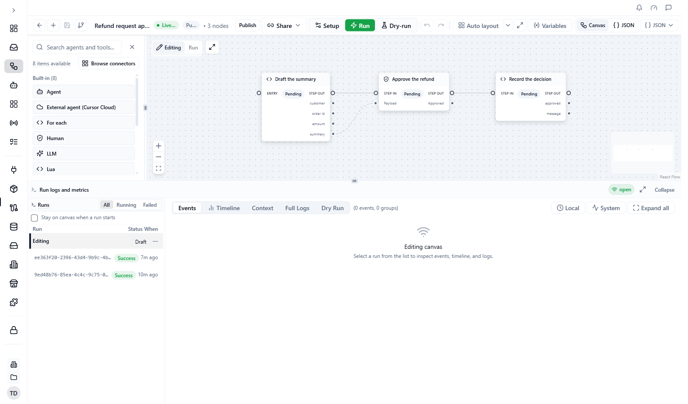
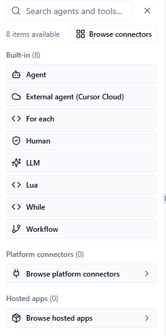
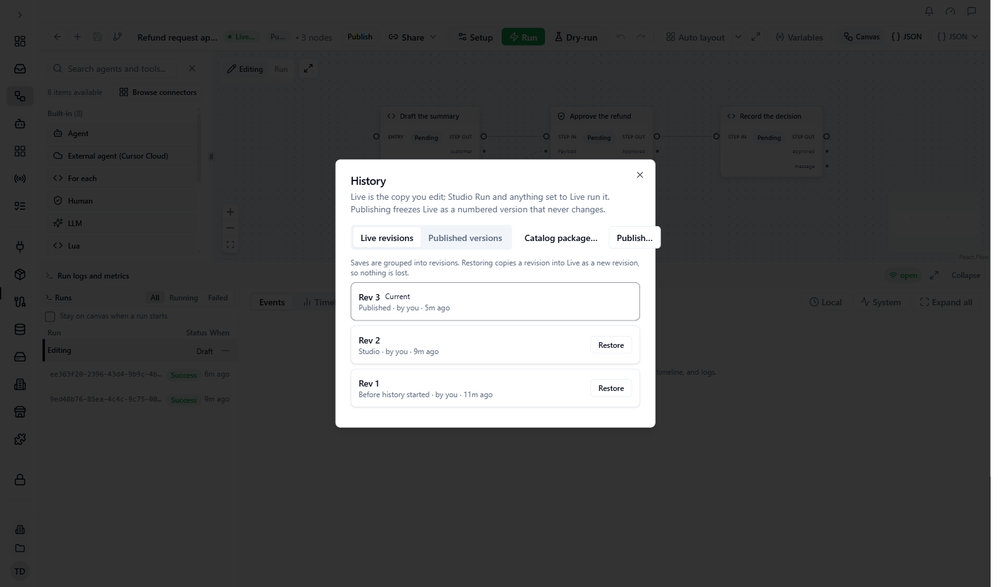

**Workflow Studio** is the visual editor where you build workflows: a set of steps that run in order, call your tools and agents, and wait for people when needed.

**Who this is for:** anyone building a workflow in the Console. You need the `project_contributor` role (or higher) in the project to edit and run workflows. `project_viewer` can look but not change.

**What you will do on this page:** create a workflow, add steps, check it, run it, and (when you want a frozen copy) publish it.

New to workflows? Follow the step-by-step tutorial [Build your first workflow](/workflows/build-your-first-workflow) first, then come back here for the full reference.

## Before you start

- Sign in to the [Console](https://console.agentruntime.io) and pick the workspace and project you want to work in.
- If a step will call a tool such as Gmail or Slack, set up the connection first. See [Integrations quickstart](/integrations/quickstart).

## Build and run your first workflow

<Steps>
  <Step title="Create the workflow">
    In the Console sidebar, open **Workflow Studio**, then click **Create workflow**. If Studio opens the last workflow you worked on instead of the list, click the back arrow in the toolbar (**Back to all workflows**) first. The **Find a workflow recipe** dialog opens. Type a name in **Workflow name** if you want one, then click **Blank canvas** for an empty canvas (or pick a recipe to start from).

    You should see the canvas, a toolbar along the top, and a green chip that reads **Live** with a "saved" time.

    <Frame caption="Workflow Studio with a workflow open: toolbar on top, step palette on the left, canvas in the middle, run panel at the bottom">
      
    </Frame>
  </Step>
  <Step title="Add steps">
    Add steps from the step palette and drag them onto the canvas. The palette has three sections. **Built-in** lists the step types: **Agent**, **External agent (Cursor Cloud)**, **For each**, **Human**, **LLM**, **Lua**, **While** and **Workflow**. Tools from your connected integrations are listed under **Platform connectors** and **Hosted apps**. To add a connector, click **Browse connectors** above the list. An empty section also shows its own button, **Browse platform connectors** or **Browse hosted apps**. See [Step types](/workflows/step-types) for what each built-in step does.

    <Frame caption="The step palette">
      
    </Frame>
  </Step>
  <Step title="Connect the steps">
    Draw a line from one step to the next. A step starts when the steps it depends on have finished. Steps that do not depend on each other run at the same time.
  </Step>
  <Step title="Fill in each step">
    Click a step to open its settings. To use data from an earlier step or from the run's start input, type `{{` and pick a suggestion. See [Template intellisense](/workflows/template-intellisense).
  </Step>
  <Step title="Dry-run it">
    Click **Dry-run** in the toolbar. A dry-run checks the workflow without calling any tool or model. Results appear in the **Dry Run** tab of the run panel at the bottom. See [Dry-run validation](/workflows/dry-run).
  </Step>
  <Step title="Set the starting input (optional)">
    Click **Setup** to open **Workflow setup**. On the **Manual** tab, choose where the run starts and type the input values. See [Run setup](/workflows/run-setup).
  </Step>
  <Step title="Run it">
    Click **Run**. Studio saves your latest edits first, then starts a run of your **Live** copy. Watch the steps in the **Events** and **Timeline** tabs of the run panel.
  </Step>
</Steps>

<Note>
  You do not have to publish to run or test. Studio saves your edits automatically, and **Run** always runs the latest saved edits. Publish when you want a frozen copy that does not change.
</Note>

## Work on the canvas

### Undo and redo

Click **Undo** or **Redo** in the toolbar to step back or forward through your edits. The two buttons sit just after the **Setup**, **Run** and **Dry-run** group, and they stay in the bar even in a narrow window. A button is greyed out when there is nothing to undo or redo. A workflow you have just opened has nothing to undo.

You can also press **Ctrl+Z** to undo and **Ctrl+Y** or **Ctrl+Shift+Z** to redo (use **Cmd** on a Mac). See [Keyboard shortcuts and links](/platform/shortcuts-and-links) for all the canvas keys, including **Delete** and **Ctrl+S**.

### Move around the canvas

- Scroll over the canvas to zoom in or out toward your pointer. The zoom goes from 25% to 250%.
- Drag an empty part of the canvas to move around.
- The three buttons at the bottom left of the canvas zoom in, zoom out, and fit the whole workflow on screen.
- The minimap at the bottom right shows the whole workflow as small boxes. Drag inside it to move the view. Scroll over it to zoom.

## See a run on the canvas

At the top left of the canvas, a small switch has two buttons: **Editing** and **Run**.

- **Editing** shows the workflow you are building. This is the normal view.
- **Run** shows the workflow as the selected run executed it, with each step marked with how it ended in that run. The first 8 characters of the run's ID show next to **Run**. **Run** is greyed out until you select a run.

<Steps>
  <Step title="Open the run panel">
    Expand **Run logs and metrics** at the bottom of Studio.
  </Step>
  <Step title="Pick a run">
    Click a run in the **Runs** list. The canvas switches to **Run**. A status badge for the run appears under the switch.
  </Step>
  <Step title="Go back to editing">
    Click **Editing** in the switch, or the **Editing** row at the top of the **Runs** list (marked **Draft**). Studio brings back the canvas you were working on.
  </Step>
</Steps>

By default, when you click **Run** in the toolbar, the canvas switches to the new run as soon as it starts. To stay on **Editing** instead, tick **Stay on canvas when a run starts** at the top of the **Runs** list. See [Execution timeline](/workflows/execution-timeline#stay-on-canvas-when-a-run-starts).

In the **Run** view:

- The canvas is read-only. If you try to change something, Studio says "Run inspect is read-only" and points you to **Back to editing**. The step settings panel has a **Back to editing** button, and the **Editing** button does the same.
- The **Dry Run** tab says "Dry-run applies to the editing canvas". Go back to **Editing** to dry-run your changes.
- If you can edit the workflow, the badge area also has two buttons:

| Button | What it does |
|---|---|
| **Fork** | Makes a new workflow from this run's graph and run setup, and opens it. You see "Workflow forked from run". |
| **Restore** | Asks "Restore workflow from this run?". Click **Restore workflow** to replace your **Live** copy with the graph from this run. Studio saves your unsaved edits first. |

## Fix a stale tool step

A step that calls a tool can fall out of date. When a dry-run finds one, it lists the problem under **Issues by step** in the **Dry Run** tab with one of two banners. The URL banner also shows in the step's settings.

| Banner | What it means | What to click |
|---|---|---|
| **Stale MCP URL on this step** | The URL saved in the step no longer matches where its MCP instance lives now. The banner shows the **Saved URL** and **Instance resolves to**. This often happens after an MCP server's router URL changed, or after you copied a workflow from another environment. | **Sync MCP URL** updates the step to the current URL and runs the dry-run again. Other steps that use the same MCP instance are updated too. **Open step** jumps to the step. |
| **Stale MCP tool on this step** | The tool the step calls is no longer published. The banner shows the **Saved tool**. This often happens after a connector was updated, or after you copied a workflow from another environment. | **Update MCP tool** opens **Replace MCP instance**. Expand an instance to see its tools, pick the current one, and click **Use**. **Open step** jumps to the step. |

If the step is switched off, the banner title ends with "disabled step" instead of "step". That step will not run, so you can fix it or delete it.

On the canvas, a step with an out-of-date tool also shows an **Update** badge. Its settings show "This tool is out of date." with an **Update** button. Both open the same **Replace MCP instance** dialog.

Studio saves your edits automatically, so the fix is kept. Run the dry-run again to check that the banner is gone.

## Live copy and published versions

Every workflow has one editable copy, called **Live**, and any number of frozen **published versions** (v1, v2, and so on).

| | What it is | How it changes |
|---|---|---|
| **Live** | The copy you edit. Studio **Run** uses it. | Every save changes it. |
| **Published version** | A frozen snapshot of Live with an optional note. | Never changes. |

Each place that starts a workflow can choose what to run: **Live**, **Last published** (your newest published version), or a specific version such as **v3**. You see this choice as **Runs** on schedules, webhooks, and event triggers, and in the Share menu. Starting a run from Studio always runs Live.

A run that has already started keeps the version it started with. Later edits never change a run in progress.

### Publish a version

<Steps>
  <Step title="Open History">
    Click **History** in the toolbar (in a narrow window it is an icon). It has two tabs, **Live revisions** and **Published versions**, and a **Publish…** button. The **Publish** button in the toolbar opens the same dialog directly.
  </Step>
  <Step title="Publish">
    Click **Publish…**, add a note such as "Added the refund check" if you like, and click **Publish vN**.

    <Frame>
      
    </Frame>

    You should see a message "vN published". If some triggers still run Live, Studio asks whether to switch them: **Keep on Live** or **Switch to Last published**.
  </Step>
</Steps>

In **History** you can also:

- **Restore** (Live revisions tab, then **Restore into Live**) to bring an earlier saved state back into Live as a new revision.
- **View** or **Compare with Live** on a published version.
- **Edit from vN** to copy a published version back into Live.
- **Copy link** to share the link of a published version.

The `Published vN` chip next to the **Live** chip shows your newest published version. Anything set to **Last published** runs it.

## Import, export, and JSON

The right end of the toolbar adapts to your window width. In a wide window you see:

- **Canvas** and **JSON**, which switch between the visual editor and the graph as JSON. See [JSON editor](/workflows/json-editor).
- The **JSON** menu (`{ } JSON` with an arrow): **Export JSON** downloads the graph, **Import** loads a graph from a file or the clipboard, **Edit JSON** opens the JSON view, and **View JSON** shows the graph read-only. Import shows a preview and, for tool steps, lets you map each tool server to one of your own instances before the graph is applied.
- **Auto layout** (left to right, top to bottom, or grid) and the full-screen button tidy the canvas.
- **Variables** opens a reference of every template variable available in the workflow.

In a narrower window these fold into **More** (the `⋯` button). **More** has **Auto layout**, **Fit to screen**, **Variables**, **Export JSON**, **Import** and **View JSON**, but no way to switch to the JSON editor. Widen the window to edit JSON.

## Share a workflow

Open **Share** in the toolbar, then **Share settings…**. The **Share workflow** dialog asks who you are sharing with:

- **Outside your org:** an unlisted share link. The person signs in and adds their own copy. The link installs your newest **published** version, never unpublished Live edits.
- **Share with your team:** a link for people who already have access to the project.
- **Run with an API key:** a ready-made request that starts the workflow. It does not share the workflow itself.
- **More options:** **List on Marketplace** or **Export as JSON file**.

### Updates to an installed copy

A workflow you added from a shared package shows **Installed from `<package>` vN** in the header. When the publisher releases a new version, a pill such as **v1 → v2** appears. Click it to open **Update to vN**, which shows what the publisher changed, what you changed, and any databases or child workflows that need a choice.

- **Update Live** merges the update into Live as a new revision. Your triggers, webhooks, connections, and run history stay.
- **Update and publish** does the same and publishes a version straight away.
- **Add as a new copy instead** leaves this copy untouched.
- **Replace with theirs** replaces Live with the publisher's version.
- **Undo** (in the message after an update) puts back the revision from before.
- **Keep this up to date** can be **Off**, **Update Live automatically**, or **Update and publish automatically**.

## Pin and rename a workflow

The workflow list is the page you see in **Workflow Studio** before you open a workflow. From inside a workflow, click the back arrow in the toolbar (its tooltip is "Back to all workflows") to get to it. Each row has an icon that opens the workflow, and a three-dot menu on its right with these items:

| Menu item | What it does |
|---|---|
| **Pin** / **Unpin** | A pinned workflow shows a pin icon and stays at the top of the list. The other workflows are listed with the most recently changed first. Pins are saved to your account for the current project. |
| **Rename** | Opens **Rename workflow**. Type the new name in **Name** and click **Save**. Only the name changes, not the steps. You see "Workflow renamed". |
| **Create copy** | Makes a copy named like the original with "(Copy)" after it. |
| **Delete** | Does the same as **Archive** below. |

**Rename** and **Delete** are greyed out if you cannot edit workflows. **Pin** needs a project: if none is selected, Studio asks you to choose a project first.

## Archive a workflow

In the workflow list, select a workflow and click **Archive**. The workflow is hidden from your lists and its run history is kept. To get an archived workflow back, contact support. You need workflow edit permission to archive.

## Common problems

| Problem | What to try |
|---|---|
| **Run** is greyed out | The canvas is empty, or your role cannot run workflows (`project_viewer` can only look). |
| A trigger runs old behaviour after you edited | The trigger is set to **Last published** or a fixed version. Change **Runs** to **Live**, or publish and switch it to **Last published**. |
| Studio says "Live changed somewhere else" | Another tab, an agent, or the API saved a newer revision. Autosave pauses so it does not overwrite it. Click **Reload Live** (this drops unsaved edits in the current tab). |
| A `{{…}}` value is empty at run time | Check the step id in the template. See [Template intellisense](/workflows/template-intellisense). |
| Studio says "Run inspect is read-only" | The canvas is on the **Run** view. Click **Editing** at the top left of the canvas. See [See a run on the canvas](#see-a-run-on-the-canvas). |
| A step shows **Stale MCP URL on this step** or **Stale MCP tool on this step** | The step points at an old URL or a tool that is no longer published. See [Fix a stale tool step](#fix-a-stale-tool-step). |
| **Delete** does nothing on the canvas | Click the step so it is selected, and make sure you are not typing in a field. **Backspace** never deletes a step. |

## Next steps

- [Step types](/workflows/step-types): what each step does and its fields
- [Run setup](/workflows/run-setup): starting input and saved defaults
- [Keyboard shortcuts and links](/platform/shortcuts-and-links): canvas keys and shareable links
- [Execution timeline](/workflows/execution-timeline): the run panel tabs and toolbar
- [Runs and Command Center](/workflows/runs-and-command-center): watch and control runs
- [Human tasks](/workflows/human-tasks): approvals and replies
- [Workflow patterns](/workflows/patterns): recipes you can copy
