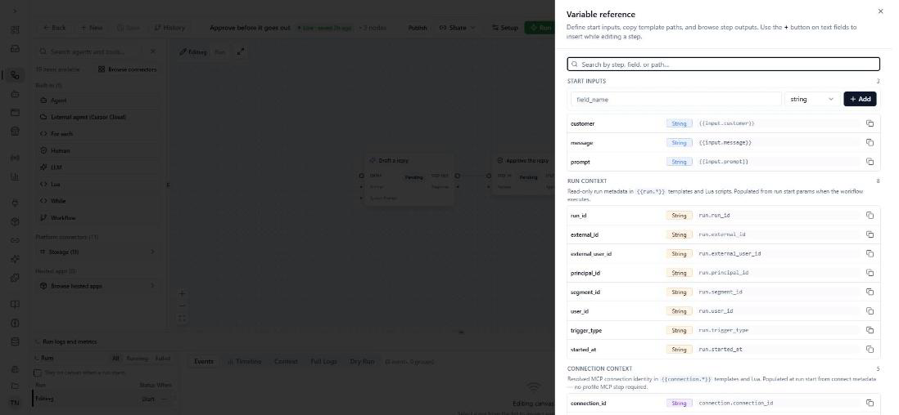

A workflow reads values at the start, such as a customer name and a message. The **Variables** panel in Workflow Studio lists every value you can use in a step and gives you the exact text to paste.

**Who this is for:** anyone editing a prompt or a step who wonders what `{{input.customer}}` means.

## Open the Variable reference

Click **Variables** in the Studio toolbar. A side panel opens, **Variable reference**: "Define start inputs, copy template paths, and browse step outputs." Use the search box (**Search by step, field, or path…**) to filter.

<Steps>
  <Step title="Find the value">
    Search for it by step, field, or path, or scroll to the section.
  </Step>
  <Step title="Copy its path">
    Click the copy button on the row. The path looks like `{{input.customer}}`.
  </Step>
  <Step title="Paste it in a step">
    Paste it into a prompt or field. While you edit a text field, the **+** button inserts a variable for you.

    **You should see:** the value filled in when the workflow runs.
  </Step>
</Steps>

<Frame caption="The Variable reference panel">
  
</Frame>

## The three sections

| Section | What it holds | Template |
|---|---|---|
| **Start inputs** | Values the workflow receives when it starts. Each row shows a name, a type such as **String**, and its path. | `{{input.name}}` |
| **Run context** | Read-only facts about the run, filled in when it starts: `run_id`, `external_id`, `external_user_id`, `principal_id`, `segment_id`, `user_id`, `trigger_type`, `started_at`. | `{{run.run_id}}` |
| **Connection context** | The identity of the resolved connection, filled in at run start, for example `connection_id`. | `{{connection.connection_id}}` |

### Add a start input

In the **Start inputs** section, type a name in the row that shows `field_name`, keep the type `string`, and click **+ Add**. The new input appears in the list with its path. Give it a value in **Setup**: see [Run setup](/workflows/run-setup).

<Note>
  The same thing goes by three names: **Starting input** and **Shared input** in the Setup dialog, **Start inputs** here, and `{{input.*}}` in templates. They all refer to the values the workflow receives at the start.
</Note>

<Note>
  In the example workflow, `prompt` appears as a start input here but the Setup dialog marks it **From step**. Change the values of the other inputs to change the example. Run context and connection context matter mostly if you run workflows from your own product, for example with embedded connections. Most workflows only use start inputs.
</Note>

## Example

A prompt that uses two start inputs:

```text
Write a polite reply to {{input.customer}} about: {{input.message}}
```

The values come from **Setup** when you click **Run**, or from the request when you [run the workflow from code](/workflows/run-from-code).

## Next steps

- [Template IntelliSense](/workflows/template-intellisense): autocomplete for `{{…}}` in step fields.
- [Run setup](/workflows/run-setup): set the sample input.
- [Workflow Studio](/workflows/studio)
- [Run a workflow from code](/workflows/run-from-code)
